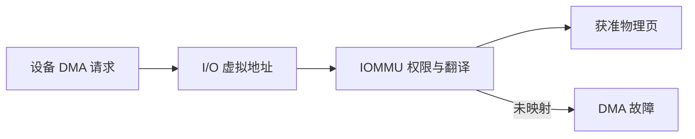

# 特权边界

- 写作时间：`2026-03-22 首次提交，2026-07-13 最近修改`
- 当前字符：`5711`

[内核设计](/basics/02-kernel-design)比较了内核结构，但宏内核与微内核都有一个共同前提：普通应用不能随意修改内核状态或控制硬件。这项限制不能只靠编程约定，因为违反约定的程序正是操作系统需要防范的对象。

来看两个具体操作。文本编辑器要计算字符位置，可以直接执行加法；它若试图关闭 CPU 中断或把磁盘数据写进任意物理内存，就必须被硬件阻止。同一条进程指令流有时运行应用代码，有时又要进入内核完成服务，CPU 因此需要一种可检查、可恢复的权限切换机制。

**双模式**先区分用户代码与内核代码当前拥有的权限；**特权指令**限制谁能改变处理器和设备控制状态；**内存保护**限制当前模式能够访问哪些地址。CPU 执行当前指令发现特殊条件时产生 **异常**，外部设备需要通知 CPU 时产生 **中断**。设备通过 DMA 访问内存时不会逐次经过 CPU 页表检查，所以还需要 **DMA 保护** 限制设备可访问范围。

## 双模式

双模式(dual mode)是处理器用至少两个执行权限级别区分受信任内核代码与普通用户代码的硬件机制。

用户态(user mode)用于运行应用程序，只能执行普通计算和访问获准内存；内核态(kernel mode)用于运行操作系统核心，可以配置页表、中断和设备。同一条执行流并非永久属于某一种模式：它执行应用代码时处于用户态，进入系统调用或处理异常时切换到内核态，完成后再返回用户态。

x86 定义了 Ring 0 到 Ring 3 四个特权级，数值越小权限越高。Linux 主要使用 Ring 0 运行内核、Ring 3 运行用户程序。当前特权级(Current Privilege Level, CPL)由当前代码段寄存器 CS 的选择子低 2 位表示，所以常见值是 CPL 0 或 CPL 3。Arm 使用 EL0、EL1 等异常级(Exception Level, EL)表达相似边界，具体寄存器名称不同，目标相同。

双模式的关键不只是“状态位不同”，而是 CPU 在执行敏感指令、翻译地址和接受控制转移时会读取当前权限并强制检查。应用无法用普通赋值把 CPL 改为 0；只有 CPU 认可的门控路径才能提高权限，并且入口地址和初始状态由内核预先配置。

:::thinking 既然 x86 有 4 个 Ring，为什么 Linux 只用 Ring 0 和 Ring 3？

Ring 1 和 Ring 2 可以运行权限介于内核与应用之间的代码，但它们不会自动形成完整服务隔离。内核组件还要共享数据结构、处理页表和中断；如果把驱动放入中间 Ring，却仍让它访问同一内核地址空间，越界写入风险并没有消失。若再用不同页表真正隔离，组件通信就已经更接近进程或微内核服务模型。

x86 的中间 Ring 还与早期分段保护关系密切，现代通用系统主要依赖分页建立内存边界。Linux 因此选择两级模型，把权限关系保持为“内核可以管理全局资源，应用只能通过受控入口请求”。Ring 1 和 Ring 2 不是无效，而是没有为 Linux 的通用结构带来足以抵消复杂度的收益。
:::

## 特权指令

特权指令(privileged instruction)是处理器只允许足够高权限代码执行的指令。

x86 的典型例子包括关闭中断、加载中断描述符表、切换控制寄存器和直接访问特定 I/O 端口。它们会改变整台 CPU 或设备的运行条件，而不是只改变当前应用的普通变量。若 Ring 3 程序直接执行不允许的特权指令，CPU 不会照做，而是产生通用保护异常，把控制权交给内核。

```text
用户程序执行普通加法       -> CPU 直接执行
用户程序执行受限硬件操作   -> CPU 拒绝并产生异常
内核执行受限硬件操作       -> CPU 在权限检查通过后执行
```

这项检查解释了为什么恶意程序不能简单写一条“关闭中断”指令独占 CPU，也不能自行把页表切换到其他进程。用户程序若确实需要读文件或使用网络，必须请求内核代为执行；[系统调用](/basics/04-system-call)会把这种主动请求路径完整展开。

特权并不表示内核指令一定正确。CPU 只确认当前代码有权执行，不理解内核选择的参数是否合理。内核 bug 仍可能错误配置硬件，所以特权级解决的是“谁可以操作”，代码与协议正确性解决“操作是否正确”。

## 内存保护

内存保护(memory protection)是处理器依据页表权限限制当前执行模式可读取、写入或执行哪些地址的机制。

页表(page table)是内核建立的地址翻译与权限数据结构。虚拟地址是程序指令和指针使用的地址，物理地址则标识主存中的实际位置。页表把虚拟地址所在的页映射到物理内存页，页表项还会记录页面是否存在、用户态能否访问、是否可写以及是否可执行等权限，具体位随体系结构而异。CPU 的内存管理单元(Memory Management Unit, MMU)在地址翻译时检查这些位，而不是相信程序传入的指针。

一个页表项若标记为仅特权态可访问(supervisor-only)，CPL 3 代码访问它就会触发缺页异常；一个页若不可写，写入同样被拒绝；不可执行(No Execute, NX)页中的字节不能直接当作指令运行。于是用户页表中即使保留某些内核映射，用户态也不能仅凭知道地址就读取内核内容；启用内核页表隔离(Kernel Page-Table Isolation, KPTI)时，大部分内核映射还会从用户态使用的页表视图中移除。

进程之间还可以使用不同页表。进程 A 的某个虚拟地址与进程 B 的相同虚拟地址可以映射到不同物理页，或者根本没有映射。[地址空间与分页](/memory/01-address-space-paging)会详细解释地址空间与多级页表，这里先抓住保护关系：内核创建页表并把页表地址装入受保护寄存器，CPU 对每次地址翻译执行权限检查，用户程序不能自行替换这份规则。

内核处理用户指针时仍要谨慎。系统调用参数来自不受信任的用户内存，另一个线程可能同时修改；内核必须使用专门的用户内存访问接口，检查范围并正确处理访问异常。切换到 Ring 0 并不会让输入自动可信。

## 异常

异常(exception)是 CPU 在执行指令期间检测到内部条件，并按异常向量转移到处理入口的事件。

多数异常与当前指令同步：同样的指令状态会在同一位置触发事件。例如除数为 0 会产生除法错误，执行无效操作码会产生无效指令异常，Ring 3 执行特权指令会产生通用保护异常，地址翻译失败或权限不符会产生缺页异常。机器检查(machine check)等硬件错误异常可能无法精确归因到一条可重试指令，因此“异常”不能一律等同于程序执行错误。

CPU 为每类异常分配向量号，内核预先在中断描述符表(Interrupt Descriptor Table, IDT)中登记入口。异常发生时，CPU 至少保存返回所需的关键状态，必要时从用户栈切换到内核栈，再跳转到对应入口；入口代码继续保存通用寄存器并调用具体处理函数。处理完成后，内核可以修复条件并重试，也可以用信号(signal)通知进程发生了需要处理的事件，或者在无法恢复时终止进程。

缺页异常说明异常不等于程序 bug。某个虚拟页尚未分配物理页时，第一次合法访问也会触发缺页；内核可以分配并建立映射，然后让原指令重新执行。反之，访问完全无权使用的地址同样触发缺页，但内核会把它作为非法访问处理。CPU 只报告原因和上下文，内核结合地址空间状态决定语义。

系统调用也是由当前执行流主动发起的同步控制转移，但现代 x86 通常使用专门的 `syscall` 指令和单独入口，不必把它等同于错误异常。[系统调用](/basics/04-system-call)会专门解释这条受控入口。

## 中断

中断是外部硬件或处理器外部事件异步请求 CPU 执行处理程序的控制转移事件。

“异步”表示事件不由当前指令的语义直接产生。网卡收到数据、存储控制器完成命令、硬件定时器到期，都可能在程序执行任意普通指令时发出中断请求。中断控制器负责收集、编号并把请求投递给目标 CPU。

CPU 接受中断时，会在当前指令边界保存必要状态并进入内核登记的中断入口。内核入口保存其余上下文，确认设备和事件，完成必须立即处理的工作，再安排后续处理并返回原执行流。中断可能发生在用户态，也可能发生在内核态；它不是“用户程序进入内核”的专用路径。

如果没有中断，CPU 可以反复读取设备状态，这叫轮询(polling)：

```c
while (!(inb(DISK_STATUS_PORT) & DISK_READY)) {
    /* The CPU keeps checking the controller. */
}
```

这里的 `inb()` 代表读取 x86 I/O 端口，循环会不断检查状态位。轮询在事件稀疏、等待较长时会消耗大量 CPU；中断让 CPU 在设备工作期间执行其他任务，完成时再处理通知。不过轮询并非永远低效，高速网络等场景可能用批量轮询减少高频中断成本。二者的选择取决于事件频率、延迟和 CPU 预算。

| 属性 | 异常 | 中断 |
|------|------|------|
| 来源 | 通常是当前指令执行、地址翻译或处理器检测的内部条件 | 外部设备、定时器或外部事件 |
| 时间关系 | 与当前指令同步 | 与当前指令异步 |
| 例子 | 除零、缺页、通用保护 | 网卡收包、I/O 完成、定时器到期 |
| 内核入口 | 按异常向量进入 IDT | 经中断控制器选择向量后进入 IDT |

## DMA 保护

DMA 保护是限制能够直接读写主存的设备只能访问获准物理页的硬件与内核机制。

[操作系统与硬件](/basics/01-os-overview)已经建立 DMA 的基本流程：驱动配置传输，设备控制器直接在设备与内存之间搬运数据，完成后由中断或轮询通知内核。由于数据传输没有让 CPU 对每个字节执行普通 load/store，进程页表中的用户/内核位不能逐次拦截设备访问。

输入输出内存管理单元(Input-Output Memory Management Unit, IOMMU)为设备 DMA 提供第二套地址翻译与权限检查。驱动把一组物理页映射进某个设备的 I/O 地址空间，设备只能使用返回的 I/O 虚拟地址(I/O Virtual Address, IOVA)；IOMMU 再把 IOVA 翻译到获准物理页。设备若访问未映射范围，IOMMU 可以阻止并报告故障。



IOMMU 规则仍由受信任内核驱动配置。若驱动把整个物理内存错误映射给设备，硬件会按这份错误规则放行；若没有 IOMMU 或平台未启用隔离，失控设备可能越过 CPU 内存保护。CPU 特权、页表保护与 IOMMU 因此分别约束指令、CPU 访存和设备访存，三者共同构成硬件边界。

## 小结

| 概念 | 说明 |
|------|------|
| 双模式 | 用用户态与内核态区分普通代码和受信任内核代码权限 |
| 特权指令 | 只有足够高权限代码才能执行的处理器指令 |
| 内存保护 | MMU 根据页表限制当前模式可访问和执行的地址 |
| 异常 | 当前指令或地址翻译同步产生的控制转移 |
| 中断 | 外部设备或事件异步请求 CPU 处理的控制转移 |
| DMA 保护 | IOMMU 对设备内存访问执行地址翻译与权限限制 |

特权边界不是一个单独开关：CPU 对指令和地址执行检查，异常与中断提供受控入口，IOMMU 再把同样的最小访问原则延伸到设备 DMA。

---

**Linux 与 x86 入口**：
- [`arch/x86/kernel/idt.c`](https://github.com/torvalds/linux/blob/master/arch/x86/kernel/idt.c)：x86 IDT 建立过程
- [`arch/x86/entry/entry_64.S`](https://github.com/torvalds/linux/blob/master/arch/x86/entry/entry_64.S)：异常、中断与系统调用底层入口
- [`arch/x86/mm/fault.c`](https://github.com/torvalds/linux/blob/master/arch/x86/mm/fault.c)：x86 缺页异常处理
- [Linux IOMMU documentation](https://www.kernel.org/doc/html/latest/driver-api/iommu.html)：设备地址翻译与 DMA 隔离

[系统调用](/basics/04-system-call)将沿着最常见的主动入口继续：用户程序执行 `syscall` 指令后，CPU 和内核怎样共同完成一次受控服务请求。
