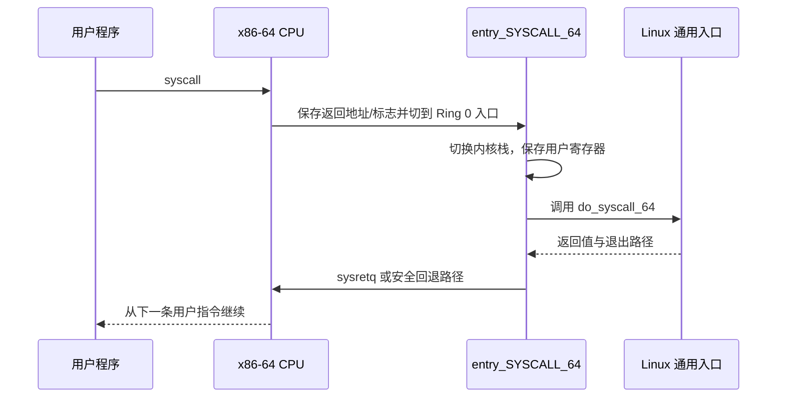

# 系统调用

- 写作时间：`2026-03-22 首次提交，2026-07-13 最近修改`
- 当前字符：`6249`

[特权边界](/basics/03-privilege-boundary)说明用户程序不能执行受限硬件操作，也不能直接访问内核内存。不过应用仍然要打开文件、创建进程和使用网络，所以 CPU 与内核必须提供一条能够验证请求、提高权限、完成服务并安全返回的主动路径。

再看[操作系统与硬件](/basics/01-os-overview)使用过的 `hello.c`。程序调用 `write()` 输出一行文字，`strace` 可以只记录这次执行中最关键的系统调用：

```console
$ gcc course/basics/code/hello.c -o /tmp/hello
$ strace -e trace=execve,write,exit_group /tmp/hello >/dev/null
execve("/tmp/hello", ["/tmp/hello"], 0xfffff801e850 /* 10 vars */) = 0
write(1, "hello\n", 6)                  = 6
exit_group(0)                           = ?
+++ exited with 0 +++
```

`write` 从用户态提出请求，内核完成输出，再回到用户态。这个过程先经过 **系统调用** 这一受控服务接口；CPU 执行专用指令进入 **内核入口**；内核根据编号完成 **调用分派**；用户程序、CPU 与内核按照 **ABI** 解释寄存器和返回值；少数只读取内核已发布数据的高频函数则可以通过 **vDSO** 避免完整切换。

## 系统调用

系统调用(system call, syscall)是用户程序请求内核执行受保护操作的标准接口。

系统调用同时完成服务和保护。应用可以请求“向 fd 1 写入这些字节”，却不能指定内核跳到任意函数，也不能要求绕过 fd 权限检查。内核只暴露编号明确、参数格式固定的入口，并在真正操作对象前验证调用进程、参数和权限。

源代码中的函数调用不一定就是系统调用。GNU C 库(GNU C Library, glibc)是许多 Linux 程序使用的 C 标准库实现。C 程序通常调用 glibc 提供的 `write()` 包装函数，包装函数再按目标架构准备寄存器并执行系统调用。`strlen()` 只在用户态计算字符串长度，不需要内核；`printf()` 可能先在用户缓冲区格式化与聚合，最终才用一次或多次 `write()` 把字节交给内核。

反过来，一个库函数也可能根据环境选择完全在用户态完成，或者在必要时执行系统调用。因此“应用 API 名称”和“是否实际跨过权限边界”要通过库实现或 `strace` 证据区分。

系统调用不是驱动或内核子系统之间的通用函数接口。它专门连接用户态与内核态。内核内部若要复用某项功能，会调用普通内核函数，而不是从 Ring 0 再伪造一次用户系统调用。

## 内核入口

内核入口(kernel entry)是 CPU 与内核共同规定的权限切换地址和初始状态保存路径。

课程容器可以运行在 AArch64 或 x86-64，`strace` 展示的系统调用名称与参数不依赖下面选择的实现案例。这里具体分析 x86-64 Linux：glibc 包装函数把系统调用号与参数放入约定寄存器，然后执行 `syscall` 指令。CPU 使用内核预先写入模型专用寄存器(Model-Specific Register, MSR)的入口配置，把下一条用户指令地址保存到 `rcx`，把记录条件码和部分控制状态的用户 RFLAGS 寄存器保存到 `r11`，切换到 Ring 0 代码段并跳到 `entry_SYSCALL_64`。

有一个容易被压缩掉的细节：x86-64 的 `syscall` 指令不会自动替 Linux 切换到当前执行流的内核栈。内核汇编入口先保存用户栈指针并取得当前 CPU 所需状态，换用当前任务的内核栈，再把用户寄存器保存成 `struct pt_regs`。内核栈是内核为任务处理系统调用、异常和中断准备的受保护栈，用户态不能直接修改其内容。



系统调用完成后，内核先处理信号、调度和返回状态检查，再选择退出指令。满足 `sysretq` 安全条件时可以使用快速返回；需要恢复更复杂状态时会走 `iretq` 等路径。把返回统一写成“一定执行 sysretq”会忽略真实入口代码中的安全分支。

这条路径与异常入口有共同点：都会提高权限、切换到内核栈并保存上下文。但系统调用由程序主动执行专用指令，入口与参数的寄存器约定都是公开契约；除零或非法访存则由 CPU 因当前指令失败而产生异常。

## 调用分派

调用分派(syscall dispatch)是内核依据系统调用号选择对应实现并把寄存器参数转换成内核函数参数的过程。

每种系统调用都有一个编号。x86-64 的主表位于 `arch/x86/entry/syscalls/syscall_64.tbl`，构建过程据此生成编号常量、入口包装和分派代码。表中部分稳定编号如下：

```text
0   common  read
1   common  write
56  common  clone
57  common  fork
59  common  execve
60  common  exit
61  common  wait4
```

`do_syscall_64()` 取得 `rax` 中的编号，检查范围并进入 x86-64 分派逻辑。源码的具体生成形式会随内核版本演化，因此概念上可以把它理解成“编号到入口包装函数的映射”，却不应断言每个版本都必须通过一个固定名字的全局数组。

Linux 常用 `SYSCALL_DEFINE<n>` 宏声明系统调用实现。构建后，x86-64 入口会经过 `__x64_sys_*` 一类包装，从 `pt_regs` 解码真正需要的参数，再进入通用实现。包装层存在的原因包括调用约定转换、32/64-bit 兼容和用户指针标注；内核其他代码应调用通用内核函数，不应直接调用用户系统调用包装。

以 `write` 为例，分派完成还没有直接写设备。实现先从 fd 找到打开对象，检查写权限与参数，再进入文件系统抽象层或对象自己的写操作。用户传入的 buffer 指针仍指向用户地址空间，内核必须用受控接口访问，并在页面无效时返回错误，而不是把该指针当成可信内核指针。

若编号不存在，内核返回表示“未实现该系统调用”的 `ENOSYS`。若编号存在，具体实现还可能返回表示文件描述符无效的 `EBADF`、权限不足的 `EACCES` 或参数无效的 `EINVAL`。系统调用入口只负责找到实现，业务规则由相关子系统检查。

## ABI

应用程序二进制接口(Application Binary Interface, ABI)是规定机器码级参数、寄存器、数据布局、返回值和可破坏状态的兼容约定。

API 与 ABI 位于不同层次。API 规定源代码怎样写，例如 `write(fd, buf, count)`；ABI 规定编译后的机器码怎样把这三个参数交给内核。API 保持不变但 ABI 改变时，源代码重新编译可能仍能运行，已有二进制却可能失效。Linux 维护稳定系统调用 ABI，正是为了让已编译程序在后续内核上继续运行。

x86-64 Linux 的原生系统调用 ABI 使用以下寄存器：

| 寄存器 | 系统调用用途 |
|--------|--------------|
| `rax` | 调用前保存系统调用号，返回后保存原始结果 |
| `rdi` | 第 1 个参数 |
| `rsi` | 第 2 个参数 |
| `rdx` | 第 3 个参数 |
| `r10` | 第 4 个参数 |
| `r8` | 第 5 个参数 |
| `r9` | 第 6 个参数 |
| `rcx` | 被 `syscall` 覆写，用于保存用户返回地址 |
| `r11` | 被 `syscall` 覆写，用于保存用户 RFLAGS |

第四个参数使用 `r10` 而不是普通 System V C 函数调用约定中的 `rcx`，原因就在于 `syscall` 指令会覆写 `rcx`。glibc 包装层负责完成这项寄存器调整，普通 C 调用者不需要手写汇编。

内核的原始返回约定通常把非负数作为成功结果，把 `-1` 到 `-4095` 范围内的负数解释为 `-errno`。glibc 包装函数检测到原始负错误后，通常把正的错误号写入线程局部的 `errno`，再向 C 调用者返回 `-1`。因此下面两层结果并不相同：

```text
内核原始返回: -EBADF
glibc write(): -1，并设置 errno = EBADF
```

`errno` 只在函数明确报告失败时有意义，成功调用不必把旧值清零。并且并非所有库接口都采用同一错误形式，阅读 API 文档时要确认具体返回契约，不能仅凭“底层是系统调用”猜测。

不同架构有不同寄存器和入口指令，32-bit 兼容进程还涉及结构宽度转换。系统调用概念保持一致，ABI 细节必须按架构和进程模式查阅。

## vDSO

虚拟动态共享对象(virtual Dynamic Shared Object, vDSO)是内核映射进用户地址空间、供 C 标准库(libc)调用特定内核协作函数的共享对象。它采用可执行与可链接格式(Executable and Linkable Format, ELF)，也就是 Linux 组织可执行文件、目标文件和共享对象的标准二进制格式。

读取时间等高频操作通常只需要内核维护的只读状态。如果每次都执行完整权限切换，固定入口成本可能超过实际计算。内核因此把实现代码放在 `[vdso]` 映射，把配套数据放在 `[vvar]` 映射。辅助向量(auxiliary vector)是内核在进程启动时交给用户空间的一组键值记录，其中包含 vDSO 的位置；libc 据此找到 vDSO 符号，再像调用普通用户函数一样执行。

```console
$ cat /proc/self/maps | grep -E "vdso|vvar"
ffff83cfa000-ffff83cfc000 r--p 00000000 00:00 0                          [vvar]
ffff83cfc000-ffff83cfe000 r-xp 00000000 00:00 0                          [vdso]
```

`[vvar]` 中的数据由内核更新，vDSO 使用带版本检查的读取协议避免看到一半更新；若硬件时钟或内核配置不允许用户态完成，函数会回退到真实系统调用。vDSO 因而不是让应用任意读取内核内存，而是内核主动发布一小组具有严格格式的数据和代码。

只有能够在用户态安全完成的特定操作适合 vDSO。`write()` 要检查 fd、修改对象并可能等待设备，不能仅靠只读共享页完成。优化没有绕过权限规则，而是把不需要特权的计算从系统调用路径中分离出来。

## 小结

| 概念 | 说明 |
|------|------|
| 系统调用 | 用户程序请求内核执行受保护操作的标准接口 |
| 内核入口 | CPU 提权、Linux 切换内核栈并保存用户上下文的路径 |
| 调用分派 | 根据系统调用号选择包装入口和具体实现的过程 |
| ABI | 机器码层面的寄存器、数据布局、返回值与兼容约定 |
| vDSO | 内核映射到用户空间、减少特定高频入口开销的共享对象 |

系统调用把硬件权限切换与内核软件检查连接起来：CPU 只允许进入预设入口，ABI 让双方解释同一组寄存器，内核再对具体对象和参数作最终授权。

---

**Linux 源码与文档入口**：
- [`arch/x86/entry/entry_64.S`](https://github.com/torvalds/linux/blob/master/arch/x86/entry/entry_64.S)：`entry_SYSCALL_64` 与退出路径
- [`arch/x86/entry/common.c`](https://github.com/torvalds/linux/blob/master/arch/x86/entry/common.c)：`do_syscall_64` 与 x86 通用入口
- [`arch/x86/entry/syscalls/syscall_64.tbl`](https://github.com/torvalds/linux/blob/master/arch/x86/entry/syscalls/syscall_64.tbl)：x86-64 系统调用编号主表
- [Adding a New System Call](https://www.kernel.org/doc/html/latest/process/adding-syscalls.html)：`SYSCALL_DEFINE`、入口包装与兼容规则
- [vDSO ABI](https://www.kernel.org/doc/html/latest/admin-guide/abi-stable.html#the-vdso)：用户态映射接口

基础与概览到这里完成了从硬件资源、内核结构和特权边界到主动服务入口的推导。[进程生命周期](/process/01-lifecycle)将以这条系统调用路径为起点，解释可执行程序怎样成为进程，以及内核怎样创建、替换和回收它。
