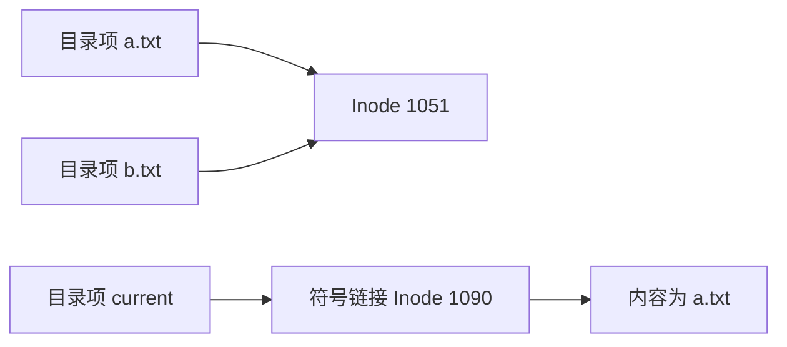
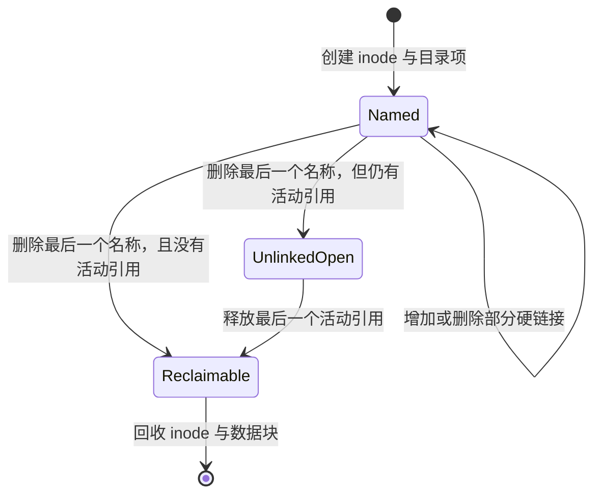

# 文件与目录

- 写作时间：`2026-03-04 首次提交，2026-07-13 最近修改`
- 当前字符：`7313`

[块层](/storage/03-block-layer)把上层读写转换成块设备能够处理的逻辑地址和长度，但用户执行 `cat reports/q2.txt` 时并不知道文件位于哪些块，也不应该直接操作块号。文件系统必须继续把“按名字访问长期保存的数据”转换成块分配、读取和回收。

先看一次普通的文件创建。程序把 `reports/q2.txt` 交给 `open()`，内核先解释这条路径，在 `reports` 目录中增加名字 `q2.txt`，再为新文件分配身份与元数据。名称不能同时承担对象身份，所以 **索引节点** 独立保存文件身份与元数据，**目录项** 再把父目录中的名字关联到它。多级目录项连起来形成 **路径名**，同一对象也就可以通过 **链接** 获得多个名字。名称与对象分离以后，删除名字不一定立即销毁对象，最后还要由 **文件生命周期** 判断何时回收空间。

本课先在[文件与目录](/filesystem/01-file-directory)中建立名称、对象与生命周期的关系。对象一旦能被找到，Linux 还要让同一组系统调用操作不同文件系统，这就需要[VFS 与实现](/filesystem/02-vfs)提供统一对象模型。文件系统操作最终会同时修改多处持久化结构，[日志与一致性](/filesystem/03-journal-consistency)因此要保证崩溃后内部结构仍然自洽；文件系统自身恢复以后，应用再通过[崩溃一致性](/filesystem/04-crash-consistency)把这些底层保证组合成可确认成功的更新协议。

## 索引节点

索引节点(inode)是文件系统内部标识一个文件对象并保存其类型、权限、所有者、时间戳、长度和数据位置等元数据的记录。

[命名空间](/process/06-namespace)曾用 inode 号判断两个 namespace 文件是否引用同一内核对象，[内存映射](/memory/03-memory-mapping)也在 `/proc/PID/maps` 中读到过文件 inode 号。那些场景只使用了“inode 是对象编号”这一结论；这里进一步拆开 inode、名称和数据位置，解释这个编号背后的完整文件对象。

文件名通常不保存在 inode 中。以 Linux 常用的磁盘文件系统 ext4 为例，inode 表中的一条记录会保存文件模式、用户与组、链接计数、逻辑长度、时间戳，以及把文件偏移映射到磁盘块的 extent。extent 是“连续文件逻辑块范围到连续物理块范围”的一条映射，用起点和长度代替逐块记录。目录在另一处保存名字与 inode 号的关联。把二者分开以后，重命名通常只需修改目录，不必移动文件数据。

inode 号只在一个文件系统实例内有意义。`42` 号 inode 在两个不同文件系统实例中可以分别代表不同对象，因此用户空间若要在某一时刻标识本机文件，至少要组合设备标识 `st_dev` 与 inode 号 `st_ino`。`stat()` 返回的正是这类信息：

```c
#include <sys/stat.h>

int stat(const char *restrict path, struct stat *restrict statbuf);
int fstat(int fd, struct stat *statbuf);
```

`stat()` 先通过路径找到对象，`fstat()` 则直接检查一个已打开 fd 指向的对象。路径可能在两次调用之间被替换，而 fd 已经持有目标对象，因此需要检查“当前打开的这个文件”时，`fstat()` 的语义更直接。

inode 中的文件类型决定后续操作的基本语义。常见类型包括普通文件、目录、符号链接、字符设备、块设备、FIFO 和套接字。Linux 的“文件接口统一”并不表示这些对象行为相同：普通文件支持按偏移读写，目录保存名字关联，设备文件把操作转给驱动，套接字则把读写转给网络协议栈。统一的是 fd 与系统调用入口，具体行为仍由对象类型和文件系统实现决定。

## 目录项

目录项(directory entry)是目录中把一个分量名称关联到 inode 号的记录。

目录本身也是一种文件对象，但它的数据不是供应用任意改写的普通字节流，而是一组受文件系统管理的名字关联。这里的目录项是具体文件系统保存的目录记录；Linux [路径查找的内存对象](/filesystem/02-vfs) `struct dentry` 则缓存名称与对象的关联，两者不能混为一谈。假设目录 `/home/lin` 中有两个普通文件，概念上可以表示为：

| 名称 | Inode 号 | 文件类型 |
|------|----------|----------|
| `notes.txt` | 1051 | 普通文件 |
| `report.pdf` | 1088 | 普通文件 |

名称只需要在同一父目录内唯一。`/home/lin/notes.txt` 与 `/tmp/notes.txt` 可以同时存在，因为它们属于不同目录。目录还包含 `.` 和 `..` 的语义：`.` 指向当前目录，`..` 指向父目录；文件系统边界和进程根目录会进一步影响 `..` 的解释，[完整路径查找过程](/filesystem/02-vfs)会展开这些边界。

创建、删除和重命名文件首先改变的是目录项：

| 操作 | 目录层面的变化 |
|------|----------------|
| `creat()` / `open(O_CREAT)` | 新增名称到 inode 的关联 |
| `link()` | 为已有 inode 新增一个名称 |
| `unlink()` | 删除一个名称，并减少 inode 的链接计数 |
| `rename()` | 在同一挂载文件系统内原子地调整一个或两个目录中的名称关联 |
| `mkdir()` | 新建目录 inode，并在父目录中增加名称 |

目录的磁盘布局是实现细节。小目录可以线性存放记录，大目录可以使用哈希索引或树形索引加速查找。用户空间通过 `readdir()` 读取目录项时，不应依赖底层保存顺序；新增或删除条目后，枚举顺序也可能改变。

## 路径名

路径名(pathname)是由一个或多个目录分量组成、供内核从起点逐级查找文件对象的字符串。

绝对路径以 `/` 开头，查找起点是进程看到的根目录；相对路径不以 `/` 开头，查找起点通常是进程的当前工作目录。路径 `/home/lin/notes.txt` 不会被当成一个整体键直接查询，内核会依次解析 `home`、`lin` 和 `notes.txt`。中间分量必须能作为目录继续查找，最后一个分量的处理则取决于调用目的：`open()` 要打开对象，`mkdir()` 要确认该名称尚不存在，`unlink()` 要从父目录删除该名称。

路径描述的是一次查找方法，不是对象永久身份。文件从 `draft.txt` 重命名为 `final.txt` 后，路径变了，inode 可以不变；两个硬链接可以用两个路径找到同一个 inode；不同进程还可能因为根目录、当前目录和挂载命名空间不同，对同一个路径字符串得到不同结果。

挂载点(mount point)是目录树中接入另一个文件系统或目录子树的位置。例如把一块文件系统挂载到 `/data` 后，查找 `/data/report.txt` 走到 `/data` 时会从原目录切换到被挂载文件系统的根目录，再继续查找 `report.txt`。路径字符串本身没有特殊标记，切换由进程所在挂载命名空间中的挂载关系决定；[VFS 与实现](/filesystem/02-vfs)会展开内核如何保存和跨越这条关系。

这一区分直接影响并发程序。程序若先检查路径再重新打开路径，两次查找之间可能有另一个进程替换目录项，形成检查时与使用时不一致(time-of-check to time-of-use, TOCTOU)。`openat()` 一类接口允许程序先持有目录 fd，再相对该 fd 解析名称，从而把查找起点固定在已打开的目录对象上。不过，后续路径分量仍可能被并发替换，因此它不能自动消除所有竞态，还需要能够约束整个路径解析过程的接口。

:::thinking 为什么 inode 不保存自己的完整路径？

一个 inode 可能同时有多个硬链接，因此不存在唯一的完整路径。即使只有一个名称，重命名父目录也会让整个子目录中的所有路径改变；若每个 inode 都保存完整路径，一次父目录重命名就需要重写大量后代记录。

文件系统选择让目录保存“父目录中的名称”，让 inode 保存对象本身。完整路径只在查找时由各级目录项组合出来。这一设计既支持硬链接，也让重命名主要修改少量目录记录。
:::

## 链接

链接(link)是文件系统命名空间中让名称引用文件对象的机制，Linux 主要提供硬链接与符号链接两种语义。

硬链接(hard link)直接增加“目录项到 inode”的关联。执行 `link("a.txt", "b.txt")` 成功后，两个名称指向同一个 inode；从任一路径写入，另一路径都会看到同一份数据。inode 的链接计数 `st_nlink` 随之增加。硬链接不能跨越不同文件系统边界，因为目标 inode 只属于原文件系统实例；普通用户也不能随意为目录创建硬链接，否则目录层次可能形成环并破坏 `..` 等约束。

符号链接(symbolic link)则是一个独立文件对象，其内容保存目标路径字符串。查找遇到符号链接时，内核读取这个字符串并继续解析。因为保存的是路径，符号链接可以跨文件系统，也可以指向尚不存在的目标；目标被删除或移动后，符号链接仍然存在，但后续跟随会得到表示名称不存在的 `ENOENT` 错误。



图中 `a.txt` 与 `b.txt` 是同一 inode 的两个硬链接；`current` 拥有自己的 inode，只把字符串 `a.txt` 作为目标。删除 `a.txt` 后，`b.txt` 仍能访问原文件，而 `current` 会失效。

| 特性 | 硬链接 | 符号链接 |
|------|--------|----------|
| 引用内容 | 目标 inode | 目标路径字符串 |
| 是否拥有独立 inode | 否，新增目录项指向原 inode | 是 |
| 能否跨文件系统 | 通常不能 | 可以 |
| 目标删除后的结果 | 其他硬链接继续有效 | 可能成为悬空链接 |
| 对目标链接计数的影响 | 增加 | 不增加 |

## 文件生命周期

文件生命周期是文件对象从创建、获得名称、被打开，到所有名称与活动引用消失后释放存储空间的过程。

一次打开把三个层次连接起来：进程 fd 表中的槽位指向打开文件对象，打开文件对象保存本次打开的偏移、状态标志和访问方式，再引用表示文件身份的 inode。也就是 `fd 表槽位 -> 打开文件对象 -> inode`。fd 数值只在本进程中充当索引；多个 fd 可以共享一个打开文件对象并共享偏移，多个独立打开文件对象也可以引用同一个 inode。区分这三层，才能准确判断 `dup()`、`fork()`、两次 `open()` 和删除路径各自改变了什么。

常见文件操作正是沿这三层改变不同状态：

| 操作 | 主要效果 |
|------|----------|
| `creat()` / `open(O_CREAT)` | 必要时创建 inode 与目录项，再建立打开文件对象和 fd |
| `open()` | 解析路径、检查权限，为这次打开建立状态并返回 fd |
| `read()` / `write()` | 从打开文件对象的当前偏移读取或写入，并按结果推进偏移；`O_APPEND` 写入会先定位到文件末尾 |
| `lseek()` | 只改变打开文件对象的当前偏移，不读取或写入文件数据 |
| `close()` | 移除 fd 槽位并释放一份引用，最后一份活动引用消失后对象才可能回收 |

这些接口的成功返回也不等于数据已经持久化。`write()` 可以只更新页缓存，`close()` 主要释放 fd 引用；需要断电保证时还要使用文件系统提供的同步接口和更新协议。

`unlink()` 删除的是指定目录项，而不是无条件立即销毁 inode。内核先让链接计数减一；只要还有其他硬链接，对象仍可通过其他名字访问。即使链接计数已经变成 0，只要内核仍持有活动引用，例如进程保留打开文件对象或文件映射，原 fd 或映射仍可继续访问数据。直到链接计数为 0 且最后一个活动引用释放，文件系统才可以回收 inode 和数据块。



这种语义解释了两个常见现象。第一，程序可以创建临时文件后立即 `unlink()`，继续通过 fd 使用它；进程退出或关闭 fd 后，文件会自动回收。第二，服务的日志文件即使被删除，只要服务仍保持原 fd 打开，磁盘空间就不会释放；服务重新打开日志或关闭旧 fd 后，空间才会归还。

打开 fd 还把“对象引用”与“名称变化”分离。另一个进程可以把路径重命名到新位置，甚至用新文件替换原路径，已经打开的 fd 仍指向原对象。这正是后续安全替换文件内容的基础：读者要么通过路径打开旧 inode，要么在重命名后打开新 inode，不会因为名称替换而让已有 fd 突然改指向另一份内容。

## 小结

| 概念 | 说明 |
|------|------|
| Inode | 标识文件对象并保存类型、权限、长度、时间戳和数据位置等元数据 |
| 目录项 | 在一个父目录内把名称关联到 inode 号 |
| 路径名 | 从进程根目录或当前目录开始逐级查找对象的方法 |
| 挂载点 | 在目录树中切换到另一个文件系统或目录子树的位置 |
| 硬链接 | 新增一个直接指向已有 inode 的目录项 |
| 符号链接 | 保存目标路径字符串的独立文件对象 |
| 链接计数 | 当前指向 inode 的硬链接数量 |
| 文件操作 | 通过 fd 读取、写入和定位打开文件对象，并用 `close()` 释放槽位引用 |
| 文件生命周期 | 最后一个名称和最后一个活动内核引用都消失后才进入空间回收 |

文件不是路径字符串本身。路径负责找到目录项，目录项负责找到 inode，而 inode 与活动引用共同决定数据对象是否仍然存在。

---

**接口与源码入口**：
- [`inode(7)`](https://man7.org/linux/man-pages/man7/inode.7.html)：inode 属性与文件类型
- [`stat(2)`](https://man7.org/linux/man-pages/man2/stat.2.html)：通过路径或 fd 读取文件元数据
- [`link(2)`](https://man7.org/linux/man-pages/man2/link.2.html) / [`unlink(2)`](https://man7.org/linux/man-pages/man2/unlink.2.html)：硬链接与名称删除语义
- [`symlink(7)`](https://man7.org/linux/man-pages/man7/symlink.7.html)：符号链接解析规则
- [`path_resolution(7)`](https://man7.org/linux/man-pages/man7/path_resolution.7.html)：Linux 路径解析
- [ext4 目录项](https://www.kernel.org/doc/html/latest/filesystems/ext4/directory.html)：ext4 目录记录与索引结构

[统一文件系统对象模型](/filesystem/02-vfs)将沿着一次 `open()`，观察这些持久化记录怎样对应到内核中的 superblock、inode、dentry 和打开文件对象。
