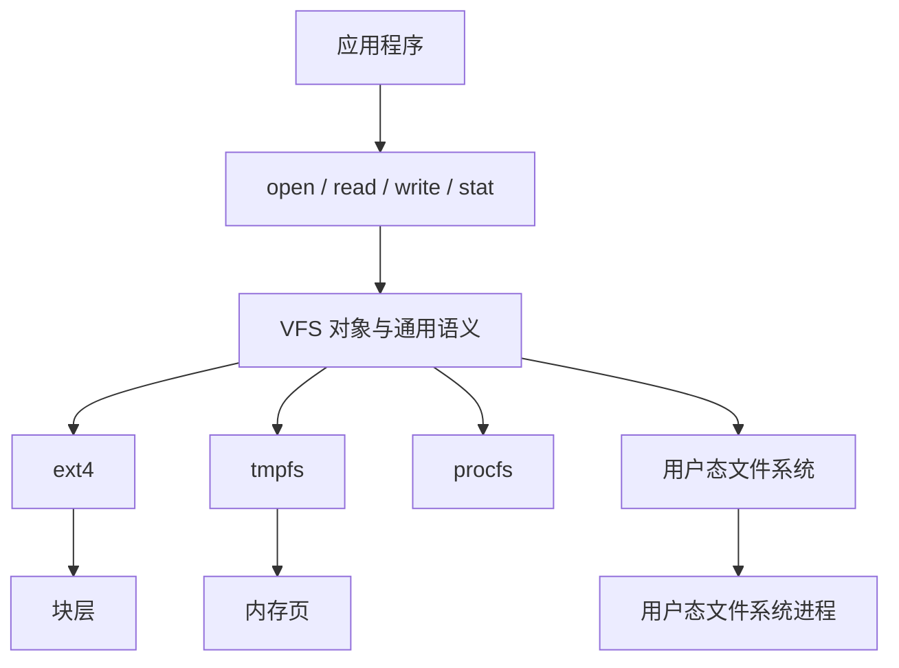
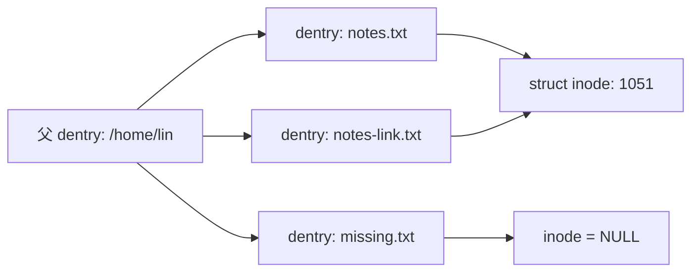
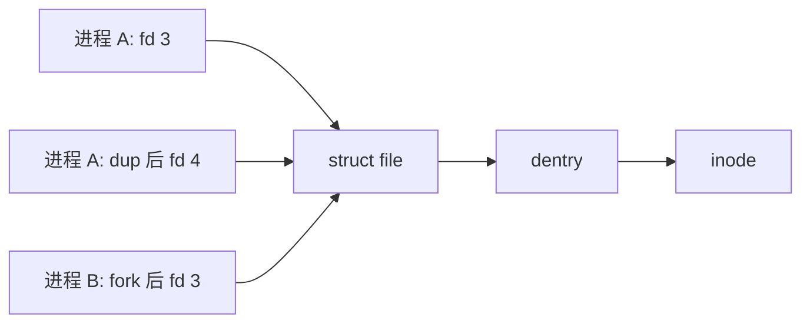

# VFS 与实现

- 写作时间：`2026-03-04 首次提交，2026-07-13 最近修改`
- 当前字符：`9270`

[文件与目录](/filesystem/01-file-directory)把文件对象从路径字符串中分离出来：路径逐级找到目录项，目录项再关联 inode。这个模型仍然留下一个问题。`/home` 可能位于磁盘上的 ext4；[内存映射](/memory/03-memory-mapping)介绍过 `/run` 常用的 tmpfs 在内存页和交换空间中管理内容；[命名空间](/process/06-namespace)介绍过 `/proc` 的 procfs 在读取时由内核动态生成进程信息。三者没有相同的存储方式，程序却都对它们调用 `open()`、`read()` 和 `stat()`。Linux 必须在统一系统调用与不同文件系统实现之间建立稳定接口。

沿着 `open("/home/lin/notes.txt", O_RDONLY)` 观察这层接口。系统调用先进入 **VFS**；查找起点所属的文件系统由 **超级块** 表示；每个路径分量通过 **inode 与 dentry** 关联名称和对象；打开成功后生成 **打开文件对象**，再放入进程 fd 表；整个逐级查找过程属于 **路径解析**；若途中遇到挂载点，**挂载** 关系会把查找切换到另一个文件系统。

## VFS

虚拟文件系统(Virtual File System, VFS)是 Linux 内核中为不同文件系统提供统一对象模型、系统调用语义和操作分派机制的抽象层。

应用调用 `read(fd, buf, len)` 时，系统调用并不直接判断“这个 fd 属于 ext4 还是 tmpfs”。fd 先找到 `struct file`，VFS 再通过该对象的操作表调用具体实现。ext4 可以把数据映射到块设备，tmpfs 可以把数据保存在内存页中，procfs 可以在读取时动态生成文本。三者实现不同，但都满足 VFS 约定的接口。

VFS 的统一主要通过操作表实现。文件系统实例级操作表处理全局状态，`struct inode_operations` 处理名称查找、创建、链接和属性修改，`struct file_operations` 处理打开后的读写、定位、同步和内存映射。具体文件系统只实现自己支持的操作，并把函数指针安装到对应对象中；VFS 负责通用检查、引用管理和调用顺序。

这不是把所有文件系统压缩成完全相同的能力。文件系统可以不支持硬链接、为文件附加键值元数据的扩展属性(extended attributes, xattrs)或直接 I/O，远程文件系统也可能需要重新验证缓存。VFS 统一的是接口契约，功能边界仍由实现返回的结果和错误码表达。

一个文件系统实现接入 Linux 时，会注册 `struct file_system_type`，提供名称和挂载入口。挂载过程创建或取得 superblock，建立根 inode 与根 dentry，再安装各类操作表。此后系统调用只通过 VFS 对象进入该实现，而不需要在通用代码中为每一种文件系统增加条件分支。

## 超级块

超级块(superblock)是 VFS 中表示一个已装载文件系统实例及其全局状态的对象。

块设备文件系统挂载时，文件系统实现会读取磁盘上的超级块和其他关键元数据，验证格式与特性，再填充内存中的 `struct super_block`。它记录文件系统类型、逻辑块大小、最大文件长度、根 dentry，以及指向实现私有状态的指针；其中 `s_op` 指向 `struct super_operations`，让 VFS 调用文件系统实例级操作。ext4 还会关联块组、日志和分配器等信息。

磁盘超级块与 VFS superblock 需要区分。前者是持久化格式的一部分，断电后仍在设备上；后者是内核运行期间的对象，卸载后可以释放。tmpfs、procfs 这类文件系统没有普通的磁盘超级块，但仍需要 VFS superblock 来承载根目录和全局操作。

从持久化格式看，块设备文件系统通常要保存四类区域。引导块或保留区位于设备开头，给固件、引导程序或格式自身预留空间；磁盘超级块记录整个文件系统的尺寸、块大小、特性和关键区域位置；inode 表或其他对象表保存文件元数据；数据块保存文件内容与目录内容。实际格式不一定按这四段各放一份：ext4 把设备划分为多个块组，在组内分布块位图、inode 位图、inode 表和数据块，还会保留关键元数据的备份。这里的四类名称描述职责，不表示所有文件系统都采用同一扁平布局。

文件增长时，文件系统还要记录“文件的第 N 个逻辑块位于设备哪里”。B 树(B-tree)是保持高度受控的有序多路搜索树，可以用来索引很大的映射集合。常见记录方式体现了不同取舍：

| 记录方式 | 保存的映射 | 主要取舍 |
|----------|------------|----------|
| 连续分配 | 起始块与连续长度 | 顺序与随机访问简单，但文件增长可能需要搬迁，外部碎片也会限制大连续区 |
| 链式分配 | 每个块或文件分配表(File Allocation Table, FAT)记录下一块 | 增长容易，逐块指针会增加开销，随机定位通常要沿链或查询 FAT |
| 索引分配 | inode 或独立索引块保存数据块指针 | 支持直接定位，索引本身会占空间，多级索引还增加读取层次 |
| 区段 | 用起始物理块与长度描述一段连续逻辑块 | 大文件映射紧凑，文件碎片增多时需要更多区段记录 |
| B 树 | 用有序树索引区段或其他映射记录 | 适合很大的映射集合，但查找、分裂和持久化树节点更复杂 |

B 树本身是索引组织方式，不是第五种物理摆放规则；现代文件系统通常组合这些思路，而不是只选一项。ext4 主要用区段描述连续范围，并在单个 inode 容纳不下时用树组织区段。分配器仍要决定新块放在哪里，尽量兼顾连续性、块组局部性与剩余空间。

空闲空间位图(bitmap)用一个 bit 表示一个块或 inode 当前是否可分配。分配时寻找合适的 0 bit 并置位，释放时清零；ext4 为各块组分别维护块位图和 inode 位图，避免每次扫描整个设备。位图能紧凑表达固定编号资源，却仍需要计数、分组和搜索策略来降低大文件系统中的扫描成本。

一次挂载会建立挂载对象；内核内部的 `struct mount` 包含面向 VFS 的 `struct vfsmount`，但不一定创建全新的底层文件系统实例。同一个 superblock 可以通过多个挂载点出现在命名空间中，例如 bind mount 可以让同一目录子树从另一个位置可见。superblock 回答“底层是哪一个文件系统实例”，挂载对象回答“它在当前命名空间的什么位置可见”。

superblock 还承担一致性与生命周期职责。VFS 和文件系统通过它关联 inode、写回、错误状态与活动引用；卸载时必须确认挂载不再忙，并让文件系统同步必要状态。[日志与一致性](/filesystem/03-journal-consistency)讨论的恢复发生在具体文件系统内部，但挂载、冻结、同步和错误传播仍要通过 superblock 级接口接入 VFS。

## inode 与 dentry

VFS inode 与 dentry 分别表示文件对象的内存状态，以及“父目录中的名称到该对象”的内存关联。

[内核内存](/memory/04-kernel-memory)曾把 dentry 作为 SLUB 分配的典型内核对象，并简要说明它缓存路径名解析结果。本节把这条结论展开：inode 保存对象状态，dentry 保存名称关系，两者的生命周期和复用方式不同。

对于 ext4 这类磁盘文件系统，`struct inode` 是[文件与目录](/filesystem/01-file-directory)中持久化 inode 的内存表示，但两者并非逐字节复制。VFS inode 保存 inode 号、类型、权限、所有者、长度、时间戳、链接计数、操作表和页缓存映射；具体文件系统还可以把它嵌入更大的私有结构。首次访问时，文件系统根据磁盘记录构造 VFS inode，修改后再按自身格式写回；tmpfs 与 procfs 等内存或伪文件系统也会创建 VFS inode，却不需要对应的磁盘 inode 记录。

inode 缓存(inode cache)保存已经构造的 VFS inode，使后续按同一文件系统和 inode 号查找时可以复用内存对象，而不必每次重新读取并解析磁盘 inode。活动 dentry、打开文件对象和页缓存映射都可能继续引用它；引用消失后，内核可以保留一段时间以便复用，也可以在内存压力下回收。名称缓存保存路径查找结果，inode 缓存保存文件对象状态，两者经常相连但不能合并。

`struct dentry` 保存一个名称分量、父 dentry 和目标 inode 指针。dentry 只存在于内存，不会作为 VFS 对象直接写入磁盘，也不等同于具体文件系统保存的目录记录。它既能表示“这个名称指向某 inode”，也能表示“已经查过，这个名称当前不存在”。后一种称为负 dentry(negative dentry)，它能避免程序反复查找不存在的名称时每次都访问底层文件系统。

硬链接说明了两个对象不能合并。`notes.txt` 与 `notes-link.txt` 拥有不同名称和 dentry，却指向同一个 inode。相反，一个负 dentry 有名称和父目录，却暂时没有 inode。名称缓存(dentry cache, dcache)因此不仅缓存对象，还缓存查找结果和命名空间结构。

:::thinking 为什么 VFS 同时需要 inode 和 dentry？

如果只保留 inode，内核无法表达同一对象的多个硬链接，也无法缓存“某个父目录中不存在这个名称”。如果只保留 dentry，文件长度、权限、页缓存和操作表就会在每个硬链接上重复，并且难以保证这些副本同步。

VFS 让 inode 承担对象状态，让 dentry 承担名称关系。多个 dentry 可以共享一个 inode，负 dentry 则可以暂时不关联 inode。这恰好覆盖了硬链接、重命名和不存在名称的缓存需求。
:::

## 打开文件对象

打开文件对象是内核为一次成功打开建立的运行时状态，Linux 主要用 `struct file` 表示。

[进程生命周期](/process/01-lifecycle)已经用“打开文件描述”解释过 `fork()`、`dup()` 和重定向为何共享文件偏移；这里观察的 `struct file` 正是 Linux 对这个 POSIX 概念的主要内核表示。

进程 fd 表中的槽位不直接指向 inode，而是指向 `struct file`。该对象保存当前文件偏移 `f_pos`、打开标志 `f_flags`、访问模式、文件操作表 `f_op`，以及由挂载对象和 dentry 组成的路径引用 `f_path`。inode 描述“这个文件是什么”，`struct file` 描述“这一次怎样打开并使用它”。

`dup()` 创建的新 fd 与 `fork()` 继承的 fd 共享同一个打开文件对象，因此也共享文件偏移和文件状态标志，例如 `O_APPEND` 与 `O_NONBLOCK`。`FD_CLOEXEC` 这类文件描述符标志保存在各自 fd 表槽位中，不因共享 `struct file` 就必须相同。两个进程若分别调用 `open()` 打开同一路径，则通常得到两个 `struct file`；它们可以指向同一 dentry 和 inode，但拥有独立偏移。这样就解释了为什么“fd 数值是否相同”“是否共享打开文件对象”“是否访问同一 inode”是三个不同问题。

读写调用最终通过 `file->f_op` 分派。普通文件实现可能先访问页缓存，再按需发起块 I/O；目录的迭代操作读取目录项；设备文件会进入驱动；用户态实现则把请求转给另一个进程处理。fd 抽象能覆盖这些对象，正是因为打开文件对象携带了具体操作表。

`struct file` 还持有 dentry 与挂载引用，所以路径被 `unlink()` 或 `rename()` 后，已有 fd 仍能继续访问原对象。名称变化只修改命名空间关系，不会把现有打开文件对象改指向新的 inode。

## 路径解析

路径解析(pathname lookup)是 VFS 从进程指定的起点出发，逐个解释路径分量并得到目标路径对象的过程。

绝对路径从进程根目录开始，相对路径通常从当前工作目录开始，`openat()` 则可以从目录 fd 开始。VFS 对每个普通分量先查询 dcache；命中正 dentry 时直接取得 inode，命中仍有效的负 dentry时确认名称不存在，未命中时调用父目录 inode 的 `lookup` 操作，让具体文件系统读取目录数据并建立 dentry。

一次 `/home/lin/notes.txt` 查找可以分解为：

中间分量要求当前对象可作为目录继续遍历，并要求进程具有搜索权限，也就是权限位语义中对目录的执行权限。遇到 `.` 时保持当前位置，遇到 `..` 时进入父位置，但不能越过进程根目录。遇到符号链接时，VFS 读取目标字符串并把它纳入待解析路径，同时限制跟随次数以防止循环。遇到挂载点时，查找会切换到被挂载文件系统的根 dentry。

[内核同步机制](/concurrency/05-kernel-synchronization)介绍过 RCU 允许读者在受保护对象仍然有效时并发读取。路径查找中的 RCU-walk 利用这项机制，在不为每个对象取得稳定引用的情况下读取 dcache；发现需要阻塞、重新验证或处理复杂情况时，再退回取得常规引用的 REF-walk。两种模式不会改变用户可见语义，只是减少高频路径查找中的锁和引用计数开销。

路径解析本身也是安全边界。攻击者若能并发替换符号链接或挂载关系，单纯检查字符串前缀并不能保证最终对象位于预期目录。Linux 的 `openat2()` 允许调用者用 `RESOLVE_BENEATH`、`RESOLVE_IN_ROOT`、`RESOLVE_NO_SYMLINKS` 等约束限制解析过程，让策略作用于实际路径遍历，而不是只检查输入文本。

## 挂载

挂载是把一个文件系统或目录子树的根路径对象关联到命名空间中某个挂载点的操作。

[命名空间](/process/06-namespace)已经从容器视角介绍过挂载、绑定挂载和独立挂载视图。本节转到 VFS 内部，说明路径查找怎样沿挂载对象跨越两个目录树。

假设根文件系统中的 `/data` 原本是一个空目录，把另一块 ext4 文件系统挂载到这里后，路径查找走到 `/data` 会切换到新文件系统的根 dentry。原目录并未删除，只是在这个挂载关系存在期间被覆盖；卸载后，原内容重新可见。

挂载表记录的不是字符串替换，而是“当前 mount 中的某个 dentry”与“另一个 mount 的根 dentry”之间的关系。因此同一个目录子树可以通过 bind mount 出现在多个位置，同一个文件系统也可以出现在多个挂载点。只读、禁止执行和禁止设备文件等有效策略可能来自挂载对象，也可能来自共享的 superblock 状态，路径访问时要组合两层约束。

Mount namespace 让不同进程可以共享或持有不同的挂载关系视图。容器中的 `/proc`、`/dev` 和根目录可以与宿主机不同，即使底层部分 inode 相同。路径解析的结果因此取决于进程所在命名空间，而不是由全局唯一的目录结构决定。

用户态文件系统(Filesystem in Userspace, FUSE)同样接入这套模型。内核中的 FUSE 文件系统提供 VFS 操作，具体请求通过 `/dev/fuse` 交给用户态守护进程处理；用户态返回查找结果、属性或数据后，内核再填充 dentry、inode 和页缓存。实现位置虽然从内核移到用户空间，它对应用仍表现为普通挂载点和文件 fd。

## 小结

| 概念 | 说明 |
|------|------|
| VFS | 统一文件系统对象、系统调用语义与操作分派的内核抽象层 |
| 超级块 | 表示一个已装载文件系统实例及其全局状态 |
| 磁盘布局 | 用超级块、对象表、分配元数据和数据块保存文件系统持久化状态 |
| 文件块映射 | 用连续、链式、索引、区段或树形记录连接文件逻辑块与设备块 |
| 空闲空间位图 | 用 bit 记录块或 inode 是否可分配，并配合分组与搜索策略完成分配 |
| VFS inode | 文件对象元数据、操作表和页缓存映射的内存表示 |
| inode 缓存 | 复用已经构造的 VFS inode，并在引用消失后允许按内存压力回收 |
| dentry | 父目录中名称到 inode 的内存关联，也能表示名称不存在 |
| 打开文件对象 | 一次打开的偏移、标志、操作表与路径引用，主要由 `struct file` 表示 |
| 路径解析 | 从根目录、当前目录或目录 fd 逐级查找目标对象 |
| 挂载 | 把文件系统或目录子树接入某个命名空间位置 |

VFS 统一了“怎样找到并操作对象”，但没有抹去文件系统差异。每个对象携带的操作表把统一语义准确分派到 ext4、tmpfs、procfs 或 FUSE 的具体实现。

---

**文档与源码入口**：
- [Overview of the Linux Virtual File System](https://www.kernel.org/doc/html/latest/filesystems/vfs.html)：VFS 对象与操作表
- [ext4 High Level Design](https://docs.kernel.org/filesystems/ext4/overview.html)：块组、磁盘布局与分配策略
- [Pathname lookup](https://www.kernel.org/doc/html/latest/filesystems/path-lookup.html)：dcache、RCU-walk 与 REF-walk
- [`fs/super.c`](https://github.com/torvalds/linux/blob/master/fs/super.c)：superblock 创建、共享与释放
- [`fs/dcache.c`](https://github.com/torvalds/linux/blob/master/fs/dcache.c)：dentry cache
- [`fs/namei.c`](https://github.com/torvalds/linux/blob/master/fs/namei.c)：路径解析和 inode 操作
- [`include/linux/fs.h`](https://github.com/torvalds/linux/blob/master/include/linux/fs.h)：`struct super_block`、`struct inode` 与 `struct file`
- [`openat2(2)`](https://man7.org/linux/man-pages/man2/openat2.2.html)：受约束的路径解析

[日志与一致性](/filesystem/03-journal-consistency)把视角从内存对象移到持久化更新，解释创建或重命名同时改变多个磁盘结构时，文件系统怎样避免崩溃后只留下部分更新。
