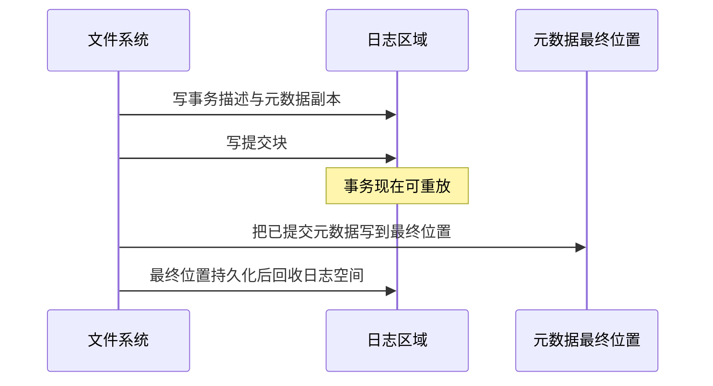

# 日志与一致性

- 写作时间：`2026-03-04 首次提交，2026-07-13 最近修改`
- 当前字符：`7254`

[VFS 与实现](/filesystem/02-vfs)沿着 `open()` 展示了内存中的 VFS 对象，但一次文件系统操作最终可能修改多处持久化结构。创建文件至少可能涉及 inode 位图、inode 表、父目录数据、父目录时间戳和空闲 inode 计数。位图用一个 bit 记录一个 inode 是否已经分配，inode 表保存对象记录，目录再保存名称关联。正常执行时，内核可以依次完成这些写入；若机器在中途掉电，设备上可能只留下其中一部分。

文件系统需要先规定哪些关系始终成立，这些关系就是 **一致性不变量**；再控制缓存与设备之间的 **写入顺序**；日志文件系统通过 **预写日志** 把多个元数据更新组成可判定完成状态的事务；ext4 的 **ext4 日志模式** 决定普通文件数据与元数据如何排序；重新挂载时，**日志恢复** 根据提交记录重放完整事务并丢弃未完成事务。

## 一致性不变量

一致性不变量(consistency invariant)是文件系统在任何可接受的持久化状态中都必须满足的结构关系。

文件系统把一个用户操作拆成多个块更新，但设备不能替它理解这些更新之间的含义。以创建 `report.txt` 为例，磁盘状态至少要满足以下关系：

- inode 位图标记该 inode 已分配时，inode 表中必须有对应有效记录。
- 父目录出现 `report.txt → inode 1051` 时，1051 号 inode 必须已经分配。
- inode 引用某个数据块时，该块不能同时出现在空闲块集合中。
- 目录新增或删除子目录时，相关目录链接计数必须符合实现规则。

若先把目录项写入磁盘，再在写 inode 位图之前崩溃，目录会引用一个仍被标为空闲的 inode。后续分配可能把同一 inode 交给另一文件，造成两个无关名称共享和覆盖元数据。反过来，若 inode 已分配但目录项尚未持久化，崩溃后会留下无法通过目录到达的对象并泄漏空间。

崩溃一致性(crash consistency)要求文件系统从任意允许的崩溃点恢复后，持久化结构仍满足这些不变量，并且已完成操作的可见范围符合文件系统承诺。它不自动表示“每次 `write()` 返回的数据都不会丢失”，也不表示多个文件的业务更新构成事务。前者取决于持久化接口，后者需要应用协议；本课先解决文件系统内部结构不能处于半更新状态的问题。

传统的文件系统一致性检查(file system consistency check, fsck)工具可以在重启后扫描整套元数据，寻找位图、inode、目录和链接计数之间的矛盾，再按规则修复。它能恢复结构，但扫描大型文件系统耗时很长，而且面对信息已经丢失的冲突时只能选择一种修复结果。日志的目标不是取消所有检查，而是让常见崩溃恢复只处理最近尚未完成落位的事务。

## 写入顺序

写入顺序(write ordering)是文件系统为具有依赖关系的持久化更新规定的先后完成约束。

应用调用 `write()` 后，数据通常先进入页缓存；内核写回线程可以稍后提交块 I/O；块层和设备还可能合并、并行或重新排序请求；存储设备控制器内部也可能有断电后会丢失的易失性写缓存。因此“CPU 已经按顺序执行两个系统调用”不等于“介质已经按相同顺序保存两组数据”。

页缓存同时服务读写路径。读取呈现连续模式时，预读(read-ahead)会在应用明确请求之前把后续文件页读入页缓存，希望未来读取直接命中；判断错误会浪费 I/O 带宽和内存。写入则先把缓存页标为脏页，回写在稍后把这些修改提交给文件系统和块层。预读减少的是未来读取等待，回写安排的是脏页输出；二者都属于缓存与 I/O 调度策略，都不能单独证明数据已经持久化。

[块层](/storage/03-block-layer)已经区分 flush 与 FUA：前者要求此前写入已经到达非易失介质，后者约束当前写入何时才能报告完成。文件系统把这两种能力与请求依赖结合，才能建立“事务记录与提交边界都完整持久化后，事务才可恢复”这样的约束。

这里的持久化顺序与 CPU 内存顺序不是同一问题。内存屏障约束多个 CPU 观察内存读写的顺序，不能把 SSD 写缓存中的数据强制写入闪存；设备 flush 处理存储持久化，也不能替代保护共享内存数据结构的锁和内存屏障。两者都涉及顺序，但作用对象与失败模型不同。

如果每次元数据修改都立即同步所有依赖块，性能会受到大量小写入和等待影响。日志把多个修改组成事务并批量提交，使文件系统可以在保持必要顺序的同时合并 I/O；下一步需要确定的是，事务记录和原位置更新应按什么顺序落盘，崩溃恢复才有可靠依据。

## 预写日志

预写日志(write-ahead logging, WAL)是在更新数据的最终位置之前，先把足以恢复该更新的事务记录持久化到日志区域的协议。

ext4 使用第二代日志块设备(Journaling Block Device 2, JBD2)保护元数据。JBD2 是内核中负责通用日志事务和磁盘格式的子系统，ext4 决定哪些文件系统更新加入事务。一次典型事务可以按以下阶段理解：

事务描述符记录后续日志块对应哪些文件系统块，元数据副本保存更新后的内容。提交块(commit block)标记整笔日志事务已经到达可恢复边界。默认提交路径会等待前面的事务内容写入后再完成提交块；启用 `journal_async_commit` 时，JBD2 可以让提交块与描述块的写入发生重叠，再依靠日志校验和识别缺失或损坏的内容。因此真正的不变量不是某个扇区必须先写，而是恢复时只有“事务记录完整、校验有效且存在提交块”的事务才能重放。

提交以后，事务不必立刻从日志消失。检查点写回(checkpoint)会在稍后把日志中的元数据写到它们在文件系统中的最终位置。只要提交记录仍保留，即使系统在检查点写回中途再次崩溃，恢复仍可重复重放相同内容。重放必须具备幂等效果：同一份已提交元数据再写一次，结果不应改变事务含义。

日志通常按环形区域复用。只有某段事务涉及的最终位置都已安全写回后，对应日志空间才可重新使用。若一个块在旧事务中记录后被释放并改变用途，JBD2 的撤销记录(revoke record)会阻止恢复过程错误重放已经失效的旧版本。

多个系统调用产生的元数据更新可以进入同一个运行事务，再由一次提交批量持久化，这称为组提交(group commit)。它分摊了 flush 与 commit block 的等待成本，但也说明日志事务边界不等于某个应用系统调用边界。应用需要明确持久化时，仍要调用相应同步接口。

:::expand 写时复制文件系统与日志
文件系统级写时复制不覆盖仍被当前持久化状态引用的块。修改数据或元数据时，文件系统先分配新块并写入新版本，再把上层树节点逐级更新到新的位置，最后切换能找到新树的根引用；旧树在根切换前仍保持可读，也可以被快照继续引用。

这种方法避免原地覆盖，适合快照、校验和与多版本数据，但它并没有取消持久化顺序。新数据、元数据树和根引用仍要按可恢复顺序写入，设备缓存仍需要 flush 或等价保证，空间分配状态也必须能在崩溃后判定。它与 `fork()` 的写时复制共享“先共享、写入时再复制”的原则，处理对象和失败模型却不同：进程写时复制复制内存页，文件系统写时复制组织持久化块与元数据树。

日志与写时复制也不是简单的“旧方案与新方案”。ext4 主要用 JBD2 日志保护元数据更新；Btrfs 等文件系统以写时复制树为核心，同时仍可能使用日志树或其他机制缩短同步写入与恢复路径。比较两者时应检查具体文件系统保证，而不能只根据名称推断崩溃语义。
:::

## ext4 日志模式

ext4 日志模式是 ext4 对普通文件数据与日志化元数据之间范围和顺序的配置策略。

ext4 的 JBD2 始终以文件系统元数据为主要保护对象，挂载选项进一步决定普通文件数据怎样参与协议：

ext4 通常用区段记录连续文件块范围，并用延迟分配把物理块选择推迟到写回阶段，以便聚合相邻脏页后寻找更连续的空间。区段与延迟分配决定数据块怎样映射和何时选择，JBD2 则保护相关元数据更新的提交与恢复；三者解决的是不同问题，不能把“使用区段”直接等同于“具有日志保证”。

| 模式 | 文件数据 | 元数据 | 主要结果 |
|------|----------|--------|----------|
| `data=journal` | 先写入日志，再写最终位置 | 写入日志 | 保证最强，写放大和日志占用更高 |
| `data=ordered` | 不写入日志，但事务相关数据先于元数据提交写回 | 写入日志 | 默认模式，避免元数据先提交而相关数据仍未写回 |
| `data=writeback` | 不要求先于元数据提交写回 | 写入日志 | 顺序约束较少，崩溃后新文件范围可能出现旧内容或未期望内容 |

`data=ordered` 的“ordered”只表示特定数据写回与元数据提交之间存在顺序，不表示每次 `write()` 都同步持久化。正常写入仍可能只修改页缓存，延迟分配也可能推迟实际块选择。若应用没有执行 `fsync()` 等操作，突然掉电后最近数据仍可能丢失。

`data=journal` 把数据和元数据都写入日志，恢复时能按事务处理二者，但代价是数据通常先写日志、再写最终位置。`data=writeback` 减少了数据排序等待，却扩大了崩溃后文件内容的不确定范围。三种模式改变的是文件系统默认保证和性能取舍，不会替应用定义多文件业务事务。

ext4 还支持快速提交(fast commit)。传统 JBD2 事务记录修改后的完整元数据块；文件系统创建时启用相应特性并使用 `data=ordered` 时，快速提交可以只记录重建元数据变化所需的最小增量，以缩短提交延迟。遇到不支持的操作、快速提交区域不足或完整 JBD2 提交时，ext4 会回到完整提交。无论记录完整块还是增量，恢复仍只接受具有有效提交边界的事务。

:::thinking `data=ordered` 是否意味着 `write()` 返回后数据已经持久化？

不是。`write()` 返回通常只确认数据已经复制到页缓存或被内核接收。`data=ordered` 约束的是某个日志事务提交时，相关文件数据不能落后于使这些数据可见的元数据；如果该事务尚未被要求提交，数据仍可能停留在易失性内存中。

需要获得明确的持久化确认时，应用必须使用 `fsync()`、`fdatasync()` 或带同步语义的打开和写入方式，并检查返回值。[崩溃一致性](/filesystem/04-crash-consistency)会把这些接口组合成完整更新协议。
:::

## 日志恢复

日志恢复(journal recovery)是文件系统在发现上次未正常卸载后，检查日志事务并把已提交更新重新应用到最终位置的过程。

挂载 ext4 时，内核读取记录日志格式、大小和事务序列等信息的日志超级块，再验证事务描述符、数据记录、提交块与校验和。具有完整有效提交记录的事务会按顺序重放；缺少提交记录或校验失败的尾部事务被忽略。重放完成后，文件系统元数据回到满足日志协议不变量的状态。

日志重放之后还可能处理孤儿 inode(orphan inode)。这类 inode 已经脱离目录但因仍被打开而尚未回收，或者正在执行无法放进单笔日志事务的文件缩短或扩展。ext4 会把它们记录在孤儿链表或专用孤儿文件(orphan file)中；若崩溃打断删除、缩短或扩展，重新挂载时可以继续释放多余块或完成必要清理，避免空间永久泄漏。完成这些恢复步骤后，文件系统才进入正常服务状态。

日志把恢复工作限制在近期事务，而不是扫描每个 inode 和数据块。`fsck` 仍然有独立价值：硬件故障、内核缺陷、内存破坏或跳过日志恢复可能造成日志协议之外的损坏，此时需要全局检查结构关系。日志处理“已知更新在崩溃中断时如何完成”，`fsck` 处理“现有全局结构是否自洽”。

日志保证也有明确边界：

- 元数据日志主要保证文件系统结构可恢复，不保证所有最近文件内容都已持久化。
- `rename()` 的命名空间原子性不等于掉电后的持久性，目录项可能仍需显式同步。
- 两个文件分别更新时，文件系统不会自动理解它们必须同时出现。
- 写入成功后仍可能在后续写回或 `fsync()` 阶段报告 `ENOSPC`、`EIO` 等错误，应用必须处理这些结果。

因此，日志解决的是文件系统内部事务，应用仍要构造自己的持久化协议。[崩溃一致性](/filesystem/04-crash-consistency)会以“安全替换一个配置文件”为具体目标，推导为什么需要临时文件、文件 `fsync()`、原子 `rename()` 和目录 `fsync()`，再在各个执行边界主动制造失败，验证所有恢复结果。

## 小结

| 概念 | 说明 |
|------|------|
| 一致性不变量 | 所有可接受持久化状态都必须满足的元数据关系 |
| 写入顺序 | 对有依赖的持久化更新施加先后完成约束 |
| 预读 | 根据读取模式提前把后续文件页装入页缓存 |
| 回写 | 把脏页修改异步提交给文件系统和块层 |
| 预写日志 | 先持久化可恢复的事务记录，再更新最终位置 |
| 文件系统级写时复制 | 把修改写入新块并切换根引用，避免覆盖当前持久化版本 |
| 提交块 | 表示日志事务记录完整、恢复时可以重放的提交边界 |
| 检查点写回 | 把已提交日志内容写入文件系统最终位置 |
| `data=ordered` | 数据不进日志，但相关数据写回先于元数据事务提交 |
| 日志恢复 | 重放已提交事务并忽略不完整尾部事务 |

日志把“多个磁盘块能否一起原子写入”转换成“恢复时能否可靠判断事务已经提交”。它保护文件系统结构，但应用数据何时持久化仍必须由同步接口和更新协议明确表达。

---

**文档与源码入口**：
- [ext4 Journal (jbd2)](https://www.kernel.org/doc/html/latest/filesystems/ext4/journal.html)：JBD2 布局、提交、revoke 与 checkpoint
- [ext4 Orphan File](https://docs.kernel.org/filesystems/ext4/orphan.html)：崩溃后的 orphan inode 清理
- [ext4 High Level Design](https://www.kernel.org/doc/html/latest/filesystems/ext4/overview.html)：ext4 磁盘结构与分配组织
- [ext4 管理指南](https://www.kernel.org/doc/html/latest/admin-guide/ext4.html)：`data=journal`、`data=ordered` 与 `data=writeback`
- [`fs/jbd2/`](https://github.com/torvalds/linux/tree/master/fs/jbd2)：JBD2 事务与恢复实现
- [`fs/ext4/super.c`](https://github.com/torvalds/linux/blob/master/fs/ext4/super.c)：ext4 挂载、恢复和日志配置
- [Block layer writeback cache control](https://www.kernel.org/doc/html/latest/block/writeback_cache_control.html)：flush 与 FUA 语义

[崩溃一致性](/filesystem/04-crash-consistency)把日志提供的底层保证转成应用协议，重点处理 `fsync()`、`rename()` 和父目录同步之间为何缺一不可。
