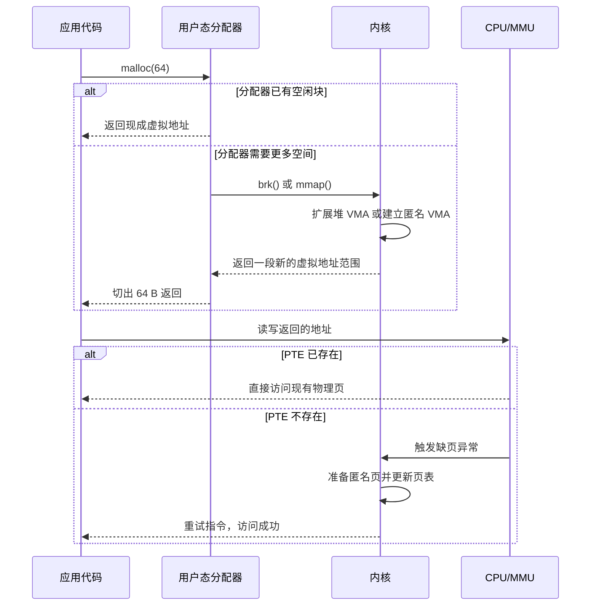

# 内存映射

- 写作时间：`2026-03-04 首次提交，2026-07-13 最近修改`
- 当前字符：`11197`

[虚拟内存](/memory/02-virtual-memory)说明了页面如何按需进入物理内存，以及内存压力下如何回收页面。站在程序接口一侧，还需要继续区分三个时间点：`malloc(64)` 何时只从用户态分配器取得一块地址，`mmap()` 何时只建立虚拟地址规则，以及页面何时真正获得物理页帧。只有把这三个时间点分开，才能解释为什么映射可以立即返回地址、第一次访问仍会缺页，以及已经申请成功的进程为何仍可能因 OOM 被终止。

这一课沿着一块内存从“获得地址”到“承受资源压力”的顺序展开。**mmap 与 VMA** 定义一段虚拟地址应当如何解释；**匿名映射与堆增长** 把 `malloc()`、`brk()` 和 `mmap()` 放到同一条时间线上；**文件映射** 通过页缓存连接虚拟地址与文件内容；**地址空间布局** 展示这些区域在真实 Linux 进程中的位置与权限；**交换** 为需要保留内容的可回收页面提供后备存储；**OOM Killer 与内存 cgroup** 则在分配无法继续时确定失败边界和受影响的进程。

## mmap 与 VMA

内存映射(memory mapping)是在进程虚拟地址空间中记录一段地址范围的访问权限、数据来源和处理规则的机制，VMA 则是 Linux 表示这段规则的核心数据结构。

[地址空间与分页](/memory/01-address-space-paging)已经给出 VMA 的最小定义。VMA 由 `struct vm_area_struct` 表示，它描述一个属性一致、虚拟地址连续的半开区间 `[vm_start, vm_end)`。同一 VMA 中的页面具有相同的读、写、执行等权限，并共享同类缺页处理规则；文件映射还会记录文件及页偏移，匿名映射则没有普通文件作为后备对象。每个用户地址空间由 `struct mm_struct` 表示，现代 Linux 使用 Maple Tree 索引其中的 VMA；Maple Tree 是支持按地址区间查找和更新的树形索引结构。修改权限的 `mprotect()`、撤销映射的 `munmap()` 等操作可能拆分 VMA，属性相容的相邻区域也可能合并，因此 VMA 不是程序源代码中每次申请的一一对应记录。

`mmap()` 和 `munmap()` 的 C 接口声明如下：

```c
void *mmap(void *addr, size_t length, int prot, int flags,
           int fd, off_t offset);
int munmap(void *addr, size_t length);
```

`addr` 是期望的起始地址，传入 `NULL` 通常表示由内核选择；`length` 是映射长度；`prot` 指定 `PROT_READ`、`PROT_WRITE`、`PROT_EXEC` 等访问权限；`flags` 至少要说明映射是共享还是私有，并可附加 `MAP_ANONYMOUS` 等属性；文件映射通过 `fd` 和页对齐的 `offset` 指定数据来源。成功时 `mmap()` 返回映射起始地址，失败时返回 `MAP_FAILED`，同时设置 `errno`。`munmap()` 成功返回 0，失败返回 -1 并设置 `errno`。

例如，下面的调用请求一段长度为 4096 字节、可读写、私有且匿名的映射：

```c
char *p = mmap(NULL, 4096,
               PROT_READ | PROT_WRITE,
               MAP_PRIVATE | MAP_ANONYMOUS,
               -1, 0);
```

这次成功调用首先建立或调整 VMA，并不保证已经为每一页分配独立物理页。后续访问 `p[0]` 时，如果对应 PTE 尚不存在，处理器才触发缺页异常并让内核补齐映射。不过这是一条默认路径而不是绝对规则：`MAP_POPULATE` 可以预先建立页表并对文件执行预读，锁定映射驻留的 `mlock()` 等操作也可能提前使页面进入 RAM。

`mmap()` 是创建映射的主要接口之一，但 VMA 不只来自显式 `mmap()`。加载 ELF 可执行文件和共享库、建立主线程栈、扩展堆以及创建线程栈，最终都会在地址空间中形成相应 VMA。VMA 回答“这段虚拟地址是否合法、允许怎样访问、缺页时去哪里取得内容”，页表则记录其中具体虚拟页当前指向哪个物理页帧；前者是区域级规则，后者是页面级映射。

## 匿名映射与堆增长

匿名映射(anonymous mapping)是不以普通文件内容作为初始数据来源的映射，堆、线程栈和许多动态分配最终都由匿名页面承载。

从 C 程序看到的动态内存接口是 `malloc()` 和 `free()`，它们属于用户态分配器，并不是同名系统调用。分配器先管理自己已经取得的大块区域；现有空闲块不足时，它才通过 `brk()` 调整堆边界(program break)，或者通过 `mmap()` 新建匿名映射。glibc 的 ptmalloc 通常同时使用两种方式，但选择会受分配大小、历史行为和可调参数影响，不能把某个固定阈值当成通用规则。两层职责需要明确分开：

1. `malloc()` 在分配器管理的区域中寻找满足大小和对齐要求的块。
2. 分配器缺少合适空间时，再通过 `brk()` 或 `mmap()` 向内核取得更大的虚拟地址范围。

真正的时间顺序更接近下面这张图：



这条链中有三个不同层次。`malloc()` 返回的是分配器承诺给调用者使用的一块地址；`brk()` 或 `mmap()` 在需要时改变进程的 VMA；某页尚未驻留时，访问才通过缺页异常建立具体物理映射。如果 `malloc()` 复用了已有且驻留的空闲块，后续访问既不需要新 VMA，也不需要缺页。只有分配器取得新地址范围并访问未驻留页面时，三个事件才会依次出现。

`brk()` 通过提高 program break 扩展传统堆区域，堆的大小随高地址方向扩大；降低 program break 则可能收缩堆。连续的堆 VMA 适合由分配器切分并复用大量小块。`mmap()` 可以独立创建 VMA，不必依附现有堆边界，因此常用于大块分配、线程栈、共享内存和文件映射。[线程](/concurrency/01-thread)介绍的线程栈通常就来自独立映射，不过线程库也可能缓存已经释放的栈供后续线程复用。

新匿名页还存在一个容易被“首次访问就分配页帧”掩盖的细节。对只读访问，Linux 可以先映射一张全零的共享只读页；直到程序首次写入，才为该进程分配可写的独立零页。这仍属于按需分页，只是“建立可读映射”和“分配私有可写页”可能发生在两次不同访问中。

`free()` 同样不等于立即执行 `munmap()`。分配器常把释放的块留在自己的空闲结构中，供后续 `malloc()` 复用；只有独立映射可以整体撤销，或者堆顶存在适合归还的连续空闲范围时，分配器才可能撤销映射或降低 program break。因而进程调用 `free()` 后，分配器统计中的已用内存可能下降，VMA 和 RSS 却不一定立刻缩小。程序接口中的“释放对象”与内核中的“撤销映射、回收页帧”是不同事件。

## 文件映射

文件映射(file-backed mapping)是把文件的一段内容作为虚拟地址范围数据来源的映射，普通文件系统上的访问通常通过页缓存与文件内容相连。

[虚拟内存](/memory/02-virtual-memory)已经把页缓存定义为按文件和文件内偏移缓存内容的内存区域。`read()` 和普通文件映射通常都会使用页缓存，区别在于数据怎样到达程序：`read()` 把页缓存中的字节复制到调用者提供的用户缓冲区，文件映射则让进程通过普通内存读写指令访问映射到页缓存页面的虚拟地址。访问尚未驻留的文件页时，缺页路径先在页缓存中查找；未命中时再发起文件 I/O，内容就绪后建立进程页表映射。

文件映射省去了显式 `read()` 循环和一次用户缓冲区复制，但这不等于它对任何访问模式都更快。首次访问仍可能承担缺页与 I/O，随机访问可能产生大量缺页，映射的建立、拆分和 TLB 失效也有成本。它首先改变的是接口和共享语义，性能需要结合访问模式测量。

这里最重要的区分是 `MAP_SHARED` 和 `MAP_PRIVATE`：

| 方式 | 读到的内容 | 写入后的去向 | 其他进程是否可见 |
|------|------------|--------------|------------------|
| `MAP_SHARED` | 文件对应的页缓存内容 | 修改共享页缓存，随后按回写规则更新文件 | 对映射同一区域的进程可见 |
| `MAP_PRIVATE` | 初始来自文件页 | 写入时触发 COW，修改进入私有匿名页 | 私有修改不可见 |

`MAP_SHARED` 允许多个映射引用同一组页缓存页面。一个进程执行普通内存写入后，其他正确同步并映射同一区域的进程可以观察到修改，页面随后由内核回写策略写入文件。`MAP_PRIVATE` 使用[进程生命周期](/process/01-lifecycle)介绍的写时复制：初始读取可复用文件页，首次写入因权限不满足触发缺页，内核为写入方建立私有匿名副本，后续修改既不传播给其他私有映射，也不写入原文件。

“其他进程可见”和“已经持久化”必须分开。`MAP_SHARED` 上的一次 store 只说明内存中的共享页面被修改，不能证明数据已经到达持久存储。程序需要通过 `msync()` 请求同步映射范围，并根据文件系统和应用的一致性要求配合 `fsync()` 等接口。[断电后的文件更新协议](/filesystem/04-crash-consistency)会完整讨论这些接口能够建立什么保证。

映射类型直接影响页面回收。干净文件页可以解除映射并从页缓存中回收，需要时再读原文件；`MAP_SHARED` 形成的脏文件页通常要先回写；`MAP_PRIVATE` 页面在写时复制后成为私有匿名页，不能把修改写回原文件，若需要在回收后保留内容，就依赖交换空间。尚未发生 COW 的私有干净页仍可从原文件恢复。

## 地址空间布局

Linux 进程地址空间布局是由一组具有不同地址范围、权限和数据来源的 VMA 共同形成的用户虚拟地址视图。

一个已启动的 Linux 进程通常同时包含 ELF 可执行文件格式装入的代码和数据 VMA、`brk()` 管理的堆、共享库与文件映射、匿名映射、各线程栈以及内核提供的辅助映射。它们不是一整段属性相同的内存，而是一组各自拥有边界和权限的区域。下面的 64 位 Linux 简图只表达常见相对位置，不承诺固定地址：

```text
用户高地址
┌──────────────────────────────┐
│     主线程栈 / argv / env     │
│     栈大小向低地址方向增长 ↓   │
├──────────────────────────────┤
│   线程栈 / 共享库 / 文件映射   │
│ 匿名映射 / 内核提供的辅助页   │
│        （mmap 区）            │
├──────────────────────────────┤
│            heap              │
│     堆大小向高地址方向增长 ↑   │
├──────────────────────────────┤
│      .bss / .data / .text    │
└──────────────────────────────┘
用户低地址
```

图中的“栈向低地址增长”是指栈占用范围扩大时，下边界向更低地址移动；“堆向高地址增长”则是指 `brk()` 扩展堆时，上边界向更高地址移动。线程栈和独立匿名映射不必遵循主线程栈或 heap 的增长方式，它们通常作为单独 VMA 管理。更高的规范地址还可保留给内核，但用户态不能按普通用户权限访问，`/proc/<pid>/maps` 也主要展示该进程的用户 VMA。

`/proc/<pid>/maps` 可以直接观察这些区域。以下输出是在 `just linux` 启动的原生 Linux 容器中从 `/project` 执行所得；这里的 `/proc/self` 指执行命令的 `sed` 进程。命令只保留可执行文件、堆和栈对应的行：

```console
$ uname -m
aarch64
$ sed -n '\|/usr/bin/sed|p;/\[heap\]/p;/\[stack\]/p' /proc/self/maps
aaaae4aa0000-aaaae4abd000 r-xp 00000000 00:3f 221808  /usr/bin/sed
aaaae4acf000-aaaae4ad0000 r--p 0001f000 00:3f 221808  /usr/bin/sed
aaaae4ad0000-aaaae4ad1000 rw-p 00020000 00:3f 221808  /usr/bin/sed
aaaaf36eb000-aaaaf370c000 rw-p 00000000 00:00 0       [heap]
ffffcbbeb000-ffffcbc0c000 rw-p 00000000 00:00 0       [stack]
```

每行先给出半开地址区间，再给出权限、文件偏移、设备号、inode 和可选路径。[命名空间](/process/06-namespace)介绍过 inode 是文件系统标识文件对象的编号，没有文件后备时通常显示为 0。权限中的 `r`、`w`、`x` 分别表示可读、可写、可执行，最后的 `p` 表示私有映射，`s` 则表示共享映射。同一个 `/usr/bin/sed` 被拆成多个 VMA，是因为 ELF 的可执行代码、只读数据和可写数据需要不同权限；`[heap]` 与 `[stack]` 是内核为这两类匿名区域提供的标签。

[地址空间与分页](/memory/01-address-space-paging)介绍的 ASLR 会改变可执行文件、共享库、堆、栈和映射区等位置，具体范围还受架构、PIE、内核配置和启动参数影响。因此上面的地址是一次真实运行结果，不是应当背诵的固定值；真正稳定的是每个 VMA 的范围、权限和来源语义。

## 交换

交换是把需要保留内容的可回收匿名页或共享内存页移到交换空间，并在后续访问时恢复到 RAM 的机制。

交换空间是承载换出内容的存储区域，传统形式可以是交换分区或交换文件，也可以由压缩块设备提供。页面换出(swap out)是把内容保存到交换空间并释放原页帧，页面换入(swap in)则是在缺页时根据交换条目找到数据并重新建立驻留页面。Linux 共享内存机制 `shmem` 及建立在它之上的内存文件系统 `tmpfs` 也能使用交换。页面类型决定回收路径：

| 页类型 | 回收时的典型动作 |
|--------|------------------|
| 干净文件页 | 直接丢弃，需要时再从文件读回 |
| 脏文件页 | 先回写文件，之后可回收 |
| 需要保留内容的匿名页或 shmem 页 | 写入交换空间，之后回收页帧 |

交换空间不是所有页面统一使用的后备存储。普通文件页已经有文件作为数据来源，干净页可丢弃，脏页可回写；匿名页、COW 后的私有脏页以及 shmem/tmpfs 页面没有可直接恢复当前内容的普通文件版本，需要保留时才依赖交换空间。shmem/tmpfs 在页缓存中管理内容，但对应页面仍可进入交换空间。

页面被换出后，相应 PTE 不再保存普通物理页帧号，而是编码能够定位交换设备与偏移的交换条目(swap entry)。再次访问会触发缺页，内核根据该条目从交换缓存或交换设备恢复内容。交换缓存(swap cache)按交换条目索引正在换入或换出的页面，避免同一份交换内容被重复读取或写入。

并非每个匿名页都一定能够换出。没有配置交换空间时，匿名内容不能依靠磁盘 swap 腾出页帧；被 `mlock()` 锁定或处于其他不可回收状态的页面也不能按普通路径换出；尚未产生私有状态的零页则可以重新构造，不必保存。交换扩大的是内核可回收页面的选择范围，并没有扩大进程的虚拟地址宽度。交换 I/O 过于频繁时，系统仍会进入[虚拟内存](/memory/02-virtual-memory)介绍的抖动。

## OOM Killer 与内存 cgroup

OOM Killer 是 Linux 在某个允许分配的内存范围内无法满足关键分配时选择受害进程并终止它的恢复机制；内存控制组(memory cgroup, memcg)则可以把记账、回收和 OOM 的范围限制在一个进程组内。

一次物理页分配失败后，内核能否回收页面、能否启动 I/O、是否允许重试以及是否应调用 OOM Killer，都取决于本次分配的上下文与标志。有些分配会直接返回失败，有些会尝试直接回收、交换或内存紧凑。[地址空间与分页](/memory/01-address-space-paging)用移动整块进程内存说明过紧凑的目标；Linux 在分页系统中迁移可移动页面，把分散空闲页合并成较大的连续范围。符合条件且仍无法推进时才进入 OOM 处理。因此“分配失败”不必然等于“立刻杀进程”，OOM Killer 也不是所有低内存路径的必经步骤。

用户态之所以可能在 `malloc()` 成功很久以后才遭遇 OOM，还与内存过量承诺(overcommit)有关。过量承诺是允许系统承诺的私有可写虚拟内存超过当前立即可用物理资源，因为许多已申请页面不会同时被触及。Linux 通过 `vm.overcommit_memory` 选择承诺策略：

| 值 | 策略 | 建立映射时的含义 |
|----|------|------------------|
| 0 | 启发式 overcommit，通常是默认值 | 拒绝明显过量的申请，同时允许合理的惰性使用 |
| 1 | 总是 overcommit | 承诺检查不阻止申请，实际资源不足可能在后续暴露 |
| 2 | 严格承诺记账 | 承诺量受 swap 加可配置物理内存比例形成的上限约束 |

因此程序可能在 `brk()`、`mmap()` 或分配器扩展阶段收到 `ENOMEM`，也可能先取得虚拟地址，等后续缺页真正需要页帧时才遇到内存压力。`malloc()` 返回非空指针只证明分配器授予了地址，不是对未来每次物理分配都成功的无条件保证。

全局 OOM 发生在系统允许本次分配使用的节点或内存范围内无法继续推进。内核使用受害者评分(badness heuristic)估算候选进程对允许内存的占用，并结合 `/proc/<pid>/oom_score_adj` 调整选择倾向；值越大越容易被选中，`-1000` 会把任务排除在普通 OOM 选择之外。选中受害者后，内核发送 `SIGKILL`，但页帧要等目标进程退出并释放地址空间后才真正重新可用。

Linux 还支持组内 OOM。[控制组](/process/07-cgroup)介绍过控制器怎样对进程组记账和限制资源，memcg 则把同样的层级边界用于匿名内存、页缓存和部分内核内存。cgroup v2 中几个关键接口的边界如下：

| 接口 | 含义 |
|------|------|
| `memory.current` | 当前 cgroup 及其后代的内存使用量 |
| `memory.high` | 节流和高强度回收边界；超过它不会直接触发 OOM Killer |
| `memory.max` | 硬限制；达到后若无法把使用量降下来，会在该 cgroup 内触发 OOM |
| `memory.events` | 统计 `high`、`max`、`oom`、`oom_kill` 等事件 |
| `memory.oom.group` | 设为 1 时，要求把 cgroup 作为不可分割工作负载共同终止；明确排除 OOM 的任务除外 |

memcg OOM 的候选范围受该 cgroup 限制，不等同于全局 OOM。即使宿主机还有未被该容器授权使用的空闲内存，容器达到 `memory.max` 且回收失败后仍可能在组内终止进程。反过来，超过 `memory.high` 只会让任务受到回收与节流压力，给外部管理程序留下调整限制或终止工作负载的机会。

整条路径可以归结为两个独立问题：`malloc()`、`brk()` 和 `mmap()` 解决“调用者能否取得一段符合规则的虚拟地址”，缺页、交换与 OOM 则解决“实际访问时能否持续提供物理资源”。前一个问题成功，不足以证明后一个问题永远成功；理解这条时间边界，才能正确解释惰性分配和容器内 OOM。

## 小结

| 概念 | 说明 |
|------|------|
| `mmap()` | 建立一段地址范围的映射规则；默认通常按需驻留，也可通过选项预填页表 |
| VMA | 描述连续虚拟地址区间、权限和数据来源的区域级内核记录 |
| 匿名映射 | 没有普通文件作为初始数据来源的映射，常承载堆、线程栈和动态分配 |
| `brk()` | 移动 program break 以扩展或收缩传统连续堆区 |
| 文件映射 | 把文件区间映射进地址空间，普通文件访问通常通过页缓存完成 |
| `MAP_SHARED` | 修改共享文件页并允许其他正确同步的映射观察，持久化仍需同步协议 |
| `MAP_PRIVATE` | 初始复用文件页，写入时 COW 为私有匿名页，不修改原文件 |
| 交换 | 在 swap 中保存需要保留的匿名页或 shmem 页，使页帧可被回收 |
| 过量承诺 | 允许承诺的虚拟内存与立即可用物理资源不必一一对应的策略 |
| OOM Killer | 符合条件的内存分配无法推进时，通过终止受害进程恢复资源 |
| 内存 cgroup | 按进程组记账、回收和限制内存，并可把 OOM 限定在组内 |

程序取得分配器返回的地址、内核建立 VMA、页面获得物理映射，是可以发生在不同时间的三个事件；交换和 OOM 处理的是后续资源压力，不能用“申请已经成功”推导“未来驻留一定成功”。

---

**源码与文档入口**：
- [`mm/mmap.c`](https://github.com/torvalds/linux/blob/master/mm/mmap.c)：`mmap()`、`brk()` 与 VMA 管理
- [`mm/filemap.c`](https://github.com/torvalds/linux/blob/master/mm/filemap.c)：文件页缓存与文件映射路径
- [`mm/swapfile.c`](https://github.com/torvalds/linux/blob/master/mm/swapfile.c)：交换空间与 swap entry 管理
- [`mm/oom_kill.c`](https://github.com/torvalds/linux/blob/master/mm/oom_kill.c)：OOM Killer 决策
- [`mm/memcontrol.c`](https://github.com/torvalds/linux/blob/master/mm/memcontrol.c)：内存 cgroup 记账与限制
- [Process Addresses](https://docs.kernel.org/mm/process_addrs.html)：VMA、`mm_struct` 与 Maple Tree
- [`mmap(2)`](https://man7.org/linux/man-pages/man2/mmap.2.html)：映射接口、返回值及共享和私有语义
- [Overcommit Accounting](https://docs.kernel.org/mm/overcommit-accounting.html)：三种 overcommit 模式与承诺记账
- [Control Group v2](https://docs.kernel.org/admin-guide/cgroup-v2.html)：`memory.high`、`memory.max` 与 memcg OOM
- [`proc_pid_maps(5)`](https://man7.org/linux/man-pages/man5/proc_pid_maps.5.html)：`/proc/<pid>/maps` 字段定义
