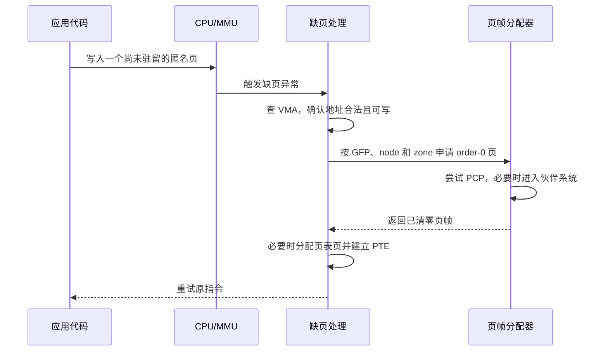

# 内核内存分配

- 写作时间：`2026-03-04 首次提交，2026-07-13 最近修改`
- 当前字符：`11147`

[内存映射](/memory/03-memory-mapping)把 `malloc()`、VMA、缺页和物理页驻留分成了不同时间点。缺页处理确认访问合法之后，仍然要取得页表页和用户页；创建 VMA、进程描述符或文件系统对象时，内核还要分配远小于一页的结构；某些大型内核数组只要求虚拟地址连续；多核系统又希望高频写入的数据尽量不在 CPU 之间共享。单一分配器无法同时高效满足这些约束，因此 Linux 把内核内存分配拆成多个层次。

这一课先用 **页帧分配器** 解释内存节点、内存区域、每 CPU 快速路径、伙伴系统和分配标志怎样共同提供物理页；**SLUB** 再把若干页切成可重复使用的小型内核对象；**vmalloc** 为内核建立虚拟连续但物理可分散的大块区域；**Per-CPU 分配器** 为每个 CPU 提供独立副本并减少共享写；**内存压缩** 在交换路径中用 CPU 时间减少内存或存储占用；**透明大页** 改变页面分配、缺页和 TLB 的粒度；**NUMA 内存策略** 最后决定物理页优先来自哪个内存节点。这七层共同回答内核“分配什么、从哪里分配、允许承担哪些代价”。

## 页帧分配器

页帧分配器(page frame allocator)是内核按页或物理连续页块管理和分配 RAM 的底层机制。

物理页帧是 RAM 中与基础页大小对齐的固定范围，内核通常用 `struct page` 保存每个受管理页帧的状态，用页帧号(Page Frame Number, PFN)标识页帧序号。虚拟页最终必须映射到页帧，页表页、页缓存页面以及许多内核分配器的底层存储也都来自这一层。

页帧先按 NUMA 内存节点(node)组织，再在每个 node 内按内存区域(zone)划分。node 表示具有特定访问距离的一组内存，zone 则表示物理地址能力或迁移约束相近的一组页帧。具体 zone 取决于架构和内核配置，常见类型如下：

| zone | 主要约束 |
|------|----------|
| `ZONE_DMA` | 满足只能访问很低物理地址的旧式 DMA 设备 |
| `ZONE_DMA32` | 满足只能使用 32 位物理地址的设备，常见于 64 位系统 |
| `ZONE_NORMAL` | 内核能够直接映射的常规内存 |
| `ZONE_HIGHMEM` | 用于内核不能永久直接映射全部 RAM 的架构，常见于部分 32 位系统 |
| `ZONE_MOVABLE` | 尽量只放可迁移或可回收页面，便于紧凑与运行时增减内存的热插拔 |
| `ZONE_DEVICE` | 为持久内存、GPU 等设备内存提供 `struct page` 与内存映射服务 |

不是每台机器都包含全部 zone，普通用户页面也不只来自一个固定 zone。分配请求携带的页分配标志(Get Free Pages, GFP)会限制允许使用的 zone、页面是否可迁移，以及分配器能否回收、执行 I/O 或等待。页帧接口的基本形式是：

```c
struct page *alloc_pages(gfp_t gfp, unsigned int order);
void __free_pages(struct page *page, unsigned int order);
```

`alloc_pages()` 成功返回连续页块中第一页的 `struct page`，失败返回 `NULL`。`order` 表示连续页数的二进制阶数：`order = 0` 是 1 页，`order = 1` 是 2 页，`order = 2` 是 4 页。Linux 的伙伴系统(Buddy System)按这些 2 的幂大小维护 zone 的空闲块；缺少恰好大小的块时拆分更高阶块，释放时则检查对应伙伴是否空闲并逐级合并。

| 操作 | 当前空闲块 |
|------|------------|
| 初始 order 3 | `[8]` |
| 拆分一个 order 3 | `[4] [4]` |
| 再拆分左侧 order 2 | `[2] [2] [4]` |
| 再拆分左侧 order 1 | `[1] [1] [2] [4]` |

伙伴系统能快速拆分和合并，但不能消除外部碎片。大量单页仍然空闲时，它们也可能散布在各处，无法组成一个高阶连续块。[内存映射](/memory/03-memory-mapping)介绍的内存紧凑会把可迁移页面搬到其他页帧，使分散空闲页集中成连续范围；它是高阶分配与 THP 的重要路径之一。紧凑需要扫描和迁移页面，会消耗 CPU，并可能增加分配延迟，而且仍不保证成功。

GFP 标志决定分配器可以为一次请求付出多大代价：

| 标志 | 调用约束与行为 |
|------|----------------|
| `GFP_KERNEL` | 常规内核分配；允许直接回收并可能睡眠，调用上下文必须允许阻塞 |
| `GFP_NOWAIT` | 不做直接回收、I/O 或文件系统操作，不能等待，内存压力下更容易失败 |
| `GFP_ATOMIC` | 不能睡眠，并允许动用一部分紧急储备，只用于确有必要的关键路径且仍可能失败 |
| `__GFP_ZERO` | 与其他标志组合，要求把返回内存清零 |

每个 zone 还维护空闲页水位。低于 low 水位时，后台回收线程 `kswapd` 会被唤醒；具体分配也可能触发直接回收或直接紧凑。分配器因此不只是读取空闲链表，还会根据调用约束决定是否等待系统恢复足够页帧。

高频低阶请求通常先访问每 CPU 页集合(per-CPU pagesets, PCP)，也就是每个 CPU 为页分配快路径维护的本地空闲页集合。PCP 与全局伙伴空闲区批量交换页面，减少频繁获取 zone 锁和跨核修改共享链表。PCP 无法满足请求，或者请求的 order 不适用当前 PCP 快路径时，分配器再进入伙伴系统。这里的 PCP 是页帧分配器的缓存层，和后文为任意内核数据建立副本的 Per-CPU 分配器不是同一个机制。

一个匿名页写缺页大致沿着以下路径取得页帧：



VMA 只判断地址范围和访问权限，页帧分配器才提供真实物理页。如果通向目标地址的某级页表尚不存在，缺页路径还要先取得页表页，再安装最终 PTE。一次用户态写入因此可能同时消耗用户数据页和页表页；两者都按页管理，但用途和生命周期不同。

## SLUB

SLUB 是 Linux 的 slab 对象分配器实现，它把页帧分配器提供的页切成可复用槽位，以满足小型内核对象的频繁分配和释放。

直接为几十或几百字节申请一整页会产生大量浪费。slab 分配体系先为某类对象建立对象缓存(slab cache)，再把一个或多个页组成 slab，并按对象大小和对齐要求切成槽位。同一个 slab cache 中的槽位具有相同布局，释放后可以直接复用；它还可以配置构造、调试和 memcg 记账等属性。这里的 cache 是内核对象池，不是处理器硬件缓存。

`kmalloc()` 为任意字节大小提供通用接口。常见的小型请求会进入能够容纳它的 `kmalloc-*` 大小类，而不应依赖某个内核配置下一定存在“恰好 64 字节”的 slab cache；很大的 `kmalloc()` 请求可能直接使用高阶页块。`kmem_cache_create()` 则允许内核子系统为固定布局对象创建 slab cache。`task_struct` 是任务描述符，`vm_area_struct` 描述 VMA，`dentry` 是文件系统缓存路径名解析结果的目录项对象，它们通常通过相应 slab cache 分配。

SLUB 的常见快路径从当前 CPU 可用槽位中取对象，避免每次分配都操作共享结构；本地槽位不足时，再从所在 NUMA node 的 partial slab 等结构补充。partial slab 是已经使用一部分、仍有空闲槽位的 slab。CPU 本地化减少锁竞争，但跨 CPU 释放、调试选项和 NUMA 定向分配仍可能进入较慢路径。

`mmap()` 可以具体展示 SLUB 与页帧分配器的分工。建立映射时，内核需要 `vm_area_struct` 等区域级元数据，这类小对象通常来自 slab cache；映射中的用户页通常等缺页时再向页帧分配器申请；缺失的页表页也按整页分配，通常不来自 SLUB。三类对象不能合并成一句“`mmap()` 分配了内存”：

| 对象 | 典型来源 | 主要约束 |
|------|----------|----------|
| 用户匿名页、文件页、页表页 | 页帧分配器 | 页数、zone、node 与物理连续性 |
| `vm_area_struct`、`task_struct`、`dentry` | SLUB | 对象大小、对齐、复用与 CPU 本地快路径 |
| 大型内核虚拟连续区域 | `vmalloc` | 虚拟地址连续，物理页可分散 |
| 每 CPU 独立数据 | Per-CPU 分配器 | 每个 CPU 的副本与访问期间的迁移约束 |

SLUB 位于页帧分配器之上：创建新 slab 时仍需取得底层页，之后才在页内完成对象分配。页帧分配器和 SLUB 不是两种互斥方案，而是分别管理“整页资源”和“页内对象”的相邻层次。

## vmalloc

`vmalloc` 是为内核建立虚拟地址连续、底层物理页允许分散的映射与分配机制。

内核把大部分 RAM 放进直接映射(direct map)，其中内核虚拟地址与物理地址保持固定偏移关系。`kmalloc()` 返回的内存来自这类直接映射页面，并保证分配范围在物理上连续；请求越大，需要的高阶连续块越难取得。`vmalloc()` 则先分配若干可以分散的页帧，再在专用 vmalloc 虚拟地址区域建立页表项，把它们映射成调用者看到的连续地址。

`vmalloc()` 更容易满足大型虚拟连续请求，但没有取消成本。分配和释放需要管理虚拟地址区间、建立或撤销页表项，并在撤销旧映射时执行必要的 TLB 同步；这些操作可能睡眠，因此不能当作任意原子上下文都可调用的接口。映射建立后，普通访问仍由 MMU 和 TLB 完成，不过底层页面没有物理连续保证，使用大量基础页也可能增加 TLB 压力。

两类接口的边界如下：

| 接口 | 虚拟地址 | 物理页 | 常见用途 |
|------|----------|--------|----------|
| `kmalloc` | 连续 | 连续 | 小型对象、需要直接映射或物理连续的范围 |
| `vmalloc` | 连续 | 可以分散 | 大型数组、模块或调试区域等只要求虚拟连续的范围 |

物理连续并不自动表示适合设备 DMA。[特权边界](/basics/03-privilege-boundary)介绍过 DMA 与 IOMMU；设备可访问地址范围、设备地址翻译、缓存一致性和映射生命周期都应由内核 DMA API 处理，驱动不能仅凭 `kmalloc()` 的连续性替代 DMA 映射接口。反过来，用户匿名页缺页只需要单页或透明大页映射，也不通过 `vmalloc()` 满足。选择接口的依据是连续性、调用上下文和用途，而不只是请求字节数。

## Per-CPU 分配器

Per-CPU 分配器是为每个逻辑 CPU 建立同一布局的独立内存实例，并通过 CPU 专属基址定位当前实例的机制。

页帧分配器中的 PCP 只缓存待分配页，取出的页可以交给任何用途；Per-CPU 分配器创建的对象则在整个生命周期中保持“每 CPU 一份”的语义。静态对象可以用 `DEFINE_PER_CPU()` 声明，动态对象可以用 `alloc_percpu()` 一类接口分配。代码看到的 per-CPU 变量更接近相对当前 CPU 区域的偏移，访问时必须结合某个 CPU 的 per-CPU 基址形成有效地址。

每个 CPU 更新自己的计数器、统计信息或队列头时，不需要让其他 CPU 反复写同一缓存行，因而可以减少缓存行抖动和共享锁竞争。[内核同步机制](/concurrency/05-kernel-synchronization)已经说明，这个收益带来两个约束：读取全局结果时必须汇总各 CPU 副本，线程在取得“当前 CPU 的指针”后也不能在使用前迁移到另一个 CPU。

`this_cpu_*` 操作把“定位当前 CPU 副本并读写”组合为体系结构支持的操作；如果代码先通过 `this_cpu_ptr()` 取得普通指针并跨越多个步骤使用，通常需要禁止抢占或迁移，防止任务换到另一 CPU 后继续操作旧 CPU 的副本。访问指定 CPU 的数据则可用 `per_cpu_ptr()`，但跨 CPU 读写仍需根据对象语义处理并发。

Per-CPU 数据减少的是共享写热点，不是自动消除所有同步。CPU 热插拔会改变在线 CPU 集合，跨 CPU 汇总可能观察到并发更新，某些全局不变量仍然需要锁、原子操作或其他协议。它解决的是数据放置问题，而不是通用互斥问题。

## 内存压缩

内存压缩(memory compression)是把页面内容编码成更少字节，以 CPU 压缩与解压开销换取较低 RAM 占用或较少交换设备 I/O 的机制。

内存压缩与前文的内存紧凑不是同一件事。紧凑迁移完整页面以形成物理连续空闲区，不改变页面内容大小；压缩改变内容的存储表示，以减少保存这些内容所需的字节数，不保证形成任何连续页块。两者分别解决“空闲页是否连续”和“内容占多少空间”。

[内存映射](/memory/03-memory-mapping)介绍的 swap 路径可以接入两种常见压缩机制：

| 机制 | 在交换路径中的角色 | 后端存储 |
|------|--------------------|----------|
| zswap | swap 页的 RAM 压缩缓存 | 需要后端 swap；缓存逐出时可写回后端 |
| zram | 把压缩后存于 RAM 的空间暴露为块设备 | 可直接作为 swap 设备，也可选配写回设备 |

匿名页进入 swap 子系统时，zswap 尝试压缩内容并用 swap entry 索引 RAM 中的压缩对象。后续换入若命中 zswap，内核从压缩池解压页面，不必读取后端设备；压缩失败、池达到限制或冷页面被逐出时，内容可写回实际 swap 设备。zswap 因而是缓存，不是独立交换设备。

zram 创建 `/dev/zram*` RAM 块设备，写入块先压缩后存入内存。管理员把 zram 设备启用为 swap 后，页面在逻辑上已经换出进程驻留集，但压缩数据和元数据仍占用 RAM。压缩率不足时，zram 节省的空间可能很少，分配器碎片和元数据还会增加额外开销；可选 backing device 可以承接特定写回策略，但不是 zram 的必需组成。

压缩收益取决于页面内容、CPU 余量和后端设备延迟。可压缩冷页较多时，它能减少 swap I/O 并提高有效容量；数据接近不可压缩或 CPU 已饱和时，压缩与解压可能只增加延迟。zswap 和 zram 都需要通过实际工作负载的压缩率、缺页延迟、CPU 使用和 I/O 指标评估，不能只凭“仍在 RAM”断定性能更好。

## 透明大页

透明大页是 Linux 自动为匿名内存与 tmpfs/shmem 映射选择大于基础页的页面粒度，并允许页面尺寸提升、拆分或降级的虚拟内存机制。

[虚拟内存](/memory/02-virtual-memory)已经说明，THP 能够扩大 TLB 覆盖范围。以 4 KiB 基础页的 x86-64 为例，传统 PMD 级 THP 常为 2 MiB，一条映射覆盖 512 个基础页。现代 Linux 还支持多尺寸透明大页(multi-size THP, mTHP)，可使用 16 KiB、32 KiB、64 KiB 等介于基础页和 PMD 大页之间的 2 的幂尺寸；实际可用大小取决于架构和内核配置。

THP 可以在缺页时直接分配合适阶数的页面，也可以由 `khugepaged` 后台线程扫描已有基础页并尝试把满足条件的连续范围合并为大页。应用不必改用 HugeTLB 专用映射接口，因此称为“透明”；但管理员可以通过 sysfs 控制文件选择 `always`、`madvise`、`never` 等策略，应用也可用 `madvise(MADV_HUGEPAGE)` 提示值得使用大页的区域。

更大页面减少缺页次数、页表项数量和 TLB 未命中，但同时扩大单次分配与清零的工作量。PMD 大页缺页可能需要清零 2 MiB，连续页不足时还可能触发回收或紧凑，造成明显延迟；只访问大范围中很小一部分时，还会增加内部碎片。mTHP 用中间尺寸降低这些延迟尖峰和空间浪费，但 TLB 收益也取决于体系结构支持。

THP 不是永久不可分的映射。内存压力、部分解除映射、写时复制和其他 VM 操作可能拆分大页，内核也可以把页面降级为更小尺寸。因而“启用 THP”不等于每个合适范围都成功使用同一尺寸，页面分配成功率、访问局部性、紧凑成本和回收行为都应纳入评估。

## NUMA 内存策略

NUMA 内存策略是在具有多个内存节点的系统中，为线程或虚拟地址范围规定物理页首选节点、允许节点和分布方式的规则。

[操作系统概览](/basics/01-os-overview)介绍过 NUMA：处理器访问不同内存节点的延迟和带宽可能不同。一个 node 可以同时包含 CPU 与本地内存，也可能是只有内存的节点；“本地”表示相对于当前 CPU 距离较近，不代表所有硬件都只有本地和远端两个固定等级。

匿名内存的默认放置常被概括为首次触碰(first-touch)。映射建立时通常还没有物理页，处理首次缺页的 CPU 会让分配器优先从其本地 node 取页；本地 node 无法满足时，内核按候选序列 `zonelist` 回退，其中按优先级排列可用的 node 与 zone。这里决定位置的是发生分配的那次触碰，而不是执行 `malloc()` 的固定线程身份。如果线程在首次触碰前已经迁移到另一 CPU，首选 node 也会随之改变。

Linux 支持多种内存策略：

| 策略 | 分配行为 | 常见目标 |
|------|----------|----------|
| default | 没有更具体策略时采用系统默认行为，通常执行本地优先分配 | 继承默认放置规则 |
| local | 在实际分配时优先当前 CPU 的本地 node | 随线程执行位置获得局部性 |
| preferred | 优先指定 node，必要时允许其他 node | 偏好局部但仍需要容量回退 |
| bind | 把分配限制在指定 node 集合 | 严格控制数据放置范围 |
| interleave | 在指定 node 间交错分配页面 | 分散容量并利用多个内存控制器带宽 |

`set_mempolicy()` 设置线程默认策略，`mbind()` 为指定虚拟地址范围设置策略，用户态工具 `numactl` 则提供命令行控制。策略还会受到[控制组](/process/07-cgroup)介绍的 cpuset 和在线 node 集合约束。因此“指定某个 node”不等于该 node 在任何时刻都有满足请求的可用页。

first-touch 对共享页面还有额外影响。线程 A 在 node 0 首先初始化一个大数组，随后 node 1 上的多个线程长期处理它，这些线程就可能持续进行远端访问。文件页和共享内存页还可能被多个进程共同使用，最早把页缓存页面实例化的访问会影响其他映射观察到的物理放置，不能为每个进程各自重新执行一遍 first-touch。

首次放置也不是永远不变。自动 NUMA 平衡会周期性采样地址空间，使部分访问产生 NUMA 提示缺页(NUMA hinting fault)，也就是专门用于观察访问位置的缺页；内核据此判断是否迁移页面或调整任务位置。采样缺页和页面迁移本身有成本，只有局部性改善带来的收益超过这些开销时才有价值。NUMA 分配因此同时受容量、拓扑、策略、线程迁移和运行时访问模式影响。

## 小结

| 概念 | 说明 |
|------|------|
| 页帧分配器 | 按 GFP、node、zone 和 order 管理单页或物理连续页块 |
| PCP | 每 CPU 维护的页分配快路径，与伙伴空闲区批量交换低阶页面 |
| 伙伴系统 | 以 2 的幂维护连续页块，按需拆分并在释放时合并伙伴 |
| 内存紧凑 | 迁移可移动页以形成连续空闲范围，不改变页面内容大小 |
| SLUB | 把底层页切成可复用对象槽位，满足小型内核结构分配 |
| `vmalloc` | 建立虚拟连续、物理可分散的内核映射，分配和释放需要管理页表 |
| Per-CPU 分配器 | 为每个 CPU 维护独立实例，减少共享写，同时要求正确处理迁移和汇总 |
| zswap / zram | 前者是 swap 页的压缩缓存，后者是可用作 swap 的压缩 RAM 块设备 |
| 透明大页 | 以多种大于基础页的粒度减少缺页与 TLB 开销，并承担紧凑和碎片成本 |
| NUMA 内存策略 | 按拓扑和策略决定页面的首选与允许分配节点 |

内核分配接口之所以分层，是因为“分配小对象、取得连续页块、建立虚拟连续区域、减少共享写、压缩交换内容、扩大页面粒度、选择 NUMA 节点”具有不同约束；任何一次分配都必须先确定对象类型和调用上下文，才能选择正确机制。

---

**源码与文档入口**：
- [`mm/page_alloc.c`](https://github.com/torvalds/linux/blob/master/mm/page_alloc.c)：伙伴系统、PCP 与页帧分配
- [`mm/compaction.c`](https://github.com/torvalds/linux/blob/master/mm/compaction.c)：内存紧凑与页面迁移
- [`mm/slub.c`](https://github.com/torvalds/linux/blob/master/mm/slub.c)：SLUB 分配器
- [`mm/vmalloc.c`](https://github.com/torvalds/linux/blob/master/mm/vmalloc.c)：`vmalloc` 区域与页表映射
- [`mm/percpu.c`](https://github.com/torvalds/linux/blob/master/mm/percpu.c)：Per-CPU 动态分配
- [`mm/zswap.c`](https://github.com/torvalds/linux/blob/master/mm/zswap.c)：zswap 压缩缓存
- [`drivers/block/zram/`](https://github.com/torvalds/linux/tree/master/drivers/block/zram)：zram 块设备
- [`mm/huge_memory.c`](https://github.com/torvalds/linux/blob/master/mm/huge_memory.c)：透明大页
- [`mm/mempolicy.c`](https://github.com/torvalds/linux/blob/master/mm/mempolicy.c)：NUMA 内存策略
- [Memory Allocation Guide](https://docs.kernel.org/core-api/memory-allocation.html)：`kmalloc()`、`vmalloc()`、`alloc_pages()` 与 GFP 标志选择
- [Physical Memory](https://docs.kernel.org/mm/physical_memory.html)：node、zone、PCP、水位和伙伴空闲区
- [this_cpu operations](https://docs.kernel.org/core-api/this_cpu_ops.html)：Per-CPU 地址与迁移约束
- [zswap](https://docs.kernel.org/admin-guide/mm/zswap.html)：zswap 缓存和后端写回
- [zram](https://docs.kernel.org/admin-guide/blockdev/zram.html)：zram 设备、压缩统计与可选写回
- [Transparent Hugepage Support](https://docs.kernel.org/admin-guide/mm/transhuge.html)：mTHP、`khugepaged` 与策略控制
- [NUMA Memory Policy](https://docs.kernel.org/admin-guide/mm/numa_memory_policy.html)：策略作用域与分配模式
