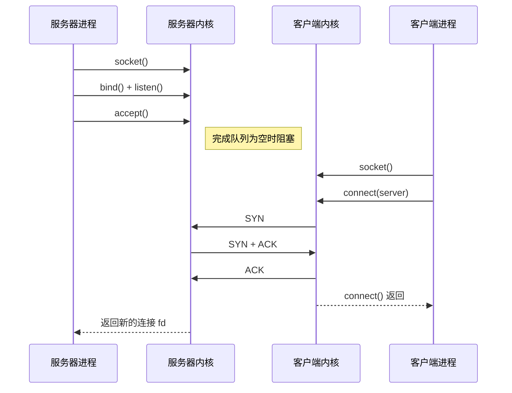
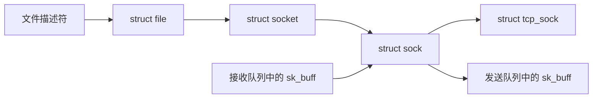

# Socket 与 TCP

- 写作时间：`2026-03-04 首次提交，2026-07-13 最近修改`
- 当前字符：`13003`

[内核内存分配](/memory/04-kernel-memory)完成了进程内部从虚拟地址到物理页的路径，但程序还需要与地址空间之外的端点交换数据。浏览器要向服务器发送请求，数据库要把结果返回给客户端，两个进程还可能位于不同机器。内存管理回答数据如何驻留，网络子系统则要回答字节怎样从当前进程经过内核和设备，到达另一台机器上的目标进程。

来看一次最常见的网络访问。客户端调用 `connect()` 连接服务器，服务器通过 `accept()` 得到一个新的文件描述符，随后双方都可以用 `read()` 和 `write()` 收发数据。应用程序面对的仍然是文件描述符，但这个 fd 后面不再是普通文件或管道，而是一个**套接字**。套接字还需要用**地址族与类型**明确“和谁通信、按什么语义通信”；选择 TCP 以后，内核要建立并维护一条 **TCP 连接**；数据进入内核后，会经过 **Linux 网络栈**中的套接字对象、协议状态和数据包缓冲区；应用可以用**套接字选项**调整延迟、复用和缓冲行为；当网络路径出现竞争时，TCP 的**拥塞控制**再决定发送速度。

网络与 IPC 这一章只有两课。本课先处理跨主机通信，建立套接字和 TCP 的完整模型。[进程间通信](/network/02-ipc)再把范围收回同一台机器，比较 AF_UNIX、管道和共享内存，并说明用户空间怎样通过 Netlink 与内核通信。

## 套接字

套接字是内核提供的通信端点，应用程序通过一个文件描述符引用它，并用文件 I/O 风格的接口收发数据。

[操作系统与硬件](/basics/01-os-overview)已经把套接字放进 Unix 的文件描述符模型，[事件驱动并发](/concurrency/04-event-driven)也用 `epoll` 等待过套接字 fd。本课沿着这个 fd 继续向下，展开它背后的协议栈。

假设浏览器要发送一条网页请求。超文本传输协议(Hypertext Transfer Protocol, HTTP)先规定请求中的方法、路径和首部各表示什么。TCP 接收这些应用字节，并向两端程序提供可靠、有序的字节流；用户数据报协议(User Datagram Protocol, UDP)则保留一条条数据报，但不提供 TCP 的连接、可靠交付和有序字节流语义。两种传输协议都可以把数据交给网际协议(Internet Protocol, IP)，IP 根据源地址、目标地址和路由把数据包送向目标主机。IPv4 和 IPv6 是 IP 的两个版本，地址长度分别是 32 位和 128 位。数据包每经过一段本地链路，还要装入该链路使用的帧中，例如以太网帧或 Wi-Fi 帧。

这条路径形成了四个层次。每一层只向上一层提供接口，并在自己的范围内处理一种问题：

| 层次 | 主要职责 | Linux 中看到的对象或协议 |
|------|----------|--------------------------|
| 应用层 | 定义应用字节的含义和消息格式 | HTTP、DNS |
| 传输层 | 进程到进程的传输语义 | TCP、UDP、端口 |
| 网络层 | 主机到主机的寻址与路由 | IPv4、IPv6 |
| 链路层 | 在一段具体链路上传输帧 | 以太网、Wi-Fi、网卡驱动 |

对常见的 TCP 和 UDP 程序来说，套接字位于应用层和传输层之间。它不是 TCP 本身，也不是 IP 地址的另一种叫法，而是应用程序进入内核网络栈的统一接口。`socket()` 的签名直接暴露了这个抽象的三个维度：

```c
#include <sys/socket.h>

int socket(int domain, int type, int protocol);
```

`domain` 选择地址格式，`type` 选择字节流或数据报等传输语义，`protocol` 再选择符合前两项约束的具体协议。三个参数共同决定内核要创建哪一种通信端点。

调用成功后，`socket()` 返回当前进程最小的空闲 fd；失败时返回 `-1` 并设置 `errno`。这与[进程生命周期](/process/01-lifecycle)使用的 `open()` 相似，因为套接字同样接入了进程的文件描述符表。创建完成后，TCP 套接字可以使用 `read()`、`write()`、`send()` 和 `recv()`。因此事件循环也不需要为网络另造一套等待机制，`epoll` 只要继续监视这些 fd 即可。

这种统一并不意味着所有文件行为都完全相同。普通文件可以从指定偏移读取，TCP 套接字却只能按顺序消费到达的字节流。对阻塞 TCP 套接字，`read()` 返回正数表示实际读到的字节数，这个数可能小于缓冲区长度；返回 0 表示已经读完所有已到达数据，并且对端完成了发送方向的有序关闭；返回 -1 表示失败并设置 `errno`。`write()` 同样可能只接受部分字节，可靠程序必须根据返回值循环发送剩余内容，而不是假定一次调用写完整个缓冲区。

如果对端已经关闭接收方向，内核会在继续写时生成[信号](/process/02-signal)介绍的 `SIGPIPE`。默认动作可能直接终止进程；如果该信号被处理、忽略或阻塞，写操作会以 `EPIPE` 失败。使用 `send()` 时还可以传入 `MSG_NOSIGNAL`，只对这次调用抑制信号，但仍要检查返回值。fd 统一的是引用和 I/O 接口，具体结束、错误和数据边界语义仍由 fd 背后的内核对象决定。

## 地址族与类型

地址族(address family)规定通信地址的格式和命名空间，套接字类型(socket type)规定数据传输的语义。

`socket()` 的 `domain` 参数选择地址族。网络程序最常见的是 `AF_INET` 和 `AF_INET6`：前者使用 IPv4 地址与 16 位端口，后者使用 IPv6 地址与端口。[进程间通信](/network/02-ipc)会使用 `AF_UNIX`，它把通信范围限制在本机，并可用文件系统路径或 Linux 抽象名称定位端点。

套接字系统调用使用 `struct sockaddr` 指针接收不同地址族的数据，调用者实际准备的是对应的具体结构。例如 IPv4 使用 `struct sockaddr_in`，其中 `sin_addr` 保存 IPv4 地址，`sin_port` 保存端口，`sin_family` 标记 `AF_INET`。端口和多字节地址字段采用网络字节序(network byte order)，也就是高位字节在前的大端序(big-endian)；`htons()` 和 `ntohs()` 分别在主机表示与 16 位网络表示之间转换端口。

IP 地址标识主机上的网络接口或可达目标，端口标识该主机上的传输层端点。服务器用 `bind()` 选择本地地址和端口；绑定通配地址时可以接收发往本机多个接口的连接。客户端通常不显式 `bind()`，`connect()` 会根据路由选择本地地址，并从临时端口(ephemeral port)范围分配供主动连接短期使用的源端口。这组本地地址和端口稍后会成为 TCP 四元组的一半。

`type` 参数回答的是另一类问题：应用程序希望看到连续字节、独立消息，还是直接操作网络层数据包？

原始套接字允许程序直接收发较低层协议的数据包。互联网控制报文协议(Internet Control Message Protocol, ICMP)使用这类接口传递网络控制与错误信息，`ping` 等诊断工具会用到它。

| 类型 | 应用看到的语义 | 常见协议 |
|------|----------------|----------|
| `SOCK_STREAM` | 可靠、有序、全双工字节流，不保留消息边界 | TCP、AF_UNIX 流式套接字 |
| `SOCK_DGRAM` | 一次发送对应一个数据报，保留消息边界 | UDP、AF_UNIX 数据报套接字 |
| `SOCK_SEQPACKET` | 可靠、有序且保留消息边界 | AF_UNIX 顺序分组套接字 |
| `SOCK_RAW` | 直接访问较低层协议数据包 | ICMP、协议分析工具 |

`SOCK_STREAM` 不保留消息边界尤其重要。应用连续调用两次 `write(fd, ..., 100)`，接收端不一定得到两次各 100 字节的 `read()`。一次读取可能只返回 60 字节，也可能把后续数据一起读到缓冲区中。TCP 只保证字节顺序，不替应用划分“请求”或“记录”。因此 HTTP 用起始行、首部以及正文长度或传输分帧规则描述消息，Redis 协议也用类型前缀和长度编码消息；应用层协议必须自己完成分帧，也就是从连续字节中识别一条完整消息的起止位置。

`protocol` 参数通常写 0，让内核根据地址族和类型选择默认协议。例如 `socket(AF_INET, SOCK_STREAM, 0)` 通常得到 TCP 套接字，`socket(AF_INET, SOCK_DGRAM, 0)` 通常得到 UDP 套接字。如果一个组合支持多个协议，应用才需要显式指定协议号。

地址族、套接字类型和传输协议是三个不同维度。`AF_INET` 不等于 TCP，`SOCK_STREAM` 也不只属于 TCP。`socket(AF_UNIX, SOCK_STREAM, 0)` 同样提供可靠字节流，但数据不会进入 IP 层和网卡。ICMP 也不承载普通 TCP 或 UDP 应用字节，它只是 `SOCK_RAW` 可以访问的协议之一。

## TCP 连接

TCP 连接(TCP connection)是由本地地址、本地端口、远端地址、远端端口共同标识，并由两端内核维护可靠有序字节流状态的通信关系。

TCP 服务器和客户端使用同一组套接字接口，但调用顺序不同：

| 角色 | 调用 | 作用 |
|------|------|------|
| 服务器 | `bind()` | 给套接字选择本地地址与端口 |
| 服务器 | `listen(backlog)` | 把套接字转为被动监听状态，并设置已完成连接等待队列的请求上限 |
| 服务器 | `accept()` | 从等待队列取出一条已建立连接，返回新的连接 fd |
| 客户端 | `connect()` | 选择远端地址并主动建立连接 |

TCP 首部中的 SYN 标志表示同步初始序列号，ACK 标志表示确认号有效。三次握手的报文顺序是 SYN、SYN+ACK、ACK：

Linux 中 `listen()` 的 `backlog` 约束已经完成握手、等待应用 `accept()` 的队列长度，并会受系统 `somaxconn` 上限约束；尚未完成握手的 SYN 请求使用另一套限制。`accept()` 不会把监听套接字改成连接套接字，原监听 fd 继续接收后续连接，新 fd 只负责一个客户端。没有已完成连接时，阻塞式 `accept()` 会等待，非阻塞式调用则返回 `EAGAIN` 或 `EWOULDBLOCK`。



握手完成后 `connect()` 与阻塞中的 `accept()` 都具备返回条件，两个进程谁先得到 CPU 并继续执行没有固定顺序，图中的返回先后只用于展示。

三次握手让双方交换初始序列号，验证两个方向的可达性，并交换最大报文段长度(Maximum Segment Size, MSS)、窗口缩放和选择确认(Selective Acknowledgment, SACK)等 TCP 选项。MSS 告诉对方本端愿意接收的单个 TCP 段有效载荷上限，发送端还必须服从实际网络路径施加的更小限制。窗口缩放让 TCP 窗口可以超过首部字段直接表示的 65,535 字节；SACK 能力协商成功后，接收端可以报告不连续到达的数据区间。客户端发送 SYN 后进入 `SYN_SENT`；服务器通常为候选连接记录 `SYN_RECV` 状态；确认完成后双方进入 `ESTABLISHED`，服务器把连接放入等待 `accept()` 的完成队列。

建立连接后，每个字节都占据序列号空间。普通 ACK 使用累计确认号表示“该序号之前的字节已经连续收到”，SACK 可以额外报告后方已到达的区间。如果数据在重传计时器到期前仍未得到确认，或者重复确认等信号表明中间存在缺口，发送端会重传相应数据。可靠性来自序列号、确认、校验和、重传和接收端重排共同作用，不是三次握手单独提供的属性。

TCP 关闭也是状态机的一部分。TCP 是全双工字节流，`shutdown(fd, SHUT_WR)` 可以只关闭本端发送方向，对端读完缓冲数据后观察到 EOF，本端仍可继续接收。常见主动关闭路径经过 `FIN_WAIT_1`、`FIN_WAIT_2` 和 `TIME_WAIT`，常见被动关闭路径经过 `CLOSE_WAIT` 和 `LAST_ACK`。FIN 标志表示发送方没有更多字节要发送。

`TIME_WAIT` 通常由主动关闭者承担，而不是固定属于客户端或服务器。它保留足够时间，以便最后一个 ACK 丢失时再次确认对端重传的 FIN，并让旧连接的延迟报文在网络中失效，避免它们混入复用相同四元组的新连接。大量 `TIME_WAIT` 可能消耗端口和内核状态，但不能据此把它当成可直接删除的无用记录。

TCP 的可靠性不会消除应用层错误。`write()` 成功只表示数据已经进入本机套接字发送缓冲区，不表示对端应用已经处理；连接中断时，尚未确认的数据可能无法送达；应用如果需要“这笔操作已经提交”的语义，仍然要设计自己的确认消息和幂等规则。

:::thinking 为什么 accept() 要返回一个新 fd？

如果监听套接字本身在第一次连接到来后就变成连接套接字，服务器便无法继续接收第二位客户端。另一种方案是让一个套接字同时承担监听和数据传输，但这样每次读写都必须额外指定连接身份，文件描述符也无法直接代表一条独立连接。

Linux 选择把两类职责拆开。监听套接字只维护本地监听端点和连接队列；每次握手完成后，`accept()` 为该连接返回独立 fd。于是每条连接都能拥有自己的收发缓冲区、TCP 状态、可调整参数和等待队列，`epoll` 也可以逐个监视它们。
:::

## Linux 网络栈

Linux 网络栈是内核中把套接字系统调用、传输协议、网络协议和网卡驱动连接起来的一组分层数据结构与执行路径。

应用拿到的套接字 fd 进入内核后，会依次关联几个容易混淆的对象：



`struct file` 是 fd 在内核通用文件接口中的对象，套接字 fd 通过它关联 `struct socket`。`struct socket` 靠近系统调用入口，记录套接字类型、状态、操作表以及指向协议对象的 `sk` 指针。`struct sock` 是协议层的通用基础对象，保存地址、端口、收发队列、等待队列和缓冲区记账等状态。TCP 在这条结构嵌套关系上形成 `struct inet_sock`、`struct inet_connection_sock` 和 `struct tcp_sock`，加入序列号、拥塞窗口与重传定时器等专属状态。

套接字缓冲区(socket buffer, `sk_buff`)是 Linux 网络栈表示待处理数据包的核心元数据结构。`struct sk_buff` 本身主要保存指针、长度、协议头偏移、设备、路由和校验状态，实际字节可以位于关联的线性缓冲区或页面分片中。发送路径把应用字节排入 TCP 发送队列，按 MSS 等约束形成 TCP 段，再添加 IP 与链路层首部；接收路径从网卡取得数据包，逐层解析后把有效载荷交给目标套接字。

一次 `write()`、一个 `sk_buff` 和一个线上数据包之间没有固定的一一对应关系。一次写入可能被分成多个 TCP 段，多次小写入也可能合并。发送分段优化允许内核先交给网卡一块较大的数据，再由硬件拆成线上帧；接收聚合优化则把多个分组合并后交给较高层处理。因此内核观察到的缓冲粒度也可能不同于线上帧。应用依赖的只能是 TCP 字节流语义，不能用写调用次数推断数据包数量。

这些对象不能互换。`struct socket` 连接通用文件接口与网络操作，`struct sock` 保存协议端点状态，`struct tcp_sock` 增加 TCP 专属状态，`sk_buff` 描述网络栈当前处理的数据包。系统调用通常从 `struct socket` 进入，TCP 算法主要操作 `struct sock` 或 `struct tcp_sock`，收发包路径则围绕 `sk_buff` 展开。

## 套接字选项

套接字选项(socket option)是应用程序按协议层级读取或修改单个套接字行为的配置项。

两个接口的 C 声明如下：

```c
int setsockopt(int fd, int level, int optname,
               const void *optval, socklen_t optlen);
int getsockopt(int fd, int level, int optname,
               void *optval, socklen_t *optlen);
```

`socklen_t` 是套接字接口专门用于表示地址或选项长度的整数类型。`level` 选择选项所属层，`optname` 选择具体选项，`optval` 与 `optlen` 传递值及长度。成功返回 0，失败返回 -1 并设置 `errno`。读取选项时，调用者先在 `*optlen` 中给出缓冲区容量，内核再把实际长度写回。

选项有层级之分。`SOL_SOCKET` 下的选项属于通用套接字层，例如缓冲区和地址复用；`IPPROTO_TCP` 下的选项属于 TCP，例如是否启用 Nagle 算法。下面几项最容易在服务器程序中遇到：

| 选项 | 解决的问题 | 需要注意的边界 |
|------|------------|----------------|
| `SO_REUSEADDR` | 允许在一定条件下重新绑定本地地址，常用于服务重启 | 不等于允许多个活动监听者随意绑定同一四元组 |
| `SO_REUSEPORT` | 允许满足约束的多个套接字绑定同一地址和端口，由内核分配新连接或数据报 | 每个参与者都要在 `bind()` 前设置，AF_INET 与 AF_INET6 套接字通常还要求相同有效用户 ID |
| `TCP_NODELAY` | 禁用 Nagle 算法，让小块数据尽快发送 | 可能增加小包数量，不应作为所有程序的固定模板 |
| `SO_SNDBUF` | 调整发送缓冲区容量 | `write()` 成功仍只代表写入本机缓冲区 |
| `SO_RCVBUF` | 调整接收缓冲区容量 | 缓冲过小会限制吞吐，过大则增加每连接内存 |
| `SO_KEEPALIVE` | 在长期空闲连接上启用 TCP 保活探测 | 探测间隔通常还受系统级参数或 TCP 专属选项控制 |

Nagle 算法会在存在未确认的小段时暂缓后续小写入，尝试合并出更大的 TCP 段，从而减少小包；`TCP_NODELAY` 禁用这项等待。请求响应型应用可能借此降低发送等待，但调用者频繁写几个字节时也可能制造更多小包，因此更根本的做法仍是合理组织应用写入。

:::expand John Nagle 与小包传输

John Nagle 在 Ford Aerospace 工作期间研究过负载较高且带宽差异很大的 TCP/IP 网络。他在 1984 年发布的征求意见文档(Request for Comments, RFC) [896](https://www.rfc-editor.org/rfc/rfc896.html)中描述了延迟发送小块数据的规则，目标是减少小包造成的网络开销。该 RFC 后来被归为历史文档，但现代 TCP 规范仍保留这条发送规则，工程上也继续称它为 Nagle 算法。

这段历史限定了算法要解决的问题：它减少的是存在未确认数据时连续小写入产生的小包，不是为所有 TCP 数据统一增加固定延迟。应用是否禁用它，仍要根据消息大小、交互时延和实际测量决定。
:::

缓冲区大小与吞吐的关系可以用带宽时延积(Bandwidth-Delay Product, BDP)理解。BDP 等于链路带宽乘以往返时间(Round-Trip Time, RTT)，表示为了持续填满链路，发送端大约需要保留多少在途数据。例如一条 100 Mbit/s、RTT 为 50 ms 的路径，BDP 是 5 Mbit，也就是 625,000 字节，约 610 KiB。发送窗口或接收窗口明显小于这个数量级时，链路即使没有丢包也可能无法达到可用吞吐。

Linux 默认会自动调节 TCP 接收缓冲区；应用显式设置 `SO_RCVBUF` 后，会关闭这个套接字的接收缓冲自动调节。显式设置 `SO_SNDBUF` 同样会关闭对应的发送缓冲自动调节。Linux 还会把这两个选项的设置值加倍，为内部记账开销留空间，`getsockopt()` 读到的是加倍后的值。缓冲上限通常不是连接建立时一次性全部预分配，但较高上限允许活跃连接消耗更多内存。大量连接场景必须同时评估吞吐、往返时间、应用处理速度和系统内存，而不能把调大缓冲当成固定优化。

## 拥塞控制

拥塞控制(congestion control)是 TCP 发送端根据丢包、确认、时延或显式拥塞信号调整发送速率与在途数据量的机制。

在途数据是已经发出但尚未得到确认的字节。拥塞控制和流量控制解决不同问题：接收窗口(receive window, `rwnd`)由接收端通告，反映接收缓冲还能容纳多少数据，防止发送方超过接收能力；拥塞窗口(congestion window, `cwnd`)由发送端算法维护，反映网络路径当前可承受的在途数据。发送节奏控制(pacing)是内核按计划的时间间隔发送数据，避免把一个窗口的报文瞬间集中发出。协议窗口上限取 `rwnd` 与 `cwnd` 中较小者，实际发送还会受应用供给、发送缓冲、pacing 和其他协议状态限制。

TCP Reno 在慢启动阶段随确认较快扩大 `cwnd`，进入拥塞避免阶段后近似按往返轮次加性增大；检测到拥塞丢包时再乘性减小，形成加性增大、乘性减小(Additive Increase Multiplicative Decrease, AIMD)模式。CUBIC 也主要使用丢包反馈，但通过三次函数控制窗口随时间增长，在高速长距离链路上更快接近先前窗口，同时在旧拥塞点附近放缓。Linux 提供并常配置 CUBIC，但新连接的默认算法由内核配置和 `tcp_congestion_control` 系统设置决定，不能假设所有 Linux 主机都相同。

瓶颈带宽和往返传播时间(Bottleneck Bandwidth and Round-trip propagation time, BBR)采用模型驱动路线。它估计瓶颈带宽和最小传播往返时间，并用这些估计控制 pacing 速率与在途数据，而不是主要等待丢包后才降低窗口。BBR 的目标是保持较高链路利用率并避免持续建立过长队列，但估计过程仍会受竞争流、无线链路和路径变化影响；它既不意味着永不丢包，也不保证在所有网络环境中优于丢包型算法。

拥塞控制运行在每条 TCP 连接的发送端内核中。应用可用 `TCP_CONGESTION` 为套接字选择允许的算法，也可以通过业务层限速与批量策略改变数据供给；可选算法取决于内核配置、已加载模块和权限。缓冲区、`rwnd`、`cwnd`、RTT、pacing 与应用处理速度共同决定实际吞吐，单独调大 `SO_SNDBUF` 不能绕过其中任何一项限制。

## 小结

| 概念 | 说明 |
|------|------|
| 套接字 | 内核通信端点，应用通过 fd 和文件 I/O 风格接口操作 |
| 地址族 | 规定通信地址格式与命名空间，例如 `AF_INET`、`AF_INET6`、`AF_UNIX` |
| 套接字类型 | 规定字节流、数据报、顺序分组或原始协议访问等传输语义 |
| TCP 连接 | 由四元组标识、两端内核共同维护的可靠有序全双工字节流 |
| 监听套接字 | 接收连接请求并维护等待队列，`accept()` 不会把它改成连接套接字 |
| 短读短写 | 一次 `read()` 或 `write()` 可以只完成部分字节，调用者必须按返回值推进 |
| `struct socket` | 连接通用文件接口与协议对象的套接字接口结构 |
| `struct sock` | 保存协议端点状态、队列和缓冲区记账的通用网络对象 |
| `sk_buff` | 描述数据包元数据并指向关联字节缓冲区或页面分片的对象 |
| 套接字选项 | 调整地址复用、延迟、缓冲区和保活等单连接行为 |
| `rwnd` / `cwnd` | 分别约束接收端容量和网络路径承受的在途数据 |
| 拥塞控制 | 根据网络反馈调整发送速率与在途数据，避免持续加重路径拥塞 |

套接字把网络协议栈接进了进程已经熟悉的文件描述符模型，但 fd 只统一了操作入口。连接状态、字节流边界、缓冲区和拥塞控制仍然决定着网络程序真正的行为。

---

**接口、源码与文档入口**：
- [`socket(2)`](https://man7.org/linux/man-pages/man2/socket.2.html)：地址族、类型、协议与返回值
- [`listen(2)`](https://man7.org/linux/man-pages/man2/listen.2.html)：监听状态、`backlog` 和完成队列
- [`accept(2)`](https://man7.org/linux/man-pages/man2/accept.2.html)：接受连接与新 fd 语义
- [`socket(7)`](https://man7.org/linux/man-pages/man7/socket.7.html)：通用套接字接口与选项
- [`tcp(7)`](https://man7.org/linux/man-pages/man7/tcp.7.html)：Linux TCP 行为和 TCP 专属选项
- [`include/linux/net.h`](https://github.com/torvalds/linux/blob/master/include/linux/net.h)：`struct socket`
- [`include/net/sock.h`](https://github.com/torvalds/linux/blob/master/include/net/sock.h)：`struct sock`
- [`include/linux/skbuff.h`](https://github.com/torvalds/linux/blob/master/include/linux/skbuff.h)：`struct sk_buff`
- [`net/ipv4/tcp.c`](https://github.com/torvalds/linux/blob/master/net/ipv4/tcp.c)：TCP 核心接口与收发路径
- [`net/ipv4/tcp_cubic.c`](https://github.com/torvalds/linux/blob/master/net/ipv4/tcp_cubic.c)：CUBIC
- [`net/ipv4/tcp_bbr.c`](https://github.com/torvalds/linux/blob/master/net/ipv4/tcp_bbr.c)：BBR
- [TCP 核心规范（编号 9293）](https://www.rfc-editor.org/rfc/rfc9293.html)：TCP 的现行核心规范与发送规则
- [TCP 拥塞控制规范（编号 5681）](https://www.rfc-editor.org/rfc/rfc5681.html)：TCP 拥塞控制算法
- [struct sk_buff](https://docs.kernel.org/networking/skbuff.html)：skb 元数据与关联数据缓冲区
- [IP Sysctl](https://docs.kernel.org/networking/ip-sysctl.html)：TCP 缓冲自动调节和拥塞控制配置
