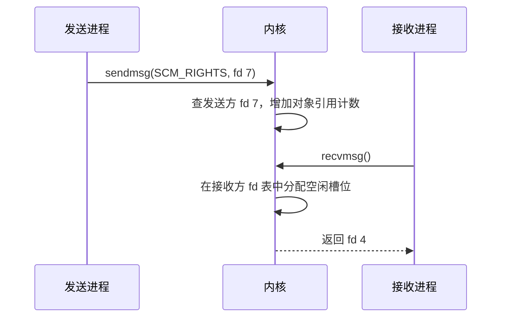

# IPC 机制

- 写作时间：`2026-03-04 首次提交，2026-07-13 最近修改`
- 当前字符：`8791`

[Socket 与 TCP](/network/01-socket-tcp)建立了跨主机通信模型：进程通过套接字 fd 进入内核，TCP 和 IP 再把字节送到远端。两个进程位于同一台机器时，完整 TCP/IP 路径不一定符合需求。父进程可能只想把日志交给子进程，Web 服务器可能要把已接受的连接交给工作进程，`ip` 命令则需要向内核查询网卡和路由信息。这些场景都属于进程间通信，但对数据复制、消息边界、同步和通信对象具有不同要求。

本课先看本机套接字的 **AF_UNIX**，它保留套接字编程模型，却省掉 IP 寻址和网络传输；只传字节还不够时，**文件描述符传递**允许进程把已经打开的文件或连接交给另一个进程；随后把管道、共享内存和套接字放进同一张 **IPC 机制比较**表，明确每种机制真正省掉了什么、又把什么责任交给应用；最后进入 **Netlink**，看用户空间怎样沿着一种专门的消息接口与内核网络子系统通信。

## AF_UNIX

AF_UNIX 套接字是只在同一台主机内通信的套接字；独立创建的端点可以用本地名称互相定位，`socketpair()` 也可以直接创建一对未命名端点。

AF_UNIX 也称 Unix 域套接字(Unix domain socket)。它仍然使用 `socket()`、`bind()`、`listen()`、`accept()`、`connect()`、`send()` 和 `recv()`，所以应用可以复用套接字生命周期；但数据不会经过 IP 路由和网卡驱动，而由内核的本地套接字实现管理。零拷贝(zero-copy)表示数据路径不需要在用户缓冲区与内核缓冲区之间复制，普通 AF_UNIX 发送和接收并不具备这种性质。绕过 TCP/IP 只缩短了协议路径，不等于自动消除数据复制。

AF_UNIX 支持三种常见类型：

| 类型 | 数据语义 | 常见用途 |
|------|----------|----------|
| `SOCK_STREAM` | 可靠、有序字节流，不保留消息边界 | 本地客户端与守护进程、数据库连接 |
| `SOCK_DGRAM` | 保留消息边界；Linux 上本地数据报可靠且保持顺序 | 本地事件和短消息 |
| `SOCK_SEQPACKET` | 可靠、有序并保留消息边界 | 既需要连接状态又需要完整记录的协议 |

端点可以使用文件系统路径，例如 `/run/myservice.sock`。`bind()` 会在该路径创建套接字节点，创建时需要父目录的写和搜索权限；在 Linux 上，连接流式套接字或向数据报套接字发送数据还会检查套接字节点的写权限。进程关闭套接字后，路径不会自动删除，服务通常需要调用 `unlink()` 清理自己留下的旧节点，否则下次 `bind()` 可能得到 `EADDRINUSE`。

Linux 还支持抽象命名空间：`sockaddr_un.sun_path` 的第一个字节为 `\0`，后续由传入地址长度限定的字节组成名称。抽象名称不出现在文件系统中，最后一个引用关闭后自动消失，但文件所有者、权限位和 `umask` 不控制它的访问，而且这种名称是不可移植的 Linux 扩展。

如果两个端点由同一个进程创建，并且稍后会通过 `fork()` 分给父子进程，`socketpair()` 可以一步得到一对已经连接的 AF_UNIX 套接字：

```c
#include <sys/socket.h>

int sv[2];
int rc = socketpair(AF_UNIX, SOCK_STREAM | SOCK_CLOEXEC, 0, sv);
```

调用成功时返回 0，并把两个 fd 写进 `sv[0]` 和 `sv[1]`；失败时返回 -1 并设置 `errno`。[进程生命周期](/process/01-lifecycle)介绍过 `FD_CLOEXEC` 在成功 `exec()` 时关闭 fd，`SOCK_CLOEXEC` 会在创建两个 fd 的同一操作中设置这项标志，避免多线程程序出现“创建完成但标志尚未设置”的泄漏窗口。两端都是全双工的，所以任何一端都能读写。相比之下，普通管道的一个 fd 固定为读端，另一个固定为写端；若要双向通信，通常需要两根管道。

AF_UNIX 的差异不只是本机传输路径更短。它还支持传递文件描述符和内核验证的进程凭据，并能用路径权限限制连接者；这些本机特有语义是守护进程、容器运行时和本地数据库选择它的重要原因。

## 文件描述符传递

文件描述符传递(fd passing)是通过 AF_UNIX 套接字把发送进程引用的内核打开文件对象安装到接收进程文件描述符表中的机制。

这里传递的不是一个普通整数。fd 3 只表示发送进程 fd 表的第 3 个槽位，接收进程自己的 fd 3 可能指向完全不同的对象。真正传递的是[进程生命周期](/process/01-lifecycle)讲过的打开文件描述引用。辅助数据(ancillary data)是与普通消息字节一起发送、但由套接字层单独解释的控制信息；Linux 通过 `sendmsg()` 携带类型为 `SCM_RIGHTS` 的控制消息，接收端再用 `recvmsg()` 取出新 fd。

发送发生时，内核根据发送方整数 fd 找到打开文件描述并增加引用计数。接收时，内核在接收方文件描述符表中选择空闲槽位，把同一打开文件描述的引用安装进去。发送方可能传 fd 7，接收方得到 fd 4；两个编号不同，但语义接近把 `dup()` 执行到另一个进程。文件偏移和文件状态标志在有意义时共享，`FD_CLOEXEC` 这类属于单个 fd 槽位的描述符标志则不共享。



这种能力让进程可以把“接受连接”和“处理连接”拆开。主进程负责监听端口和执行访问控制，接收到客户端连接后，把连接 fd 传给某个工作进程；工作进程不需要重新握手，直接开始读写同一条连接。特权分离也建立在相同机制上：高权限进程打开设备或低端口，低权限进程只接收已经审核过的 fd，因而不必获得更大的全局权限。

接收端通常应给 `recvmsg()` 传入 `MSG_CMSG_CLOEXEC`，让收到的 fd 在安装时就带 `FD_CLOEXEC` 标志，避免后续 `exec()` 把敏感描述符泄漏给新程序。处理完控制消息前，程序还要检查 `MSG_CTRUNC`：这个标志表示接收控制缓冲区过小，部分辅助数据已被截断。对 `SCM_RIGHTS`，内核会自动关闭装不进控制缓冲区或超过接收进程 fd 上限的多余描述符，但应用仍不能把一组不完整 fd 当成完整协议消息；已经成功取出的 fd 在后续校验失败时也必须主动关闭。

凭据有两种常见取得方式。连接建立后，`SO_PEERCRED` 可以读取对端在连接或 `socketpair()` 建立时的 PID、UID 和 GID；接收方启用 `SO_PASSCRED` 后，每条消息还可附带 `SCM_CREDENTIALS`。这些凭据由内核按 AF_UNIX 规则生成或验证，与应用在普通消息体中自行填写的身份字段不同，但授权代码仍要明确选择哪一个时间点和哪一组身份语义。

:::thinking 为什么 SCM_RIGHTS 不能只发送 fd 整数？

假设发送进程把数字 7 当作普通字节发出去。接收进程拿到 7 以后，只能查询自己的 fd 表第 7 项；这个槽位可能空着，也可能指向另一个文件。不同进程的 fd 表彼此独立，所以整数脱离所属进程后没有全局意义。

`SCM_RIGHTS` 让内核参与传递。内核能同时访问两张 fd 表，也能操作打开文件对象的引用计数，因此它可以把“发送方 fd 7 指向的对象”转换成“接收方某个新 fd 指向同一对象”。这不是复制编号，而是跨进程复制一条受内核管理的引用。
:::

## IPC 机制比较

IPC 机制比较是根据数据是否复制、通信方向、消息边界、同步责任和参与进程关系，为具体场景选择进程间通信方式的过程。

管道、AF_UNIX 套接字和共享内存都能让本机进程交换数据，但它们把复制、同步和协议责任放在不同位置。[事件驱动并发](/concurrency/04-event-driven)介绍的背压，是消费者来不及处理时，通信机制限制或暂停生产者继续写入的能力。

| 机制 | 数据路径 | 消息边界 | 双向通信 | 内置同步与背压 | 典型场景 |
|------|----------|----------|----------|----------------|----------|
| 管道 | 普通路径在用户缓冲区与内核管道缓冲区之间复制 | 字节流 | 单根管道单向 | 有，缓冲区满时写端阻塞或返回 `EAGAIN` | shell 流水线、父子进程字节流 |
| AF_UNIX 套接字 | 普通路径在用户缓冲区与内核套接字缓冲区之间复制 | 按套接字类型决定 | 支持 | 有，支持等待、就绪通知和凭据 | 本地服务、工作进程通信、文件描述符传递 |
| 共享内存 | 映射后，进程访问同一组物理页 | 由应用定义 | 支持 | 没有，应用必须设计同步和容量协议 | 大数据量、高频随机访问、共享状态 |

共享内存减少了内核中转复制，但没有自动提供通信协议。两个进程同时修改同一区域会遇到与线程共享内存相同的竞态条件；应用必须用进程共享互斥量、原子变量、[同步原语](/concurrency/02-synchronization)介绍的 futex，或者经过证明的无锁结构建立同步。futex 让无竞争状态主要在用户态检查一个共享整数，只在需要睡眠和唤醒时进入内核。同步不仅要防止同时修改，还要用正确内存序保证消费者不会在数据写完前观察到“已就绪”标志。

共享内存还必须自行定义对象布局、生产和消费索引、容量上限、异常退出恢复与背压。生产者快于消费者时，共享页不会自动阻止覆盖未消费数据；环形队列等结构必须明确“满”的判定以及等待或丢弃策略。减少一次复制，实际换来的是应用自行承担状态机与一致性。

管道和 AF_UNIX 套接字在普通路径中多了内核缓冲区，但内核同时提供睡眠唤醒、容量限制、EOF、错误传播和 `epoll` 就绪通知。管道仍是字节流，不过不超过 `PIPE_BUF` 的单次写入不会与其他写者交错；这项原子性不等于接收端会按每次写入返回一条消息。对于控制消息或中等数据量，现成语义通常比减少复制更重要。只有测量证明复制是主要瓶颈，并且应用能正确承担同步协议时，共享内存才是合理选择。

选择 IPC 时还要看参与关系和载荷类型。[进程生命周期](/process/01-lifecycle)介绍的匿名管道最容易在 `fork()` 前创建，因为子进程会继承 fd；没有亲缘关系的进程可以使用文件系统中的命名管道(named pipe)，但它仍然只有管道语义。AF_UNIX 套接字能通过稳定名称连接无关进程，还能传递 fd 和凭据。

共享内存可以通过 `shm_open()` 创建 POSIX 共享内存对象，通过 `memfd_create()` 创建可传递 fd 的匿名内存文件，或者直接映射普通文件，再由多个进程调用[内存映射](/memory/03-memory-mapping)介绍的 `mmap()` 映射同一对象。状态通知可以使用信号量、futex 或 `eventfd`；`eventfd` 是内核维护的 64 位计数器 fd，写入用于累加事件，读取用于消费计数，并可被 `epoll` 监视。大块数据适合留在共享页中，`eventfd` 只负责通知，避免为了一个就绪标志轮询整个共享区。

## Netlink

Netlink 是 Linux 为用户空间进程与内核子系统之间提供的消息型套接字接口，支持请求响应、完整对象枚举和异步通知。

Netlink 使用 `AF_NETLINK` 地址族，套接字类型通常选择 `SOCK_RAW` 或 `SOCK_DGRAM`，当前 Netlink 本身不依赖两者提供不同报文语义。它不是连接一个内核“服务器进程”；内核子系统直接接收、解析并回复消息，内核端通常用端口标识(port ID)0 表示。`socket()` 的协议参数选择 Netlink 家族，例如 `NETLINK_ROUTE` 管理链路、地址、路由，以及把 IP 地址关联到本地链路地址的邻居项；`NETLINK_KOBJECT_UEVENT` 则传递设备事件。

每条消息以 `struct nlmsghdr` 开头，其中包含消息长度、类型、标志、序列号和发送者端口标识。消息体由具体家族定义，现代通用 Netlink(Generic Netlink)常把字段编码为由类型、长度和值(Type-Length-Value, TLV)组成的可扩展属性。消息必须按 Netlink 对齐规则遍历，不能把接收缓冲区直接强制转换成一个固定 C 结构后忽略长度。

序列号由应用管理，用来把请求、响应和 ACK 对应起来。端口标识区分 Netlink 套接字端点，不应直接等同于进程 PID，因为同一进程可以创建多个 Netlink 套接字。Netlink 支持单播请求响应、多播通知和转储(dump)；转储是一次枚举某类全部对象的多段响应，例如列出所有网卡或路由。

`ip link` 展示了一条具体路径。命令创建 `NETLINK_ROUTE` 套接字，发送 `RTM_GETLINK` 转储请求；内核遍历网络设备，把设备及其属性编码成多条 Netlink 消息返回。网卡状态随后变化时，加入对应多播组的套接字还能异步收到通知。`ip` 不需要解析 `/proc` 文本，也不需要为每种网络对象增加一个新系统调用。

Netlink 应用必须检查消息长度、类型、标志、序列号和端口标识。一次 `recvmsg()` 可能包含多条对齐后的消息，多段响应带 `NLM_F_MULTI`，转储通常以 `NLMSG_DONE` 结束。请求设置 `NLM_F_ACK` 后，ACK 使用 `NLMSG_ERROR` 格式，其中错误码为 0 才表示成功，非零值表示负的 `errno`。任何消息截断、长度越界或序列号不匹配都不能按成功结果继续解析。

Netlink 不是无条件可靠的内核到用户通知通道。接收套接字缓冲区已满或内存不足时，内核可能丢弃消息；应用通常通过 `recvmsg()` 返回 `ENOBUFS` 发现本地视图可能落后，并重新执行转储与内核状态同步。即使没有观察到丢包，内核也可能因对象在遍历期间变化而给转储消息设置 `NLM_F_DUMP_INTR`，表示结果可能不一致，应用此时同样需要重试。多播通知适合增量更新，但不能替代启动时的完整转储和丢失后的重建流程。复杂程序通常使用 libnl、libmnl 等用户态 Netlink 解析库，或者内核提供的 YAML 格式协议规范与生成工具，减少手写长度、对齐和属性校验错误。

Netlink 和 AF_UNIX 都使用套接字 API，但通信模型不同。AF_UNIX 连接两个用户空间端点，名称和权限属于本机 IPC；Netlink 连接用户空间与某个内核接口家族，消息格式由内核导出的用户空间 API 头文件和协议规范定义。套接字统一了创建、发送、接收和等待接口，但消息边界、可靠性、寻址与权限仍由具体协议决定。

## 小结

| 概念 | 说明 |
|------|------|
| AF_UNIX | 只在本机通信的套接字地址族，支持字节流、数据报和顺序分组 |
| 路径名套接字 | 由文件系统路径命名，可利用目录和节点权限控制访问 |
| 抽象命名空间 | Linux 特有的 AF_UNIX 名称，不创建文件系统节点 |
| `socketpair()` | 一次创建两个已经连接的全双工本地套接字 |
| 文件描述符传递 | 通过 `SCM_RIGHTS` 把打开文件对象的引用安装到接收进程 fd 表中 |
| `MSG_CMSG_CLOEXEC` | 在接收 fd 时原子设置 `FD_CLOEXEC`，避免描述符继承竞态 |
| `MSG_CTRUNC` | 表示辅助数据因控制缓冲区不足而被截断，协议不能把结果当作完整消息 |
| 共享内存 | 多进程映射同一组物理页，减少数据复制，但同步和背压由应用负责 |
| `eventfd` | 可由 `epoll` 监视的 64 位计数器 fd，适合为共享内存传递事件通知 |
| Netlink | 用户空间与 Linux 内核子系统之间的消息型套接字接口，通知丢失后需要重新同步 |

IPC 的性能不能只按“复制次数最少”排序。内核缓冲区同时提供了阻塞、唤醒、背压、权限和错误语义；共享内存省掉的数据复制，往往会以应用自行设计同步协议为代价。

---

**接口、源码与文档入口**：
- [`unix(7)`](https://man7.org/linux/man-pages/man7/unix.7.html)：AF_UNIX 地址、类型、权限、fd 与凭据语义
- [`cmsg(3)`](https://man7.org/linux/man-pages/man3/cmsg.3.html)：辅助数据遍历宏
- [`sendmsg(2)`](https://man7.org/linux/man-pages/man2/sendmsg.2.html)：普通消息与控制消息发送接口
- [`pipe(7)`](https://man7.org/linux/man-pages/man7/pipe.7.html)：管道容量、EOF 与 `PIPE_BUF` 原子性
- [`shm_open(3)`](https://man7.org/linux/man-pages/man3/shm_open.3.html)：POSIX 共享内存对象
- [`memfd_create(2)`](https://man7.org/linux/man-pages/man2/memfd_create.2.html)：匿名内存文件
- [`futex(2)`](https://man7.org/linux/man-pages/man2/futex.2.html)：共享整数上的内核等待与唤醒
- [`eventfd(2)`](https://man7.org/linux/man-pages/man2/eventfd.2.html)：计数器通知 fd
- [`netlink(7)`](https://man7.org/linux/man-pages/man7/netlink.7.html)：Netlink 消息、ACK、dump 与丢失检测
- [`net/unix/af_unix.c`](https://github.com/torvalds/linux/blob/master/net/unix/af_unix.c)：AF_UNIX 实现
- [`net/core/scm.c`](https://github.com/torvalds/linux/blob/master/net/core/scm.c)：fd 与凭据控制消息
- [`net/netlink/af_netlink.c`](https://github.com/torvalds/linux/blob/master/net/netlink/af_netlink.c)：Netlink 套接字实现
- [`include/uapi/linux/netlink.h`](https://github.com/torvalds/linux/blob/master/include/uapi/linux/netlink.h)：`nlmsghdr` 与公共标志
- [Introduction to Netlink](https://docs.kernel.org/userspace-api/netlink/intro.html)：现代属性消息、请求与 dump 模型
