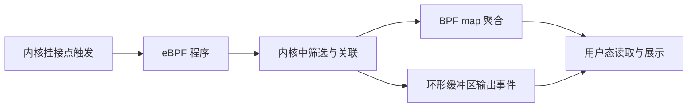

# 性能分析与内核追踪

- 写作时间：`2026-03-04 首次提交，2026-07-13 最近修改`
- 当前字符：`10099`

[虚拟化](/virtualization/01-virtualization)增加了客体、VMM、宿主内核与设备后端等执行层次；[CPU 调度](/process/04-scheduling)中的等待、[同步原语](/concurrency/02-synchronization)中的锁竞争、[虚拟内存](/memory/02-virtual-memory)中的缺页、[I/O 系统](/storage/01-io-system)中的块 I/O、[Socket 与 TCP](/network/01-socket-tcp)中的拥塞和[日志与一致性](/filesystem/03-journal-consistency)中的提交也都可能影响同一次请求。生产服务变慢时，仅凭代码阅读或单条日志无法判断当前机器真正发生了什么。可观测性的任务是把运行状态转换成能够验证假设的证据。

本课先建立 **观测模型**，区分指标、剖析和追踪；**perf** 用硬件计数器与内核事件完成计数和采样；**ftrace** 记录内核函数与预先定义的内核事件；**eBPF** 在事件发生处执行受验证的可编程聚合；最后用 **生产诊断** 把这些能力组成低风险、可复现的排障流程。

## 观测模型

观测模型(observability model)是把系统状态、事件和资源消耗转换成测量结果，并依据测量范围与误差解释运行行为的方法。

性能问题通常先表现为一个结果，例如 P99 延迟从 20 ms 增长到 400 ms、吞吐停止增长或 CPU 使用率升高。P99 是第 99 百分位数，表示 99% 的观测延迟不高于该值，剩余约 1% 更慢。这个结果不能直接说明原因。有效调查要先明确对象和时间窗口，再选择能够区分候选原因的观测类型：

| 观测类型 | 数据形态 | 适合回答的问题 | 主要限制 |
|----------|----------|----------------|----------|
| 指标(metric) | 时间窗口内的计数、速率、分位数或利用率 | 问题何时发生、影响多大、哪个资源异常 | 聚合后通常缺少单次事件因果链 |
| 日志(log) | 程序主动记录的离散消息 | 业务状态、错误上下文和显式决策 | 未埋点路径不可见，文本量可能很大 |
| 剖析(profile) | 周期性样本聚合为函数、栈或资源分布 | 时间主要消耗在哪些代码路径 | 近似分布，低频事件可能漏采 |
| 追踪(trace) | 带时间戳的事件序列及字段 | 某次请求或内核路径按什么顺序发生 | 数据量和运行开销可能很高 |

计数(counting)累计事件总量，例如 CPU 周期、指令、上下文切换和缺页。采样(sampling)每隔一定事件数或时间记录一次指令地址、调用栈和上下文，用有限数据估计总体分布。追踪(tracing)在特定事件实际发生时记录一条数据，例如进程被唤醒、块请求提交或 TCP 重传。三者不是精度从低到高的简单排序，而是回答不同问题。

利用率还必须和饱和度区分。CPU 100% 表示执行资源繁忙，但 CPU 40% 不表示请求没有等待：线程可能阻塞在磁盘、网络、锁或调度队列，单核热点也可能被全机平均值稀释。观察资源时至少要同时检查利用率、等待队列或排队时间、错误数量与完成吞吐。

利用率、饱和度与错误方法(Utilization, Saturation and Errors, USE)把每类资源的起始问题固定为三项：资源有多少时间处于忙碌状态，不能立即服务的工作积压到什么程度，以及发生了多少错误。CPU、内存容量、块设备、网卡和互连都可以逐项检查；某项不适用时也要明确说明，而不是直接跳过。USE 从资源向上排查，适合发现容量瓶颈和硬件异常。

请求速率、错误与持续时间方法(Rate, Errors and Duration, RED)从服务或请求出发，分别检查单位时间请求数、失败请求数或比例，以及请求耗时分布。持续时间应观察分位数或直方图，单个平均值可能掩盖尾延迟。RED 能快速界定用户可见症状，USE 能继续检查支撑服务的资源；二者是选择第一批问题的清单，不会仅凭同时异常就自动证明根因。

测量本身会改变被测系统，这称为观察者效应(observer effect)。高频函数追踪会增加 CPU 与内存带宽消耗，完整调用栈会扩大样本，向终端输出每个事件可能比被测路径更昂贵。生产观测应先使用低成本聚合和有限范围采样，再根据证据缩小到特定进程、CPU、cgroup、函数或事件。

时间范围也属于测量定义。平均 10 分钟的 CPU 利用率可能隐藏持续 100 ms 的队列尖峰，而一次 5 秒采样可能恰好错过每分钟发生一次的停顿。所有证据都应记录开始时间、持续时间、目标范围、采样频率和机器负载，否则不同结果不能直接比较。

## perf

perf 是 Linux 基于 `perf_event_open()` 统一访问硬件性能监控单元和内核软件事件的性能分析工具集。

硬件性能监控单元(Performance Monitoring Unit, PMU)是 CPU 中对周期、指令、缓存未命中和分支预测失败等硬件事件计数的单元。不同处理器提供的原始事件与计数器数量不同，Linux perf events 子系统把硬件计数器、软件计数器、追踪点和动态探针等来源统一成 fd。事件既可以只计数，也可以在溢出时生成采样记录。

`perf stat` 适合先回答“整体资源效率是否异常”。例如 `perf stat -e cycles,instructions,branches,branch-misses,cache-misses -- command` 会在命令运行期间计数。每周期指令数(Instructions per Cycle, IPC)可由 instructions 除以 cycles 得到；这里的 IPC 指处理器指标，不是前面学过的进程间通信。IPC 低并不自动等于缓存问题：分支预测失败、指令前端停顿、数据依赖和后端资源等待都可能降低它。按任务统计时，线程未被调度运行期间硬件计数通常也停止，因此判断 I/O 睡眠时要同时比较总耗时(`elapsed time`)、实际获得 CPU 的时间(`task-clock`)、上下文切换与离开 CPU 的等待证据，而不是直接归因于 IPC。`cache-misses` 等通用事件还会映射到处理器提供的具体 PMU 事件，跨 CPU 比较前必须核对事件定义。

`perf record` 与 `perf report` 组成采样剖析。`perf record -F 99 -g -p PID -- sleep 30` 以目标频率记录进程样本与调用栈，`perf report` 再按符号和栈聚合。若样本主要落在某函数，只能说明采样事件在该函数执行期间经常发生；要判断它消耗 CPU、遭遇 cache miss 还是频繁被调度，需要确认采样事件类型和调用栈模式。

火焰图(flame graph)把聚合后的调用栈画成一层层函数方框。纵轴表示调用栈深度，横轴只是把收集到的栈并排排列，不是时间轴；方框宽度表示包含该函数的样本数量或事件权重。宽框说明所选事件经常落在这条栈上，不自动表示函数单次调用很慢。CPU 样本生成的火焰图突出执行热点，等待事件生成的火焰图突出阻塞路径，因此解读前必须先确认输入事件、采样范围和栈展开方式。

调用栈展开有多种来源。帧指针(frame pointer)展开的额外采样开销较低且结果稳定，但程序必须保留帧指针；基于 DWARF 格式调试信息的栈展开会产生更大的样本；硬件最近分支记录(Last Branch Record, LBR)能在支持的 CPU 上记录近期分支。栈不完整时，剖析结果会把成本归到错误上层，因此构建选项和展开方式是测量配置的一部分。

在 CPU 上剖析(on-CPU profiling)记录线程实际执行时的代码路径，适合定位计算热点；离开 CPU 剖析(off-CPU profiling)关注线程离开 CPU 到再次运行之间的等待栈，适合锁、I/O、定时器和调度等待。服务延迟高但 CPU 不高时，只做 CPU 周期采样往往看不到主要等待，应该转向调度事件、阻塞栈和资源完成事件。

`perf` 还能通过 `perf sched` 分析调度延迟，通过 `perf lock` 分析内核锁事件，通过 `perf trace` 观察系统调用与事件。功能可用性受内核配置和 PMU 支持影响，`perf_event_paranoid` 内核参数还会限制非特权进程可观测的范围。[保护与安全](/security/01-protection-security)介绍过把超级用户权限拆开的 Capabilities；生产环境应优先授予专用于性能观测的 `CAP_PERFMON`，而不是直接提供范围广得多的 `CAP_SYS_ADMIN`。

采样是统计估计。某函数占 20% 样本不意味着每次请求都在其中花费严格 20% 时间；短函数和低频尾延迟事件可能样本不足。提高频率能增加分辨率，也会提高中断、栈收集和数据处理开销。正确做法是延长合理观测窗口、控制目标范围，并用独立事件验证关键结论。

## ftrace

ftrace 是 Linux 内核内置的函数与事件追踪框架，通过 tracefs 配置追踪器、过滤器和每 CPU 环形缓冲区。

tracefs 通常挂载在 `/sys/kernel/tracing`。`current_tracer` 选择追踪器，`set_ftrace_filter` 限制函数集合，`set_ftrace_pid` 限制函数追踪涉及的任务，`set_event_pid` 则限制事件追踪涉及的任务；`trace` 与 `trace_pipe` 分别读取快照或持续消费事件。追踪实例(tracing instance)是拥有独立缓冲区和配置的一套 ftrace 环境；生产调查应建立独立实例，避免和全局追踪相互覆盖配置与数据。

函数追踪器 `function` 在函数入口记录调用，函数图追踪器 `function_graph` 同时记录入口与返回，因此可以显示调用层次和函数持续时间。它们适合回答“这条内核路径实际调用了哪些函数”和“某段函数调用为何耗时”，但追踪所有内核函数会产生巨大数据量。启用前必须先按函数、PID 或 CPU 过滤。

静态追踪点(tracepoint)是内核开发者在特定语义位置显式定义的事件，例如 `sched_switch`、`sched_wakeup`、块请求、系统调用和网络事件。每个追踪点有明确字段格式，关闭时开销很低。与函数名相比，追踪点更适合长期工具，因为内部函数可以重命名或内联，事件语义通常更稳定，但它仍不是不变的用户态 ABI，升级内核后仍要核对字段。

动态探针可以在没有静态追踪点的位置增加观测。内核动态探针 `kprobe` 和 `fprobe` 作用于内核指令或函数，用户态动态探针 `uprobe` 作用于用户程序与共享库。它们提高覆盖面，但依赖当前二进制符号、函数签名和优化结果；升级内核或程序后，探针偏移与参数解释必须重新验证。

ftrace 环形缓冲区按 CPU 保存事件，写入路径尽量避免全局锁。读取记录时要同时看时间戳、CPU、任务 PID 和丢失/覆盖情况。多个 CPU 的事件可以按时钟排序，但“日志显示相邻”不一定表示存在因果关系；唤醒事件与后续调度事件需要用 PID、CPU 和时间关联。

延迟追踪器把常见机制封装成专用调查。`irqsoff` 寻找关闭中断时间最长的区间，`preemptoff` 寻找禁止抢占区间，`wakeup` 关注当前最高优先级任务从唤醒到实际运行的延迟。它们记录最坏区间而不是所有平均行为，适合定位偶发长尾，但启用范围和运行开销仍需评估。

## eBPF

eBPF 是 Linux 让受验证的小程序附着到内核事件，在事件发生处执行筛选、关联与聚合的可编程执行环境。

eBPF 程序附着的位置称为挂接点(hook)。程序不能任意调用内核函数，只能调用内核按程序类型开放的辅助函数(helper)。BPF 映射(BPF map)是保存在内核中的键值或数组状态，用来让多次事件和用户空间共享数据；环形缓冲区则把筛选后的事件连续交给用户空间。

用户空间先通过 `bpf()` 系统调用创建 map、加载程序并取得 fd。验证器(verifier)遍历可能的控制流路径，检查程序能否终止、指针类型与访问边界是否合法，以及栈和辅助函数使用是否符合规则；通过后，程序可以解释执行或由即时编译器(Just-In-Time compiler, JIT)编译成本机指令。验证只说明程序满足内核规定的安全约束，不保证观测逻辑在业务上正确。

追踪场景中的 eBPF 程序可以附着到静态追踪点、更底层的原始追踪点(raw tracepoint)、动态探针、函数入口与出口以及 perf 事件。程序通常在事件发生时提取少量字段，在 map 中按 PID、cgroup、栈或资源键聚合，再只把低频异常或最终聚合结果发送给用户空间。

这种“先在内核过滤”能避免把每个事件都复制到用户空间。例如统计系统调用延迟时，入口程序按线程保存开始时间，出口程序计算差值并直接更新直方图；用户空间只需周期性读取各延迟桶，而不必接收每次调用的两条原始事件。代价是 map 查找、时间读取和栈采样仍会消耗资源，hook 越热，程序必须越短。

BPF 类型格式(BPF Type Format, BTF)描述内核类型信息。一次编译、到处运行(Compile Once, Run Everywhere, CO-RE)让 libbpf 加载库在装载程序时根据目标内核的 BTF 调整结构字段偏移，减少为每个内核版本重新编译的需要。CO-RE 解决类型布局兼容，不保证某个函数、追踪点或语义永远存在；挂接点仍应优先选择稳定接口并检查目标能力。

BPF map 可以采用哈希表、数组、最近最少使用(LRU)表、每 CPU 计数器和栈映射等形式。每 CPU map 让各 CPU 更新自己的副本，减少[同步原语](/concurrency/02-synchronization)中见过的共享缓存行争用，读取时再汇总；全局 map 适合必须共享的关联状态，但要控制容量和同步。环形缓冲区适合把变长事件按顺序交给用户空间，消费者不足时必须记录丢失，而不能默认数据完整。

eBPF 不是“零开销追踪”。在每个网络包、调度事件或内存分配上采集完整栈，仍可能明显改变系统行为。上线前要估算触发频率、单次指令数、map 内存、输出速率和丢失策略，并准备快速卸载程序的控制路径。

## 生产诊断

生产诊断(production diagnosis)是从可复现症状出发，逐层缩小资源与执行路径范围，并用独立证据验证根因的过程。

第一步是把“服务很慢”变成可测量问题：哪个服务、实例、请求类型和时间窗口受到影响；延迟分布、错误率和吞吐怎样变化；是否只发生在某个 CPU、[内核内存](/memory/04-kernel-memory)讲过的 NUMA 节点、磁盘、网卡、容器或虚拟机。没有范围的全机追踪会混合无关工作负载，也难以建立前后对照。

第二步检查资源边界。CPU 看每核利用率、运行队列和调度等待，还要看[cgroups](/process/07-cgroup)的 CPU 配额耗尽后，任务被暂停执行的节流时间；内存看工作集、缺页、回收与交换空间。压力停顿信息(Pressure Stall Information, PSI)统计任务因 CPU、内存或 I/O 资源竞争而无法继续工作的时间比例：`some` 表示至少部分任务停顿，`full` 表示所有非空闲任务同时停顿；系统级 CPU 的 `full` 没有定义并报告为 0。cgroups 的 I/O 控制器已经使用过 IOPS，这里还要同时观察带宽、队列深度和完成延迟；网络看重传、丢包、套接字队列与拥塞窗口。资源高利用且队列增长说明饱和，错误上升可能说明容量或硬件问题，利用率低但等待高则指向阻塞或外部依赖。

[虚拟化](/virtualization/01-virtualization)讲过，客体 vCPU 仍要等待宿主调度。vCPU 窃取时间(steal time)是客体 vCPU 本可运行、却没有获得物理 CPU 的时间，它与客体线程主动睡眠不同；该值升高通常说明宿主正在运行其他任务或 vCPU。

第三步根据候选机制选择证据：

| 候选问题 | 首选观测 | 后续验证 |
|----------|----------|----------|
| CPU 计算热点 | `perf stat` + on-CPU 剖析 | 指令、缓存、分支事件与代码级基准 |
| 调度等待 | `sched_switch` / `sched_wakeup`、off-CPU 剖析 | 运行队列、cgroup CPU 配额、vCPU 窃取时间 |
| 锁竞争 | off-CPU 栈、futex/lock 事件 | 锁持有区间、线程并发度与缓存行争用 |
| 文件 I/O | 块 I/O 追踪点、延迟直方图 | 页缓存命中、写回、队列深度与设备延迟 |
| 网络尾延迟 | TCP 重传、套接字队列、包与系统调用事件 | 往返时延、拥塞、对端处理和软中断调度 |
| 缺页与回收 | 缺页、内存回收、PSI 事件 | 工作集、内存上限、NUMA 与交换空间 |

选定观测后还要关联事件，而不只是看它们是否同时发生。请求延迟峰值与缺页同时出现，并不能证明缺页导致延迟；需要把请求时间、线程 PID、缺页地址或计数、调度状态和完成时间关联，或者在可控环境改变内存上限后观察结果是否按假设变化。[Socket 与 TCP](/network/01-socket-tcp)已经用 RTT 表示报文发出到响应返回的往返时延，诊断时还必须把它与本机排队、对端处理时间区分。根因结论应说明完整机制，而不只是列出相关指标。

:::thinking CPU 利用率不高，为什么请求仍可能很慢？

线程只有实际执行指令时才计入 CPU 利用率。等待磁盘、网络、锁、[同步原语](/concurrency/02-synchronization)讲过的 futex、定时器或 vCPU 调度期间，请求延迟继续增长，CPU 却可以保持空闲。全机平均还会掩盖单核事件循环达到 100% 的情况。

因此下一步不是盲目增加 CPU 采样频率，而是检查每核利用率、运行队列和 off-CPU 时间，再用调度、I/O 或锁事件解释等待区间。观测类型必须与假设中的资源状态匹配。
:::

最后一步是验证修复并保留基线。相同负载、相同时间窗口和相同采样配置下，比较修复前后的延迟分布、吞吐、资源队列与剖析结果；只看到平均值改善不能说明尾延迟已经解决。诊断期间启用的探针、权限和临时 sysctl 内核参数也要撤销，采集数据应避免泄露路径、地址、请求内容和其他租户信息。

工具输出始终要带着边界解释：样本显示的是分布估计，trace 显示的是已启用事件，缺少记录可能表示事件未发生，也可能表示过滤、权限、缓冲区覆盖或符号展开失败。可观测性不是把运行状态完整复制出来，而是在已知误差下收集足以排除错误假设的证据。

## 小结

| 概念 | 说明 |
|------|------|
| 观测模型 | 明确测量对象、时间范围、数据类型、误差与观察者效应 |
| USE / RED | 分别从资源和请求出发选择利用率、排队、错误、速率与耗时等起始问题 |
| perf | 统一访问 PMU、软件计数器和采样事件的 Linux 工具集 |
| 火焰图 | 按调用栈层次展示聚合样本宽度的可视化，不把横轴解释为时间 |
| ftrace | 使用 tracefs、函数追踪器和追踪点记录内核执行事件 |
| eBPF | 在受验证内核程序中筛选、关联和聚合挂接点事件 |
| on-CPU 剖析 | 统计线程实际在 CPU 上执行时的代码路径 |
| off-CPU 剖析 | 统计线程阻塞或等待调度期间的调用栈与持续时间 |
| 生产诊断 | 从症状定界，经资源检查和机制观测，最终用独立实验验证根因 |

性能诊断的核心不是掌握最多工具，而是为每个候选机制选择能够证伪它的测量，并把指标、样本和事件连接成可重复验证的因果链。

---

**文档与源码入口**：
- [`perf_event_open(2)`](https://man7.org/linux/man-pages/man2/perf_event_open.2.html)：计数、采样、PMU 与权限模型
- [Perf tools](https://perfwiki.github.io/main/)：`perf stat`、`record`、`report` 等工具文档
- [Performance Analysis Methodology](https://www.brendangregg.com/methodology.html)：USE、RED 与其他性能调查方法
- [Flame Graphs](https://www.brendangregg.com/flamegraphs.html)：火焰图生成与坐标含义
- [ftrace](https://www.kernel.org/doc/html/latest/trace/ftrace.html)：函数追踪器、tracefs 与过滤器
- [Event Tracing](https://www.kernel.org/doc/html/latest/trace/events.html)：静态 tracepoint 与事件过滤
- [Perf security](https://www.kernel.org/doc/html/latest/admin-guide/perf-security.html)：`perf_event_paranoid`、Capabilities 与观测权限
- [`bpf(2)`](https://man7.org/linux/man-pages/man2/bpf.2.html)：BPF 对象、程序和 map 系统调用接口
- [libbpf CO-RE](https://www.kernel.org/doc/html/latest/bpf/libbpf/libbpf_overview.html)：BTF 与跨内核类型重定位
- [PSI](https://www.kernel.org/doc/html/latest/accounting/psi.html)：CPU、内存与 I/O 压力停顿信息
- [`kernel/trace/`](https://github.com/torvalds/linux/tree/master/kernel/trace) / [`kernel/bpf/`](https://github.com/torvalds/linux/tree/master/kernel/bpf)：ftrace 与 eBPF 内核实现

理论部分到这里形成了完整闭环：进程、内存、I/O、文件系统、安全和虚拟化不仅能够解释，也能够用运行证据验证。后续项目课会把这些机制落实到 zish、zedis、zcryptfs 和 zigos 的设计、实现与验收中。
