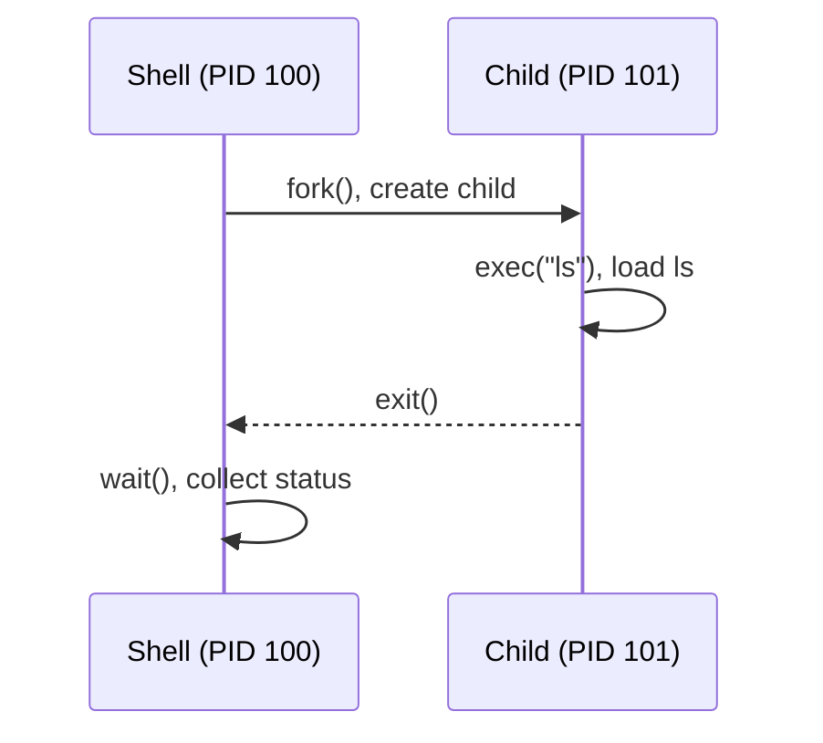

# 进程生命周期

- 写作时间：`2026-02-27 首次提交，2026-07-13 最近修改`
- 当前字符：`18215`

完成[系统调用](/basics/04-system-call)的学习后，我们已经知道用户程序怎样请求内核服务。接下来的问题是：用户程序本身以什么形式被内核管理，又怎样从创建走到退出？这正是进程管理要解释的第一条主线。

机器启动后，内核不会直接执行 `ls` 这样的用户命令。它先完成自身初始化，再启动 PID 为 1 的用户态进程。前面已经从 `ps` 输出认识了 PID，这里进一步明确：它是内核区分进程的数字编号。PID 1 继续启动系统服务或登录环境，最终才有 shell 在终端里等待命令。整条链路可以先写成：`kernel -> PID 1 -> 登录环境 -> shell -> ls`。

当 shell 启动 `ls` 时，通常要依次完成三件事：

1. 用 `fork()` 创建子进程
2. 在子进程中用 `exec()` 加载 `ls`
3. 用 `wait()` 等待并取得子进程的退出状态



再看 `ls | grep .zig`。两个命令同时运行，`ls` 的输出成为 `grep` 的输入。shell 仍然使用同一组进程操作，只是在 `exec()` 之前改变了子进程的文件描述符连接方式。

本课先定义内核管理的**进程**，再说明系统启动阶段的 **PID 1**。随后沿着 **fork**、**exec**、**wait** 走完一个子进程的创建、程序替换与状态回收，最后用**重定向与管道**解释 shell 怎样连接文件和多个进程。

这一章会沿着同一条主线继续推进。进程需要接收异步事件，于是有了**信号**；多个相关进程需要共同使用终端，于是有了**进程组与会话**；多个可运行进程争用 CPU，则需要**CPU 调度**和 **Linux 调度器**。最后再用**命名空间**与 **cgroups**解释 Linux 怎样隔离并限制一组进程。

## 进程

进程是一个正在执行的程序实例，以及内核为这次执行维护的状态与资源集合。

程序(program)通常是磁盘上的可执行文件，例如 `/usr/bin/ls`。它包含指令和初始数据，但没有“当前执行到哪里”这样的运行状态。同一个程序可以同时执行多次，每次执行都是不同进程，拥有不同 PID、虚拟地址空间和文件描述符表。

进程控制块(Process Control Block, PCB)是操作系统教材对“内核中的进程记录”的通用称呼。Linux 没有一个名为 `PCB` 的类型，而是为每个可调度任务维护 `struct task_struct`。可调度任务(task)是能够被调度器安排到 CPU 上执行的一条指令流。

线程(thread)是进程内部的一条执行流。单线程进程通常对应一个 task；多线程进程则对应一组 task，它们共享同一地址空间和其他进程资源。由此更准确的说法是：Linux 用 `task_struct` 统一表示每条可调度执行流，再通过线程组和共享的资源结构表达“同一进程中的多个线程”。

本课只需要关注 `task_struct` 记录或引用的四类信息：

| 类别 | 例子 | 用途 |
|------|------|------|
| 身份 | task ID、线程组 ID | 区分任务与进程 |
| 执行状态 | 可运行、睡眠、退出状态 | 判断任务当前能否占用 CPU |
| 亲属关系 | 父任务、子任务列表 | 支持父进程取得子进程状态与重新指定父进程 |
| 资源引用 | 地址空间、文件描述符表、凭据 | 找到任务正在使用的内核对象 |

:::expand pid 与 tgid
Linux 内核中的每个 task 都有自己的 ID；同一进程中的 task 又组成线程组，并共享一个线程组 ID：

```
进程（主线程）: pid=100, tgid=100
  ├── 线程 1:   pid=101, tgid=100
  └── 线程 2:   pid=102, tgid=100
```

| 用户态 API | 返回的内核字段 | 含义 |
|-----------|--------------|------|
| `getpid()` | `tgid` | 进程 ID（线程组共享） |
| `gettid()` | `pid` | 线程 ID（每个 task 唯一） |
:::

每个进程还拥有自己的虚拟地址空间(virtual address space)。虚拟地址空间是进程可以使用的地址范围及其映射关系，不等同于一段连续的物理内存。一个典型用户进程会在其中安排以下区域：

```
High Address
┌──────────────────┐
│      Stack       │ ← 函数调用帧与局部变量
│        ↓         │   栈大小向低地址方向增加
│                  │
│        ↑         │   堆大小向高地址方向增加
│       Heap       │ ← 动态分配区域
├──────────────────┤
│       BSS        │ ← 未显式初始化的全局与静态变量
├──────────────────┤
│       Data       │ ← 已初始化的全局与静态变量
├──────────────────┤
│       Text       │ ← 可执行指令，通常不可写
└──────────────────┘
Low Address
```

图中的增长方向描述的是区域大小怎样变化，不表示每次分配都会得到物理上相邻的内存。具体映射机制会在内存管理章节展开。

进程从创建到退出会经历若干状态。下面使用“就绪、运行、睡眠、僵尸”建立最小状态模型：

```
              fork()
                │
                ▼
          ┌───────────┐  scheduled   ┌───────────┐
          │   Ready   │ ──────────→  │  Running  │
          │           │              │           │
          │           │  ←────────── │           │
          └───────────┘  time slice  └─────┬─────┘
                          expired      │       │
                               wait    │       │ exit()
                              for I/O  │       │
                                       ▼       ▼
                                 ┌───────────┐ ┌───────────┐
                                 │ Sleeping  │ │  Zombie   │
                                 │           │ │           │
                                 └─────┬─────┘ └─────┬─────┘
                                       │             │
                                  I/O complete  parent wait()
                                       │             │
                                       ▼             ▼
                                  back to Ready  status collected,
                                                 record removed
```

:::thinking "就绪"到底是什么意思？
就绪(ready)表示任务已经具备继续执行的条件，但当前没有占用 CPU。Linux 通常用 `TASK_RUNNING` 同时覆盖“正在运行”和“可运行但正在排队”两种情况，调度器再根据任务是否当前占用 CPU 区分它们。

任务可以从多条路径进入就绪状态：刚创建的子任务会变得可运行；正在运行的任务被抢占后会重新排队；等待 I/O、定时器或锁的任务在条件满足后也会被唤醒。由此，就绪并不意味着任务此前一定处于睡眠，只表示它现在不再等待 CPU 以外的条件。
:::

- **就绪到运行**：调度器选中任务，CPU 开始执行它的指令
- **运行到就绪**：任务被抢占、主动让出 CPU，或可用执行时间结束
- **运行到睡眠**：任务等待 I/O、定时器、锁或其他事件
- **睡眠到就绪**：等待条件满足，内核唤醒任务
- **运行到僵尸**：进程退出，父进程尚未取得其退出状态
- **僵尸到消失**：父进程取得状态，内核删除剩余的进程记录

:::expand 上下文切换的开销
上下文切换是 CPU 停止执行一个任务并开始执行另一个任务的过程。内核必须保存前一个任务继续运行所需的寄存器状态，再恢复后一个任务的状态。

若两个任务属于不同进程，内核通常还要切换地址空间。CPU 会缓存近期的虚拟地址翻译结果，现代硬件还可以给缓存项附带地址空间标签，因此切换地址空间不一定清空全部翻译缓存。即便如此，新任务的数据和指令也可能不在当前核心的缓存中，所以切换成本既包含内核执行的直接工作，也包含后续缓存未命中的间接影响。[CPU 调度](/process/04-scheduling)会正式引入相关硬件名称，并继续分析这些成本与测量边界。
:::

僵尸进程(zombie process)是已经结束执行，但退出状态尚未被父进程取得的进程。退出时，内核已经释放其地址空间、文件描述符等大部分资源，只保留 PID、退出状态和少量记账信息，等待父进程取得。父进程长期不处理子进程状态，会使这些有限但不可忽略的记录持续累积。

## PID 1

PID 1 是每个 PID 命名空间中的第一个进程，也是该命名空间默认的子进程回收者。

在系统启动时，内核会在初始 PID 命名空间中启动第一个用户态进程。PID 命名空间是一个独立的进程编号视图，同一进程在嵌套命名空间中可以有不同 PID；这里先用它解释为什么宿主机和容器都能各自看见 PID 1，完整机制将在命名空间课程中展开。

现代 Linux 发行版的初始 PID 1 通常是 `systemd` 或其他 init 实现。容器可以创建新的 PID 命名空间，并直接把应用作为其中的 PID 1。课程容器启动 `bash` 作为入口，所以观察到的是：

```console
root@hands-on-os:/project# ps aux | head -2
USER       PID %CPU %MEM    VSZ   RSS TTY      STAT START   TIME COMMAND
root         1  0.0  0.0 289680  7216 pts/0    Ss   16:48   0:00 bash
```

宿主系统中的 `systemd` 没有消失，只是位于容器可见范围之外。反过来，容器中的 `bash` 必须承担该命名空间 PID 1 的职责，包括处理失去原父进程的后代。

父进程退出而子进程仍在运行时，内核会为子进程重新指定父进程。简化模型常说“交给 PID 1”，Linux 的完整规则是优先交给最近的存活子收割者(child subreaper)；如果没有这样的进程，再交给该 PID 命名空间的 child reaper，通常就是 PID 1。child subreaper 是主动声明愿意接收后代进程的用户态进程，服务管理器和容器运行时可以利用它集中回收子进程。

## fork

`fork()` 创建调用进程的子进程，使父子进程从同一个程序位置继续执行，并得到不同的返回值。

可移植操作系统接口(Portable Operating System Interface, POSIX)规定了 Unix-like 系统共同遵循的一组程序接口。POSIX 的 `fork()` 只接收隐含的“当前进程”，不接收要运行的新程序：

```c
pid_t fork(void);
```

调用成功时，父进程得到子进程 PID，子进程得到 `0`；失败时，父进程得到 `-1`，同时设置 `errno`，并且不会创建子进程。假设 shell 的 PID 是 100，新建子进程的 PID 是 101：

```
fork() 之前：
  内存里只有一个进程（PID 100），正在运行 shell 的代码

fork() 执行：
  内核创建 PID 101，并复制或共享规定的进程状态
  PID 101 仍执行 shell 的代码，从 fork() 返回处继续

fork() 返回：
  PID 100 的 fork() 返回 101  -> pid = 101
  PID 101 的 fork() 返回 0    -> pid = 0
```

父子进程根据返回值进入不同分支，因此常把这个行为概括为“一次调用，两次返回”：

```c
pid_t pid = fork();

if (pid == -1) {
    /* fork failed */
} else if (pid == 0) {
    /* child process */
} else {
    /* parent process; pid identifies the child */
}
```

子进程仍然在执行 shell 的代码。它进入子进程分支后，通常立即调用 `exec()` 加载目标程序；在调用成功之前，它还不是 `ls`。

“复制进程”描述的是父子进程看到的初始状态，不是把父进程占用的每个物理字节立刻复制一遍。父子进程拥有彼此独立的虚拟地址空间，初始内容相同；修改普通变量只影响修改方。文件描述符表也各自独立，关闭子进程中的 fd 不会删除父进程的对应槽位。不过，对应槽位初始指向同一个打开文件描述(open file description)，所以父子进程会共享文件偏移和文件状态标志。

写时复制(Copy-on-Write, COW)是延迟复制父子进程私有内存页的机制。页(page)是内核和硬件管理内存映射的固定大小单位，x86-64 Linux 常用的基础页大小是 4 KiB；页表记录虚拟页到物理页帧的映射。

`fork()` 时，内核为子进程建立页表，并让父子进程的私有映射暂时引用同一批物理页。原本可写的私有页会受到写保护：

```
after fork():
┌──────────────────┐     ┌──────────────────┐
│     Parent       │     │      Child       │
│ page table ──────┼──┬──┼────── page table │
└──────────────────┘  │  └──────────────────┘
                      ▼
            ┌────────────────────────┐
            │ shared physical page   │
            │ write-protected for COW│
            └────────────────────────┘

kernel copies the page only when either side writes.
```

一方首次写入仍被双方共享的 COW 页时，CPU 触发页故障(page fault)。页故障表示当前内存访问无法按现有页表权限完成。内核识别出这是合法的 COW 写入后，通常执行以下操作：

1. 分配一页新的物理内存
2. 复制原页内容
3. 让写入方的映射指向新页并恢复写权限
4. 保持另一方仍指向原页

没有发生写入的私有页可以继续共享。典型的 `fork()` 加 `exec()` 路径因此通常不需要复制父进程的大部分数据页，但 `fork()` 仍要创建任务结构、复制页表和其他内核元数据。父进程地址空间越大，页表处理越多；父子进程后续写入越多，COW 复制越多。因此 COW 降低了成本，但不能把 `fork()` 视为零开销操作。

## exec

exec 函数族用新程序映像替换当前进程的程序映像，同时保留这个进程的 PID。

程序映像(process image)包含当前执行的代码、数据、堆、栈以及地址映射。`execve()` 是 Linux 上完成这项工作的系统调用，`execl()`、`execvp()` 等 libc 函数是在它之上提供不同参数形式的接口。成功后，CPU 开始执行新程序的入口，旧程序的下一行代码不会再执行；只有调用失败时 exec 函数才返回 `-1` 并设置 `errno`。

```c
#include <unistd.h>

int main(void) {
    char *argv[] = { "ls", "-l", NULL };

    execvp("ls", argv);  /* success: never returns */
    return 1;            /* reached only on error */
}
```

exec 函数名的后缀说明参数形式和路径处理方式：

| 字母 | 含义 |
|------|------|
| `l` | 参数以可变参数列表(list)传入 |
| `v` | 参数以数组（vector）传入，对应 C 的 `char *argv[]` |
| `p` | 按 PATH 搜索命令（不带 `p` 的版本要求传绝对路径） |
| `e` | 显式传环境变量（environment），不带 `e` 的版本继承当前环境 |

常见接口及其标准归属如下：

| 函数 | 特点 | 标准 |
|------|------|------|
| `execve` | 直接传路径、`argv` 和 `envp` | POSIX |
| `execvp` | 传 `argv`，并按 `PATH` 搜索命令 | POSIX |
| `execvpe` | 传 `argv` 与 `envp`，并搜索 `PATH` | GNU 扩展 |

exec 会保留 PID、父子关系和当前工作目录等进程属性。已打开的文件描述符默认也会保留；只有设置了 close-on-exec 标志(`FD_CLOEXEC`)的 fd 才会在成功加载新程序时自动关闭。shell 正是利用“fd 可以跨 exec 保留”这一点，先改变标准输入或标准输出所引用的对象，再加载目标命令。

:::thinking fork 和 exec 为什么是两个独立的系统调用，而不是一个 create_process("ls", args) 一步到位？
Unix 把“创建子进程”和“加载新程序”拆成两个操作，使调用者可以在两者之间执行普通系统调用。考虑 shell 实现 `ls > output.txt`：它需要先在子进程中打开文件、调整 fd，再加载 `ls`。

这里的 `dup2(fd, 1)` 会把标准输出所在的 fd 1 改为引用刚打开的文件；随后关闭原来的 `fd`，fd 1 仍然保留这份引用。重定向与管道一节会在文件描述符表中完整画出这个变化。

```c
pid_t pid = fork();

if (pid == 0) {
    int fd = open("output.txt", O_WRONLY | O_CREAT | O_TRUNC, 0644);

    dup2(fd, 1);           /* stdout now refers to output.txt */
    close(fd);             /* the original descriptor is redundant */
    chdir("/tmp");

    execlp("ls", "ls", "-l", (char *)NULL);
    _exit(127);            /* exec failed */
}
```

如果把这些配置都塞进单个“创建并运行”接口，接口必须预先为工作目录、fd、凭据等每种需求设计参数。fork 与 exec 分离后，中间区域本身就是可组合的配置接口。代价是多线程程序必须谨慎限制 fork 后、exec 前能够安全执行的操作。`posix_spawn()` 则把常见的创建、fd 配置与程序加载组合交给 C 库和内核实现，可以避免应用自己暴露这段敏感区间。
:::

fork 和 exec 也可以独立使用。预创建工作进程的服务器可以只调用 fork，让子进程继续执行同一份服务器代码；启动脚本则可以只调用 exec，在设置环境后用真实服务替换自身。容器入口脚本末尾常见的 `exec "$@"` 就属于后一种情况，它使容器中的 PID 1 直接成为目标程序，而不是额外保留一层等待中的 shell。

## wait

`waitpid()` 等待符合条件的子进程发生状态变化，并把该状态报告给父进程。

本课使用 `options = 0`，此时 `waitpid()` 等待指定子进程终止：

```c
pid_t waitpid(pid_t pid, int *wstatus, int options);
```

调用成功时，它返回发生变化的子进程 PID，并把编码后的状态写入 `wstatus`。调用失败时返回 `-1` 并设置 `errno`。`WIFEXITED()`、`WEXITSTATUS()` 等宏负责解释状态值，程序不应自行猜测其中的位布局。

```c
#include <stdio.h>
#include <sys/types.h>
#include <sys/wait.h>
#include <unistd.h>

int main(void) {
    pid_t pid = fork();

    if (pid == -1) {
        return 1;
    }

    if (pid == 0) {
        char *argv[] = { "ls", NULL };
        execvp("ls", argv);
        _exit(127);
    }

    int status;
    if (waitpid(pid, &status, 0) == -1) {
        return 1;
    }

    if (WIFEXITED(status)) {
        printf("child exit code = %d\n", WEXITSTATUS(status));
    }

    return 0;
}
```

子进程中的 `execvp()` 只有失败才会返回。失败路径调用 `_exit(127)`，直接终止子进程，避免用普通 `exit()` 再次刷新从父进程继承的用户态 I/O 缓冲区。

这条等待路径完成三件事：

1. **取得状态**：父进程判断子进程是正常退出，还是因其他事件结束
2. **删除僵尸记录**：消费退出状态后，内核可以释放剩余的 PID 与记账信息
3. **进程同步**：前台命令结束前，shell 暂不显示下一次输入提示符

子进程执行退出流程时，内核会关闭其 fd、释放地址空间并处理其他大部分资源，然后保留退出状态等少量信息。只要这些信息还没有被 wait 系列调用消费，该进程就是僵尸。孤儿进程(orphan process)则是原父进程已经退出、自己仍可能继续运行的进程；它会按 PID 1 一节所述规则获得新的父进程。孤儿与僵尸描述的是两种不同情况，不能混为一谈。

:::thinking waitpid 怎么跨进程等到子进程退出？
等待队列(wait queue)是内核记录“哪些任务正在等待某个条件”的数据结构。`waitpid()` 不是反复占用 CPU 查询子进程，而是按以下顺序工作：

1. 内核扫描调用进程的子进程，检查是否已有符合条件的状态
2. 如果子进程仍在运行，父进程加入等待队列并进入可中断睡眠，让出 CPU
3. 子进程执行 `do_exit()` 时释放主要资源、保存退出状态、进入僵尸状态，并唤醒父进程所在的等待队列
4. 父进程重新运行后再次检查条件，复制退出状态到用户空间，再由 `release_task()` 删除剩余记录

子进程状态变化时，内核通常还会向父进程产生 `SIGCHLD`。前面已经见过信号这种异步通知，[信号](/process/02-signal)会继续解释它的产生与处理。这里的关键是：父子进程不需要直接读写彼此的内存，亲属关系、退出状态和等待队列都由内核维护。
:::

到这里，`fork()`、`exec()`、`wait()` 已经完成子进程的创建、程序加载和状态回收。shell 还要决定新程序从哪里读取数据、把结果写到哪里，这需要重定向与管道。

## 重定向与管道

重定向与管道是 shell 通过重新连接文件描述符，改变进程输入与输出去向的机制。

文件描述符是进程用来引用已打开内核对象的非负整数，也是进程文件描述符表(file descriptor table)的槽位编号。fd 表属于进程；每个已占用槽位引用一个打开文件描述，后者保存文件偏移、访问模式和状态标志，并进一步关联普通文件、终端或管道等对象。

fd 0、1、2 分别约定为标准输入(stdin)、标准输出(stdout)和标准错误(stderr)。这些名称是用户态约定：程序通常从 fd 0 读取普通输入，向 fd 1 输出结果，向 fd 2 输出诊断信息。它们初始常连接终端，但 shell 可以在启动程序前改接到其他对象。

```
Process file descriptor table
┌────┬──────────────────────┐
│ 0  │  → /dev/pts/0        │  ← stdin
├────┼──────────────────────┤
│ 1  │  → /dev/pts/0        │  ← stdout
├────┼──────────────────────┤
│ 2  │  → /dev/pts/0        │  ← stderr
├────┼──────────────────────┤
│ 3  │  → /home/user/a.txt  │
├────┼──────────────────────┤
│ 4  │  (free)              │
└────┴──────────────────────┘
```

重接 fd 主要依赖下面四个操作。

**`open(path, flags, ...)`** 创建或取得一个打开文件描述，再让当前进程 fd 表中编号最小的可用槽位引用它。上图中如果成功打开 `b.txt`，返回 fd 4；失败则返回 `-1` 并设置 `errno`。

**`close(fd)`** 解除该槽位的引用，使 fd 编号可以再次使用。只有最后一个引用消失后，对应的打开文件描述才会被释放。

**`dup(old_fd)`** 新建一个 fd，让编号最小的可用槽位引用 `old_fd` 对应的同一个打开文件描述。上图执行 `dup(3)` 会返回 fd 4；随后 fd 3 和 fd 4 都通过同一个打开文件描述访问 `/home/user/a.txt`。

**`dup2(old_fd, new_fd)`** 允许调用者指定目标槽位。上图执行 `dup2(3, 4)` 后，原本空闲的 fd 4 也引用 `/home/user/a.txt` 的打开文件描述；如果 fd 4 已占用，`dup2()` 会以原子方式关闭原引用并完成替换。

这些操作既不复制文件内容，也不重新打开文件。多个 fd 引用同一个打开文件描述时，会共享文件偏移和文件状态标志；每个 fd 自身的 close-on-exec 标志仍属于对应 fd 槽位。

重定向(redirection)就是让约定 fd 改为引用另一个打开文件描述。shell 执行 `ls > output.txt` 时，子进程的核心步骤是：

```c
fork();
/* In the child process; error handling omitted. */
int fd = open("output.txt", O_WRONLY | O_CREAT | O_TRUNC, 0644);
dup2(fd, 1);                 /* stdout now refers to output.txt */
close(fd);                   /* the original descriptor is redundant */
execlp("ls", "ls", (char *)NULL);
```

如果先 `close(1)` 再 `open(...)`，新文件通常也会占用编号最小的空闲槽位 1。但是 `open()` 与 `dup2()` 的组合显式指定目标，能够统一表达文件重定向、`2>&1` 和管道连接，也避免让正确性依赖两次调用之间 fd 1 始终空闲。

`ls` 不需要知道这次重定向。它仍调用 `write(1, ...)`，但此时 fd 1 引用的是 `output.txt`，数据因此进入文件。fd 抽象把“程序向哪个编号写”与“编号当前连接什么对象”分离开来。

当 shell 要把一个进程的输出接到另一个进程的输入时，目标对象从普通文件变成管道，fd 重接机制本身不变。

管道(pipe)是由内核维护的单向字节流，通过读端 fd 和写端 fd 访问。读端按照内核接受字节的先后顺序取得数据，但字节流本身不记录每次 `write()` 的消息边界。多个进程同时写入时，不超过 `PIPE_BUF` 字节的单次 `write()` 不会与其他写入交错；更大的写入可能被拆分，并与其他写入的字节交错。

管道常与 `fork()` 组合实现父子进程通信。子进程得到父进程 fd 表的副本，因此父子双方起初都持有管道的读端和写端。两张 fd 表彼此独立，但相应槽位引用同一组管道端对象：子进程关闭自己的 fd 3 不会清空父进程的 fd 3，只会减少一个引用。

```text
fork() 之后：

父进程 fd 表             内核对象              子进程 fd 表
fd 0 ───────────────┐                     ┌─────────────── fd 0
fd 1 ───────────────┼──→ 终端从端 ←────────┼─────────────── fd 1
fd 2 ───────────────┘                     └─────────────── fd 2
fd 3 ─────────────────→ 管道读端 ←──────────────────────── fd 3
fd 4 ─────────────────→ 管道写端 ←──────────────────────── fd 4

两张 fd 表彼此独立，相应槽位引用同一批内核对象。
```

`pipe()` 的 POSIX 接口长这样：

```c
int pipe(int pipefd[2]);
```

返回类型 `int` 表示调用状态，不表示某个 fd：成功返回 `0`，失败返回 `-1` 并设置 `errno`。调用者先提供至少包含两个元素的数组，调用成功后，内核把两个 fd 写入数组：

- `pipefd[0]` 是读端(read end)
- `pipefd[1]` 是写端(write end)

`pipe()` 刚返回时，两个 fd 都属于调用进程。随后调用 `fork()`，父子进程各自继承读端和写端；再分别关闭不需要的端，就能建立单向的进程间数据通道。管道也能在一个进程内部使用，但 shell 管道依赖的正是这条继承路径。

内核根据所有进程仍持有的管道端引用判断数据流是否结束。关闭一个 fd 只移除一个引用，不代表其他进程中的同类管道端也已关闭。

**所有写端引用关闭后**，读端的 `read()` 在取完缓冲区剩余字节后返回 0。这个返回值表示文件结束(End of File, EOF)，也就是不会再有新字节到达。

**所有读端引用关闭后**，继续 `write()` 会产生 `SIGPIPE` 信号，其默认处置是终止进程；如果进程忽略或捕获该信号，`write()` 返回 `-1` 并把 `errno` 设为 `EPIPE`。

这两条规则决定了 shell 必须关闭自己不用的管道端。如果父进程仍保留写端，即使真正的写入进程已经退出，读取进程也无法得到 EOF，整条命令可能一直等待。

把 `fork()`、`exec()`、fd 与管道组合起来，shell 执行 `ls | grep .zig` 的核心步骤如下。代码省略了错误处理，只保留 fd 连接过程：

```c
int pipe_fds[2];
pipe(pipe_fds);

pid_t pid1 = fork();
if (pid1 == 0) {
    close(pipe_fds[0]);                 /* ls does not read from the pipe */
    dup2(pipe_fds[1], 1);               /* stdout refers to the write end */
    close(pipe_fds[1]);                 /* original descriptor is redundant */
    execl("/bin/ls", "ls", (char *)NULL);
    _exit(127);
}

pid_t pid2 = fork();
if (pid2 == 0) {
    close(pipe_fds[1]);                 /* grep does not write to the pipe */
    dup2(pipe_fds[0], 0);               /* stdin refers to the read end */
    close(pipe_fds[0]);                 /* original descriptor is redundant */
    execl("/bin/grep", "grep", ".zig", (char *)NULL);
    _exit(127);
}

close(pipe_fds[0]);                     /* parent uses neither end */
close(pipe_fds[1]);                     /* otherwise grep cannot get EOF */
waitpid(pid1, NULL, 0);
waitpid(pid2, NULL, 0);
```

用 ls 子进程的视角，逐步看 fd 表发生了什么变化：

```
1. fork() 之后，子进程继承了父进程的 fd 表：

   fd 0 → tty (stdin)
   fd 1 → tty (stdout)          ← ls 会往这里写
   fd 2 → tty (stderr)
   fd 3 → pipe 读端文件对象      ← pipe() 创建的
   fd 4 → pipe 写端文件对象      ← pipe() 创建的

2. close(pipe_fds[0])，关掉读端（ls 只需要写）：

   fd 0 → tty (stdin)
   fd 1 → tty (stdout)
   fd 2 → tty (stderr)
   fd 3 → [空]
   fd 4 → pipe 写端文件对象

3. dup2(pipe_fds[1], 1)，把 fd 1 指向 fd 4 所指的文件对象：

   fd 0 → tty (stdin)
   fd 1 → pipe 写端文件对象      ← 原来指向 tty，现在指向管道写端
   fd 2 → tty (stderr)
   fd 3 → [空]
   fd 4 → pipe 写端文件对象      ← 和 fd 1 指向同一个对象

4. close(pipe_fds[1])，关掉原来的 fd 4（fd 1 已经指向写端了，fd 4 多余）：

   fd 0 → tty (stdin)
   fd 1 → pipe 写端文件对象      ← ls 往 fd 1 写，数据就进了管道
   fd 2 → tty (stderr)
   fd 3 → [空]
   fd 4 → [空]
```

从 fd 表的变化可以直接得到结果：shell 把 `ls` 的 fd 1 从 tty 改接到管道写端，再把 `grep` 的 fd 0 从 tty 改接到管道读端。`ls` 仍然调用 `write(1, ...)`，数据进入管道；`grep` 仍然调用 `read(0, ...)`，数据来自管道而不是键盘。

每个 close 都有原因：

| 谁 | 关闭什么 | 原因 |
|----|---------|------|
| ls | 读端 | ls 只写不读 |
| ls | 写端原 fd | dup2 后 stdout 已经是写端，原 fd 多余 |
| grep | 写端 | grep 只读不写 |
| grep | 读端原 fd | dup2 后 stdin 已经是读端，原 fd 多余 |
| shell | 读端 + 写端 | 父进程不参与管道数据传输；不关写端，grep 等不到 EOF |

这就是 `ls | grep .zig` 的完整连接机制。shell 没有改变 `ls` 或 `grep` 的读写代码，只改变了两个程序启动时的 fd 表。

## 小结

| 概念 | 说明 |
|------|------|
| 进程 | 正在执行的程序实例，以及内核维护的状态与资源集合 |
| `task_struct` | Linux 表示一条可调度执行流的核心结构 |
| 进程状态 | 就绪、运行、睡眠和僵尸构成的最小生命周期模型 |
| PID 1 | PID 命名空间中的第一个进程和默认 child reaper |
| `fork()` | 创建从同一程序位置继续执行的子进程 |
| COW | 让父子进程先共享私有物理页，发生写入时再建立私有副本 |
| exec 函数族 | 用新程序映像替换当前进程，成功后不返回旧程序 |
| `waitpid()` | 等待子进程状态并消费退出信息，删除剩余僵尸记录 |
| fd | 进程 fd 表中引用已打开内核对象的非负整数 |
| `dup2()` | 让指定 fd 槽位引用另一个 fd 的打开文件描述 |
| 管道 | 通过读端和写端 fd 访问的内核单向字节流 |

shell 启动命令的核心不是一个不可分割的“运行”操作，而是一条可组合链路：`fork()` 建立子进程，fd 操作配置数据流，exec 加载目标程序，`waitpid()` 最终取得状态并完成回收。

---

**Linux 源码入口**：
- [`kernel/fork.c`](https://elixir.bootlin.com/linux/latest/source/kernel/fork.c)：`copy_process()`，fork 的核心实现
- [`fs/exec.c`](https://elixir.bootlin.com/linux/latest/source/fs/exec.c)：`do_execveat_common()`，exec 的核心实现
- [`kernel/exit.c`](https://elixir.bootlin.com/linux/latest/source/kernel/exit.c)：`do_exit()` / `do_wait()`，退出与回收
- [`fs/pipe.c`](https://elixir.bootlin.com/linux/latest/source/fs/pipe.c)：`do_pipe2()`，管道创建
- [`fork(2)`](https://man7.org/linux/man-pages/man2/fork.2.html)：fork 的接口、继承规则与 COW 说明
- [`exec(3)`](https://man7.org/linux/man-pages/man3/exec.3.html)：exec 函数族及标准归属
- [`wait(2)`](https://man7.org/linux/man-pages/man2/wait.2.html)：等待状态与僵尸进程语义
- [`pipe(2)`](https://man7.org/linux/man-pages/man2/pipe.2.html)：管道接口与示例
