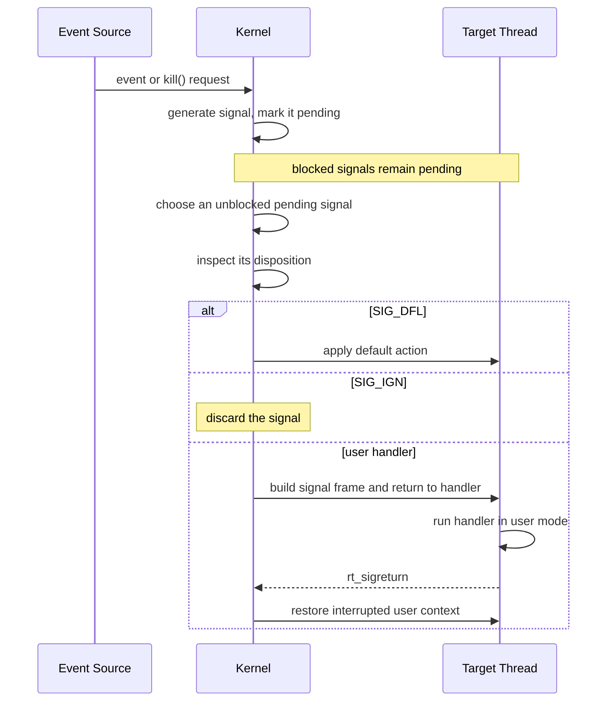
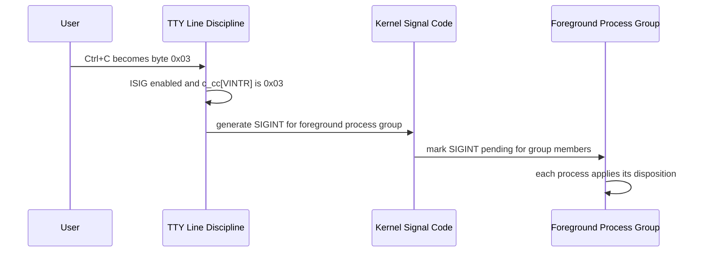

# 信号

- 写作时间：`2026-02-27 首次提交，2026-07-13 最近修改`
- 当前字符：`10048`

在[进程生命周期](/process/01-lifecycle)中，父进程可以主动调用 `waitpid()` 等待子进程。但是许多事件不会等到程序下一次主动查询：用户可能按下 Ctrl+C，定时器可能到期，子进程也可能在父进程处理其他工作时退出。

在终端运行 `sleep 100` 并按 Ctrl+C，可以直接看到这种控制流变化：

```console
$ sleep 100
^C
$
```

`sleep` 此时没有读取键盘，也没有循环检查按键。终端子系统识别 Ctrl+C 后，请求内核向前台进程发送 `SIGINT`；`SIGINT` 的默认动作是终止进程，所以 `sleep` 提前结束。若程序安装了处理函数，也可以先设置状态标志，再由普通控制流决定怎样退出，而不是只能接受默认动作。

本课先建立信号从生成到递送的**信号机制**，再解释默认、忽略和处理函数三种**处置**。随后沿 Ctrl+C 的路径分析**终端驱动**，归纳其他**信号来源**，再用 fork 与 exec 推导**信号继承**，最后用 **SIGCHLD** 连接子进程退出与父进程回收。

## 信号机制

信号是由内核递送的有限通知机制，它可以在普通函数调用顺序之外改变进程或线程的执行状态。

“发送一个信号”并不等于处理函数已经开始执行。完整过程分成三个阶段：

1. **生成**：某个事件发生，内核为目标记录一个信号
2. **挂起(pending)**：信号已经生成，但尚未递送
3. **递送(delivery)**：内核选中一个未被阻塞的挂起信号，并执行它的当前处置

阻塞(blocking)表示暂缓递送某个信号，而不是丢弃它。每个线程都有信号掩码(signal mask)，其中列出的信号暂时不能递送；解除阻塞后，仍在 pending 集合中的信号才有机会被处理。线程是进程中的一条执行流，多线程会在并发章节展开，这里只需要区分：处置属于整个进程，掩码属于各个线程。

Linux 用几组相互关联的状态表达这些概念：

| 语义 | Linux 中的主要位置 | 共享范围 |
|------|-------------------|----------|
| 信号处置 | `sighand_struct.action[]` | 进程内线程共享 |
| 进程定向 pending | `signal_struct.shared_pending` | 进程内线程共享 |
| 线程定向 pending | `task_struct.pending` | 当前线程 |
| 信号掩码 | `task_struct.blocked` | 当前线程 |

进程定向信号可以递送给任意一个未阻塞该信号的线程；线程定向信号只能递送给指定线程。单线程程序只有一条执行流，暂时可以把两者都理解成“发给这个进程”，但内核仍保留这一区分。

内核准备从内核态返回用户态时，会检查当前线程是否存在未阻塞的挂起信号。若处置是用户处理函数(handler)，内核不会在内核态直接调用这个函数，而是在用户栈上建立信号帧(signal frame)，保存被打断位置的寄存器与信号掩码，再把用户态指令位置改为处理函数入口。处理函数返回时，C 库提供的信号跳板(signal trampoline)调用 `rt_sigreturn`，内核据此恢复原来的寄存器、栈和掩码。



标准信号通常用集合表达挂起状态。同一种标准信号在阻塞期间生成多次，通常只保留“至少发生过一次”，解除阻塞后可能只递送一次。实时信号(real-time signal)则可以排队保存多个实例和附带数据。由此，标准信号适合表达状态变化通知，不适合充当可靠的事件计数器。

## 处置

处置(disposition)是进程针对某个信号选择的递送动作，每个信号都有一个当前处置。

内核为每个信号定义默认动作(`SIG_DFL`)；进程还可以选择忽略(`SIG_IGN`)或安装用户处理函数。核心转储(core dump)是按系统配置保存进程部分内存与寄存器状态、供调试器分析的文件。常见默认动作如下：

| 默认动作 | 说明 | 信号举例 |
|----------|------|----------|
| 终止(Term) | 结束进程 | `SIGINT`、`SIGTERM`、`SIGPIPE`、`SIGHUP` |
| 核心转储(Core) | 结束进程并按配置生成 core dump | `SIGQUIT`、`SIGSEGV`、`SIGABRT` |
| 停止(Stop) | 暂停进程，可由 `SIGCONT` 恢复 | `SIGTSTP`、`SIGSTOP`、`SIGTTIN`、`SIGTTOU` |
| 继续(Cont) | 恢复已停止进程 | `SIGCONT` |
| 忽略(Ign) | 默认不改变进程状态 | `SIGCHLD`、`SIGURG` |

默认忽略与显式设置 `SIG_IGN` 通常结果相似，但 `SIGCHLD` 是重要例外。在 Linux 上保留 `SIGCHLD` 的默认处置时，终止的子进程仍然可以等待并可能成为僵尸；显式设置 `SIG_IGN` 或使用 `SA_NOCLDWAIT`，则会让终止状态自动回收。需要读取子进程状态的 shell 不能采用后者。

`SIGKILL` 和 `SIGSTOP` 不能被捕获、忽略或阻塞，因此目标进程无法自行改写它们的动作。发送方仍需通过权限检查，而且处于不可中断内核等待中的任务也可能要等到相应内核路径结束后才能表现出动作，所以“不可捕获”不等于“发送后在同一瞬间完成”。

POSIX 推荐用 `sigaction()` 检查或修改处置：

```c
#include <signal.h>

int sigaction(int signum,
              const struct sigaction *act,
              struct sigaction *oldact);
```

`act->sa_handler` 指定 `SIG_DFL`、`SIG_IGN` 或处理函数；`sa_mask` 指定处理函数运行期间额外阻塞的信号；`sa_flags` 调整递送行为。默认情况下，正在处理的那个信号也会暂时加入当前线程的掩码，防止同一个处理函数立即递归进入，除非使用 `SA_NODEFER` 改变这一行为。

`SA_RESTART` 允许 Linux 在处理函数返回后自动重启一部分被中断的阻塞接口。例如，对终端或管道执行、尚未传输数据的 `read()` 可能被重启。它不是对所有系统调用的统一保证：具体行为取决于接口，有些调用即使设置了 `SA_RESTART` 仍会返回 `-1` 并设置 `errno = EINTR`。程序必须按所用接口的文档决定是否重试，不能把 `SA_RESTART` 当成通用错误处理替代品。

## 终端驱动

终端驱动(terminal driver)是 Linux TTY 子系统中管理终端设备语义的内核部分，行规程(line discipline)则负责输入编辑和特殊控制字符。

终端是可以被进程读写的 TTY 端点。会话可以拥有一个控制终端(controlling terminal)，控制终端又记录一个前台进程组(foreground process group)。进程组是由同一个进程组 ID(Process Group ID, PGID)标识的一组相关进程；终端产生的交互信号会发给整个前台组，而不是只发给某一个进程。

典型终端模拟器把 Ctrl+C 编码为字节 `0x03`。终端属性结构(termios)保存输入模式、控制字符和回显等设置。当其中的 `ISIG` 标志启用，且 `c_cc[VINTR]` 配置为 `0x03` 时，行规程识别这个字节，不把它作为普通输入交给 `read()`，而是向前台进程组生成 `SIGINT`。规范模式(canonical mode)会先在内核中按行缓冲并编辑输入，遇到换行或配置的结束字符后才把一条输入记录交给 `read()`：

| 配置项 | 默认按键 | 行规程的动作 |
|--------|----------|-------------|
| `VINTR` | Ctrl+C | 向前台进程组生成 `SIGINT` |
| `VQUIT` | Ctrl+\ | 向前台进程组生成 `SIGQUIT` |
| `VSUSP` | Ctrl+Z | 向前台进程组生成 `SIGTSTP` |
| `VEOF` | Ctrl+D | 在规范模式中结束当前输入记录；空记录可使 `read()` 返回 0 |
| `VERASE` | Backspace | 在规范模式中删除尚未提交的前一个字符 |



`stty intr '^X'` 可以把 `VINTR` 改成 Ctrl+X；关闭 `ISIG` 的原始模式程序则会把 Ctrl+C 当作普通字节读取。由此，Ctrl+C 并非 CPU 或键盘硬件直接绑定到 `SIGINT`，而是终端配置定义的控制字符。

:::expand 伪终端
伪终端(pseudoterminal, PTY)由 master 与 slave 两端组成。终端模拟器或 SSH 服务端操作 master，shell 和前台命令通常把 slave 作为控制终端。写入 master 的字节进入 slave 一侧的 TTY 行规程，slave 上程序的输出则可以从 master 读出。

PTY 让图形终端窗口和远程登录复用与串口终端相同的 TTY 接口。它模拟的是终端连接，不要求背后存在物理串口设备。
:::

[进程组与会话](/process/03-process-group)会继续解释 shell 怎样设置前台 PGID，以及为什么后台进程不能任意读取控制终端。

## 信号来源

信号来源(signal source)是导致内核为目标进程或线程生成信号的事件或系统调用请求。

终端特殊字符、子进程状态变化、定时器到期和其他进程请求都可以产生信号。最终的权限检查、pending 状态更新与递送仍由内核完成。

有些信号与当前线程执行的指令同步发生。例如非法内存访问产生 `SIGSEGV`，如果处理函数直接返回而没有修复地址映射或改变控制流，同一条指令可能再次触发故障。另一些信号与目标当前执行位置无关，例如其他进程发送的 `SIGTERM` 或子进程退出产生的 `SIGCHLD`。

| 事件 | 产生的信号 | 目标 |
|------|-----------|------|
| 子进程退出、停止或继续 | `SIGCHLD` | 父进程 |
| 当前指令访问非法内存 | `SIGSEGV` | 出错线程 |
| 当前指令无法由处理器执行 | `SIGILL` | 出错线程 |
| 写入没有读端的管道 | `SIGPIPE` | 写入方 |
| 定时器到期 | `SIGALRM` | 设置定时器的进程 |
| TTY 识别 `VINTR` | `SIGINT` | 前台进程组 |

进程可以用 `kill()` 请求内核发送信号：

```c
#include <signal.h>
#include <sys/types.h>

int kill(pid_t pid, int sig);
```

`pid` 为正数时指定单个进程，为 `0` 或负数时还可以按调用者所在组或指定进程组发送。接口名虽然是 `kill`，却能发送任意允许的信号；`sig = 0` 甚至只做目标与权限检查，不递送信号。调用是否获准取决于进程凭据、目标关系和 `CAP_KILL` 等规则，不能理解为任意进程都能控制任意目标。

shell 的 `kill 1234` 默认请求发送 `SIGTERM`，`kill -KILL 1234` 则请求发送 `SIGKILL`。`SIGTERM` 可以被处理，使服务有机会有序退出；`SIGKILL` 无法被目标处理，通常只在正常终止无效时使用。

## 信号继承

信号继承(signal inheritance)是 fork 与 exec 对处置、掩码和 pending 状态分别采用的保留规则。

fork 创建新进程，exec 则在同一进程中替换程序映像，因此两者的规则不同：

| 信号状态 | `fork()` 后的子进程 | `execve()` 后的同一进程 |
|----------|--------------------|--------------------------|
| 默认或忽略处置 | 复制父进程处置 | 保持不变 |
| 自定义处理函数 | 复制父进程处置 | 重置为 `SIG_DFL` |
| 信号掩码 | 复制父线程掩码 | 保持不变 |
| pending 集合 | 新子进程从空集合开始 | 保持原 pending 集合 |

exec 必须重置自定义处理函数，因为函数地址属于旧程序映像，替换地址空间后已不再有效。`SIG_DFL` 与 `SIG_IGN` 不引用旧程序代码，所以能够保留。信号掩码与 pending 状态是内核维护的进程或线程状态，也不因加载新程序而自动清空。

这组规则直接影响 shell。支持作业控制的交互式 shell 会把前台作业放进不同于 shell 的进程组，再把控制终端交给该作业，因此 Ctrl+C 通常只发给前台作业；shell 自身仍会为 `SIGINT` 等信号设置适合交互循环的处置。fork 创建的子进程会继承这些处置和掩码，所以如果其中的 `SIGINT` 处于忽略或阻塞状态，直接 exec 后的新程序仍可能无法按默认方式响应 Ctrl+C。单线程 shell 可以在 exec 前恢复目标程序需要的默认处置和信号掩码：

```c
pid_t pid = fork();

if (pid == 0) {
    struct sigaction action = { .sa_handler = SIG_DFL };
    sigemptyset(&action.sa_mask);
    sigaction(SIGINT, &action, NULL);

    sigset_t empty;
    sigemptyset(&empty);
    sigprocmask(SIG_SETMASK, &empty, NULL);

    execlp("sleep", "sleep", "100", (char *)NULL);
    _exit(127);
}
```

示例清空了全部阻塞信号以突出机制；真实 shell 会按自身策略恢复一组精确的处置与掩码。关键顺序不变：先在 fork 出的子进程中配置，再用 exec 加载目标程序。

## SIGCHLD

`SIGCHLD` 是子进程停止、继续或终止时，内核向父进程生成的状态变化通知。

前台命令期间，shell 可以直接阻塞在 `waitpid()` 中。后台命令则不同：shell 必须继续读取新输入，不能一直等待某一个子进程。`SIGCHLD` 让父进程在处理其他工作时仍能知道“至少有一个子进程状态发生了变化”。

`SIGCHLD` 是标准信号，同一信号的多个实例可能合并。假设三个子进程几乎同时退出，父进程不能假设一定收到三次处理函数调用。每次开始回收时都应循环调用：

```c
int status;
pid_t pid;

while ((pid = waitpid(-1, &status, WNOHANG)) > 0) {
    /* record pid and status */
}
```

`pid = -1` 表示检查任意子进程，`WNOHANG` 表示当前没有可等待状态时立即返回 0，而不是阻塞。循环直到返回 0，才能一次处理当前已经积累的全部终止状态。需要跟踪作业暂停和恢复的 shell 还会加入 `WUNTRACED` 与 `WCONTINUED`，让 `waitpid()` 同时报告停止和继续状态。

信号处理函数可能在普通代码执行到任意可递送位置时运行，所以它只能调用异步信号安全(async-signal-safe)的接口。异步信号安全表示函数即使打断了程序正在进行的其他操作，也不会依赖可能处于半更新状态的共享内部数据。

| 处理函数中可安全使用的例子 | 不应使用的例子 |
|----------------------------|----------------|
| `write()`、`waitpid()`、`_exit()` | `printf()`、`malloc()`、`free()` |
| 对 `volatile sig_atomic_t` 赋值 | 获取普通互斥锁、修改复杂容器 |

一种简单分工是让处理函数只设置标志，主循环再调用 `waitpid()` 并更新作业表：

```c
static volatile sig_atomic_t got_sigchld;

static void on_sigchld(int signo) {
    (void)signo;
    got_sigchld = 1;
}

/* in the main loop */
if (got_sigchld) {
    got_sigchld = 0;

    int status;
    pid_t pid;
    while ((pid = waitpid(-1, &status, WNOHANG)) > 0) {
        /* update normal program state here */
    }
}
```

`sig_atomic_t` 保证处理函数与普通代码可以不可分割地读写这个简单标量，`volatile` 要求编译器每次实际访问它。对于同时等待终端、管道和子进程的事件循环，仅用标志还要处理“检查后、睡眠前又来了信号”的竞态。`sigsuspend()` 可以原子地临时替换信号掩码并进入等待；self-pipe 让处理函数向进程自己创建的管道写一个字节，使事件循环像监听普通 fd 一样监听信号；Linux 的 `signalfd()` 则直接把一组被阻塞信号转换成可读取的 fd。三种方案都遵循同一原则：处理函数只做受限工作，复杂状态更新回到普通控制流中完成。

## 小结

| 概念 | 说明 |
|------|------|
| 信号 | 由内核递送、可在普通函数调用顺序之外改变执行状态的通知 |
| pending | 信号已经生成但尚未递送的状态 |
| 信号掩码 | 每个线程当前阻塞递送的一组信号 |
| 处置 | 默认动作、忽略或用户处理函数 |
| `sigaction()` | 检查或设置信号处置、处理期掩码与行为标志 |
| `SA_RESTART` | 允许一部分被处理函数中断的接口自动重启 |
| `SIGKILL` / `SIGSTOP` | 不可捕获、不可忽略、不可阻塞的信号 |
| 终端驱动 | 通过行规程把配置的控制字符转换为前台进程组信号 |
| 信号继承 | fork 复制处置与掩码但清空 pending；exec 重置处理函数但保留掩码与 pending |
| `SIGCHLD` | 子进程停止、继续或终止时通知父进程 |
| 异步信号安全 | 处理函数中只能执行不会破坏被中断状态的有限操作 |

信号把事件生成与用户态处理分开，但这种控制流变化要求程序同时管理处置、掩码、继承和处理函数安全性；任何一项遗漏，都可能让 shell 自身或它启动的命令表现出错误的终止行为。

---

**Linux 与 POSIX 入口**：
- [`kernel/signal.c`](https://elixir.bootlin.com/linux/latest/source/kernel/signal.c)：信号生成、挂起选择与递送核心路径
- [`fs/exec.c`](https://elixir.bootlin.com/linux/latest/source/fs/exec.c)：`flush_signal_handlers()`，exec 时重置处理函数
- [`signal(7)`](https://man7.org/linux/man-pages/man7/signal.7.html)：信号处置、掩码、pending 与继承总览
- [`sigaction(2)`](https://man7.org/linux/man-pages/man2/sigaction.2.html)：`sigaction()` 与 `SA_RESTART`
- [`termios(3)`](https://man7.org/linux/man-pages/man3/termios.3.html)：`ISIG`、`VINTR` 与其他终端控制字符
- [`signal-safety(7)`](https://man7.org/linux/man-pages/man7/signal-safety.7.html)：异步信号安全接口清单
