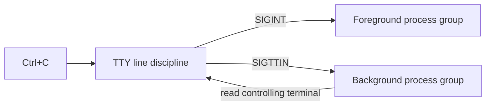
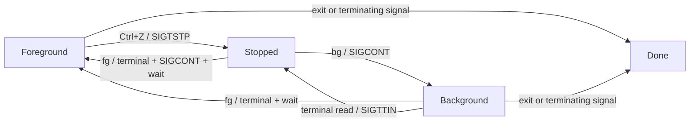

# 进程组与会话

- 写作时间：`2026-02-27 首次提交，2026-07-13 最近修改`
- 当前字符：`8034`

[信号](/process/02-signal)既可以发给单个进程，也可以发给一组进程。后一种能力对 shell 很重要，因为一条管道通常包含多个进程：

```console
$ sleep 100 | cat
^C
$
```

`sleep` 和 `cat` 都因 Ctrl+C 结束，shell 自身却继续等待下一条命令。终端没有解析管道，也不知道这两个程序的业务关系；shell 在创建它们时，已经把二者放进同一个进程组，并让终端把该组记为前台目标。

本课先用**进程组**表达一个 shell job 中的全部进程，再看**控制终端**怎样选定唯一的前台组。shell 把这些机制组合成 **Job Control**，也就是 `jobs`、`fg`、`bg` 和 Ctrl+Z。随后用**会话**约束进程组与终端的归属，最后解释失去同会话外部父进程的**孤儿进程组**为什么需要特殊处理。

这些对象形成严格层级：一个会话包含一个或多个进程组，一个进程组包含一个或多个进程；控制终端属于一个会话，并从该会话中选择一个进程组作为前台组。

```text
Session
├── shell process group
├── foreground job process group
└── background job process group
```

## 进程组

进程组(process group)是共享同一个 PGID 的一组进程，也是 POSIX 向多个相关进程执行信号与等待操作的基本单位。

每个进程都属于一个进程组。`fork()` 创建的子进程先继承父进程的 PGID，exec 不改变 PGID；shell 随后用 `setpgid()` 把一个命令或整条管道放入新组。job 是 shell 管理的一条命令或管道，可能对应一个进程，也可能对应多个进程。

进程组组长(process group leader)是 PID 等于 PGID 的进程。shell 通常选择管道中第一个子进程的 PID 作为整组 PGID：

```text
Process group PGID=200
├── sleep  PID=200  group leader
└── cat    PID=201
```

“组长”是 ID 关系，不代表它负责调度或管理其他成员。即使 PID 200 先退出，只要组内还有其他进程，PGID 200 仍可以继续存在。

POSIX 提供以下接口：

```c
#include <unistd.h>

int setpgid(pid_t pid, pid_t pgid);
pid_t getpgid(pid_t pid);
pid_t getpgrp(void);
```

`pid = 0` 表示调用者自身，`pgid = 0` 表示使用目标进程 PID 作为 PGID。会话是包含一个或多个进程组的上层集合；一个进程只能把自己或尚未 exec 的直接子进程移入同一会话中的现有进程组，或者为目标创建以其 PID 为 PGID 的新组。会话一节会继续解释这个集合怎样与终端关联，这里先确定进程组不能跨越会话边界。

shell 创建 `ls | grep foo` 时，可以采用以下顺序：

1. fork 第一个子进程，假设 PID 为 300，并选定 PGID 300
2. fork 第二个子进程，假设 PID 为 301
3. 把 PID 300 与 PID 301 都设置为 PGID 300
4. shell 保持在自己的进程组，不加入 PGID 300

父进程和每个子进程通常都会调用相应的 `setpgid()`。原因是 fork 后谁先运行没有保证，这种结果取决于执行顺序的问题叫竞态条件(race condition)。如果只有父进程设置，子进程可能先 exec，父进程随后再修改它的 PGID 会得到 `EACCES`；如果只有子进程设置，父进程可能在进程组建立前就尝试把它设为终端前台组。双方都执行并检查返回结果，可以让两种调度顺序都得到正确分组。

进程组建立后，负的 `kill()` 目标表示 PGID：

```c
kill(-300, SIGINT);
```

这个调用请求内核向 PGID 300 中有权接收该信号的进程发送 `SIGINT`。`killpg(300, SIGINT)` 提供等价的组级接口。管道成员共享 PGID 后，终端和 shell 都不需要保存“应该通知哪些 PID”的临时列表。

## 控制终端

控制终端是与一个会话关联的 TTY 设备，它记录该会话当前唯一的前台进程组。

一个会话至多拥有一个控制终端，一个终端也至多控制一个会话。同一会话中只有一个进程组是前台组，其余都是后台组。终端生成的 `SIGINT`、`SIGQUIT` 和 `SIGTSTP` 都发送给前台组，后台组不会因为用户在当前终端按下这些控制键而收到相同信号。

`tcgetpgrp()` 与 `tcsetpgrp()` 读取或修改终端的前台 PGID：

```c
#include <unistd.h>

pid_t tcgetpgrp(int fd);
int tcsetpgrp(int fd, pid_t pgrp);
```

`fd` 必须引用调用进程的控制终端，`pgrp` 必须是调用者所在会话中的非空进程组。交互式 shell 通常使用连接控制终端的 fd 0，但重定向可能改变 fd 0、1、2 的去向，因此不能把“任意标准 fd 永远都可用”当作接口保证。

前台归属同时控制终端信号和终端读取：



后台进程组尝试读取控制终端时，内核通常向整个组发送 `SIGTTIN`，其默认动作是停止进程。如果该组已经成为孤儿组，或者调用线程阻塞或忽略 `SIGTTIN`，读取可能改为失败并设置 `errno = EIO`。这条规则防止多个 job 同时争用交互输入。

后台写终端默认允许，所以后台 job 的输出可能出现在提示符之间。若终端启用了 `TOSTOP`，后台写会生成 `SIGTTOU`。此外，后台进程调用 `tcsetpgrp()` 等终端控制操作时，即使没有启用 `TOSTOP`，只要没有阻塞或忽略 `SIGTTOU`，其进程组也会收到 `SIGTTOU`。shell 在交接前台归属时必须处理这项规则。

## Job Control

Job Control 是 shell 以进程组为 job 单位，通过终端前台归属、信号和 `waitpid()` 管理运行、停止与继续状态的机制。

先看 shell 启动前台管道 `ls | grep foo` 的完整职责：

1. 创建管道，fork 两个子进程
2. 让两个子进程进入同一个新进程组
3. 子进程连接 fd、恢复目标程序应有的信号处置与掩码，再 exec
4. shell 调用 `tcsetpgrp()` 把控制终端交给新进程组
5. shell 用 `waitpid(-pgid, ..., WUNTRACED | WCONTINUED)` 等待组内子进程状态
6. job 终止或停止后，shell 用 `tcsetpgrp()` 收回终端，并恢复 shell 的终端模式

`waitpid()` 的 pid 参数为负数时，绝对值表示目标进程组。`WUNTRACED` 让停止状态也能返回，`WCONTINUED` 让 `SIGCONT` 引起的继续状态也能返回。shell 必须汇总组内所有进程的状态，不能因为管道中的第一个进程退出就认定整个 job 已经结束。

终端模式(termios state)包括规范输入、回显和控制字符配置。全屏编辑器可能在运行时关闭回显并启用原始模式；若它被 Ctrl+Z 停止，shell 收回前台时还要恢复自己的终端模式，否则新的提示符可能无法正常回显。恢复该 job 到前台时，shell 再把保存的 job 终端模式写回。

Ctrl+Z 的路径是：行规程向前台组生成 `SIGTSTP`，组内进程按默认动作停止；`waitpid()` 因 `WUNTRACED` 返回；shell 记录 job 为 Stopped，收回控制终端并显示新提示符。进程没有退出，其地址空间和 fd 仍然存在。

`fg` 恢复一个停止的 job 时，shell 通常依次完成：

1. 把控制终端交给 job 的 PGID
2. 恢复该 job 保存的终端模式
3. 向整个进程组发送 `SIGCONT`
4. 再次等待它停止或终止

`bg` 只让 job 在后台继续运行：shell 发送 `SIGCONT`，但不把控制终端交给它，也不阻塞等待。由此，`fg` 与 `bg` 的区别不只是一次 `tcsetpgrp()`；前台操作还包含终端模式恢复和同步等待。

命令末尾的 `&` 直接创建后台 job。shell 仍会建组和记录状态，但不交出控制终端，也不等待该 job 完成。后台子进程的状态随后通过 `SIGCHLD` 和非阻塞 `waitpid()` 更新。

`jobs` 主要读取 shell 自己维护的 job 表。该表把 `%1` 这样的 job 编号映射到 PGID、命令文本以及每个成员的 Running、Stopped 或 Done 状态；内核只提供 PID、PGID、信号与等待状态，不替 shell 维护用户可见的 job 编号。



交互式 job-control shell 通常忽略 `SIGTSTP`、`SIGTTIN` 与 `SIGTTOU`，并为 `SIGINT`、`SIGQUIT` 等信号设置自己的策略。这样它在管理终端时不会被作业控制信号意外停止。子进程在 exec 前必须恢复普通命令应有的默认处置和掩码，否则会继承 shell 的管理策略。

## 会话

会话(session)是一个或多个进程组的集合，用会话 ID(Session ID, SID)标识，并且可以拥有一个控制终端。

创建会话的进程是会话首进程(session leader)，其 PID 等于新 SID。它同时成为新进程组的组长，所以刚创建时满足 `PID = PGID = SID`，并且新会话和新进程组都只有调用者一个成员。

```text
Session SID=100
├── Process group PGID=100
│   └── shell PID=100, session leader
├── Process group PGID=300
│   ├── sleep PID=300
│   └── cat PID=301
└── Process group PGID=400
    └── find PID=400
```

会话边界让内核能够约束两件事：一个终端的前台组必须来自拥有该终端的同一会话；`setpgid()` 也不能把进程移到其他会话的进程组。它不是“终端内全部进程”的动态搜索结果，而是 fork、`setpgid()` 与 `setsid()` 持续维护的身份关系。

`setsid()` 创建新会话：

```c
#include <unistd.h>

pid_t setsid(void);
```

调用成功后，调用者成为新会话首进程和新进程组组长，并脱离原控制终端；新会话最初没有控制终端。已经是进程组组长的进程不能调用 `setsid()`，否则它离开原会话时会把原进程组拆到两个会话中，破坏“一个进程组只能属于一个会话”的层级。需要确保成功的程序通常先 fork，再由不是组长的子进程调用 `setsid()`。

Linux 上，一个没有控制终端的会话首进程打开终端设备时，如果没有使用 `O_NOCTTY`，且该终端尚未属于其他会话，它通常会取得该终端作为控制终端。程序也可以用 `TIOCSCTTY` ioctl 显式完成这一步。ioctl 是对设备执行特定控制操作的系统调用接口。

终端模拟器建立 shell 环境时，常见逻辑可以概括为：先创建一对伪终端主端和从端，再 fork 子进程；子进程调用 `setsid()`，取得从端作为控制终端，把从端复制到 fd 0、1、2，再 exec shell。具体实现可能由 `forkpty()` 或 `login_tty()` 等库函数封装，但最终仍要建立 SID、PGID、控制终端和标准 fd 这四层关系。

终端挂断不会自动向会话中的所有进程组逐一发送 `SIGHUP`。Linux 在符合终端配置的挂断条件下向会话首进程发送 `SIGHUP`；会话首进程退出时，内核向控制终端的前台进程组发送 `SIGHUP`。shell 还可以按自身策略把 `SIGHUP` 传播给它记录的其他 job。区分内核规则与 shell 策略，才能解释为什么不同 shell 的后台 job 在终端关闭后可能表现不同。

## 孤儿进程组

孤儿进程组(orphaned process group)是这样一个进程组：组内每个成员的父进程要么也在该组内，要么属于另一个会话。

这里的“孤儿”描述整个组在当前会话中的父子连接，不等同于“父进程已经退出”的孤儿进程。一个进程组即使所有成员都有存活父进程，也可能因为那些父进程位于其他会话而成为孤儿组；反过来，只要组内某个成员仍有父进程位于同一会话的另一个组，它就不是孤儿组。

考虑同一会话中的两组进程：

```text
PGID=100: shell PID=100
    └── parent of PID 200

PGID=200: stopped job PID=200
```

此时 PGID 200 不是孤儿组，因为 PID 200 的父进程 PID 100 位于同一会话的另一个进程组。若 shell 退出，PID 200 被重新指定给该会话之外的进程作为父进程，PGID 200 就满足孤儿组定义。系统里仍可能有进程有权限向它发送信号，但已经没有同会话、组外的父进程能够按原 job-control 关系等待和恢复它。

如果进程退出导致某个进程组刚刚成为孤儿组，并且组内至少有一个成员处于停止状态，内核会依次向组内每个进程发送：

1. `SIGHUP`，通知原有作业控制关系已经消失
2. `SIGCONT`，让停止的进程恢复并有机会处理挂起的 `SIGHUP`

`SIGHUP` 的默认动作是终止，许多程序因此在恢复后结束；安装处理函数的程序也可以选择其他行为。若新孤儿组没有停止成员，POSIX 不要求因这次转换发送这两个信号。这个规则的目标很具体：避免停止中的进程组在失去同会话父进程后永久无法继续。

## 小结

| 概念 | 说明 |
|------|------|
| 进程组 | 共享 PGID 的进程集合，也是 shell job 的内核控制单位 |
| 组长 | PID 等于 PGID 的进程；退出后进程组仍可继续存在 |
| 控制终端 | 与一个会话关联，并记录唯一前台进程组的 TTY |
| 前台进程组 | 接收终端控制信号并有权读取终端的进程组 |
| `setpgid()` | 在同一会话中创建进程组或移动进程 |
| `tcsetpgrp()` | 把同会话中的非空进程组设为终端前台组 |
| Job Control | shell 用进程组、终端、信号与等待状态管理 job |
| 会话 | 包含一个或多个进程组、可拥有控制终端的 SID 集合 |
| `setsid()` | 创建新会话和新进程组，并脱离原控制终端 |
| 孤儿进程组 | 组内成员不再有同会话、组外父进程的进程组 |

进程组确定“一次控制哪些进程”，控制终端确定“当前控制哪个组”，会话则限制这些组与终端能够怎样组合；shell 的 Job Control 正是对这三层关系的持续维护。

---

**Linux 与 POSIX 入口**：
- [`kernel/exit.c`](https://elixir.bootlin.com/linux/latest/source/kernel/exit.c)：`kill_orphaned_pgrp()`，孤儿进程组处理
- [`kernel/sys.c`](https://elixir.bootlin.com/linux/latest/source/kernel/sys.c)：`setpgid()` 与 `setsid()` 的内核实现
- [`drivers/tty/tty_jobctrl.c`](https://elixir.bootlin.com/linux/latest/source/drivers/tty/tty_jobctrl.c)：终端前后台检查
- [`setpgid(2)`](https://man7.org/linux/man-pages/man2/setpgid.2.html)：PGID 设置规则与孤儿组语义
- [`tcsetpgrp(3)`](https://man7.org/linux/man-pages/man3/tcsetpgrp.3.html)：终端前台组接口与约束
- [`setsid(2)`](https://man7.org/linux/man-pages/man2/setsid.2.html)：会话创建和终端挂断规则
- [`credentials(7)`](https://man7.org/linux/man-pages/man7/credentials.7.html)：PID、PGID、SID 与控制终端总览
