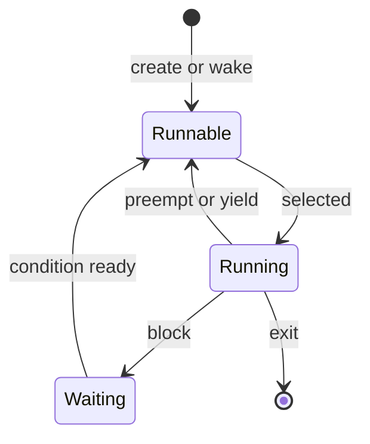

# CPU 调度

- 写作时间：`2026-03-04 首次提交，2026-07-13 最近修改`
- 当前字符：`7547`

系统中的可运行任务通常多于逻辑 CPU。假设一台机器有 4 个逻辑 CPU，却有 20 个任务已经具备执行条件，同一时刻最多只有 4 个任务真正执行，其余任务必须等待。内核不仅要决定谁先获得 CPU，还要决定任务可以运行多久，以及什么事件允许另一个任务取代它。

调度器(scheduler)是内核中选择下一个可运行任务的组件。这里的任务是 Linux 可以独立调度的一条执行流，既可能是单线程进程，也可能是多线程进程中的一个线程。

本课先确定吞吐量、延迟与公平性等**调度目标**，再沿任务状态解释**调度时机**和上下文切换。随后在**经典算法**中比较按到达顺序、短任务优先、时间片轮转与优先级选择，用**多级反馈队列**说明系统怎样根据任务行为调整优先级，再进入有截止期限的**实时调度**，最后分析锁竞争引起的**优先级反转**。

## 调度目标

调度目标(scheduling objective)是评价 CPU 分配结果的指标集合，不同工作负载会要求不同指标优先。

任务执行通常在 CPU 执行期(CPU burst)与等待期之间交替。CPU 执行期是任务连续使用处理器执行指令的阶段；等待期是任务等待磁盘、网络、定时器或锁等条件的阶段。等待 I/O 只是其中最常见的一类，因此教材常称它为 I/O burst。

```text
CPU-bound task:  [ long CPU ][wait][ long CPU ][wait]
I/O-bound task:  [CPU][ wait ][CPU][ wait ][CPU][ wait ]
```

CPU 密集型(CPU-bound)任务的 CPU 执行期通常较长，例如编译、编码和数值计算；I/O 密集型(I/O-bound)任务通常频繁等待外部事件，例如交互式终端和网络服务。这个分类描述一段时间内的行为，不是进程永久不变的类型，同一程序在不同阶段也可能改变特征。

常用评价指标如下：

| 指标 | 定义 | 常见目标 |
|------|------|----------|
| CPU 利用率 | CPU 处于有效执行状态的时间比例 | 提高 |
| 吞吐量(throughput) | 单位时间完成的任务数量 | 提高 |
| 周转时间(turnaround time) | 任务从提交到完成的总时间 | 缩短 |
| 等待时间(waiting time) | 任务在可运行队列中等待 CPU 的累计时间 | 缩短 |
| 响应时间(response time) | 从请求到第一次得到可见响应的时间 | 缩短 |
| 公平性(fairness) | 可运行任务获得 CPU 的份额是否符合策略 | 避免长期偏离 |
| 截止期限(deadline) | 指定工作是否在约定时刻前完成 | 按实时约束满足 |

这些目标不能同时达到最优。延长一次运行时间可以减少切换、提高吞吐量，却可能让交互任务等待更久；优先运行短任务可以降低平均等待时间，却可能让长任务迟迟得不到 CPU。调度算法的差异，本质上是对这些冲突目标作出不同选择。

## 调度时机

调度时机(scheduling point)是内核允许重新选择运行任务的状态转换或内核返回点。

任务至少处于以下三类相关状态：运行(running)表示当前占用 CPU；就绪或可运行(runnable)表示执行条件已满足但正在等 CPU；等待(waiting)表示还在等 I/O、定时器或其他条件。可运行任务进入运行队列(run queue)，等待任务则登记在与所等事件相关的等待队列上。



非抢占式调度(non-preemptive scheduling)只在当前任务阻塞、主动让出或退出时重新选择。抢占式调度(preemptive scheduling)还允许内核在任务仍可继续运行时收回 CPU，例如运行额度到期，或更高优先级任务变为可运行。通用多任务操作系统需要抢占，否则一个不阻塞的循环就可能长期阻止其他同优先级任务执行。

硬件定时器让内核能够在未来某个时刻重新取得控制权，但现代 Linux 不必依赖固定 1 ms 或 4 ms 的永久周期 tick。内核可以根据最近的调度期限设置定时器，并在空闲时减少周期中断。应该保留的抽象是：调度器能够安排一个未来检查点，而不是记住某个适用于所有机器的固定时间片。

从一个任务切换到另一个任务叫作上下文切换。内核要保存前一个任务恢复执行所需的寄存器和栈位置，再恢复后一个任务的状态。若两个任务属于不同地址空间，还可能需要切换页表相关状态；同一进程内的线程共享地址空间，可以省去其中一部分工作。

上下文切换有直接成本，也有间接成本。直接成本来自保存状态、运行调度代码和恢复状态；间接成本来自新任务的指令、数据与地址翻译不一定仍在当前 CPU 缓存中。地址转换后备缓冲区(Translation Lookaside Buffer, TLB)保存近期的虚拟地址翻译结果，x86 的进程上下文标识符(Process-Context Identifier, PCID)可以给这些结果附带地址空间标签，使切换后的一部分结果仍然可用。因此不能把“切换进程必然清空整个 TLB”当成通用规则，也不能用一个固定微秒数代表所有硬件与工作负载。

Linux 用 `TASK_RUNNING` 同时表示正在 CPU 上运行和在运行队列中等待。每个逻辑 CPU 同一时刻只有一个当前任务，其余 `TASK_RUNNING` 任务只是具备被选择的资格。[Linux 调度器](/process/05-linux-scheduler)会把这个状态模型对应到每 CPU 运行队列与 `__schedule()` 路径。

## 经典算法

经典调度算法(classic scheduling algorithm)是使用到达顺序、预计执行时间、时间片或优先级选择下一个任务的一组基础策略。

**先来先服务(First-Come, First-Served, FCFS)** 按到达顺序运行任务，通常采用非抢占方式。它实现简单，但长任务在队首时会让后续短任务全部等待，这叫护航效应(convoy effect)。

```text
Tasks: P1=8 ms, P2=2 ms, P3=2 ms

FCFS: |---- P1 ----| P2 | P3 |
time: 0             8    10   12

waiting: P1=0, P2=8, P3=10, average=6 ms
```

**最短作业优先(Shortest Job First, SJF)** 选择预计下一次 CPU 执行期最短的任务；其抢占版本叫最短剩余时间优先(Shortest Remaining Time First, SRTF)，新到任务剩余时间更短时可以抢占当前任务。在执行时间已知的理想条件下，SJF 能降低平均等待时间。现实系统无法预知未来执行期，只能根据历史估计；若短任务持续到达，长任务还可能发生饥饿(starvation)，也就是长期保持可运行却得不到 CPU。

**轮转调度(Round Robin, RR)** 让同优先级任务按队列轮转，每次最多运行一个时间片(time quantum)。对有限的可运行任务集合，RR 给每个任务提供有限等待上界。时间片过长时行为接近 FCFS，响应较慢；时间片过短时上下文切换占比上升。最佳时间片取决于切换成本、任务数量和响应目标，不存在适用于所有系统的固定值。

**优先级调度(priority scheduling)** 总是选择最高优先级的可运行任务，同优先级内部再使用 FCFS 或 RR。它能表达任务重要性，却会让持续到来的高优先级任务压制低优先级任务。老化(aging)通过逐步提高长期等待任务的有效优先级，给低优先级任务重新获得 CPU 的机会。

| 算法 | 主要依据 | 优点 | 主要问题 |
|------|----------|------|----------|
| FCFS | 到达顺序 | 简单、切换少 | 护航效应、响应差 |
| SJF / SRTF | 预计执行时间 | 平均等待时间低 | 未来不可知、长任务可能饥饿 |
| RR | 固定时间片轮转 | 公平进展、响应可控 | 时间片选择与切换成本 |
| 优先级调度 | 静态或动态优先级 | 表达重要性与紧迫性 | 低优先级饥饿 |

真实通用调度器不会原样只用其中一种算法。它通常组合公平计账、优先级、抢占和负载信息，同时还要处理多核拓扑。经典算法的价值是隔离单个设计变量，帮助判断一个复杂实现正在优化什么。

## 多级反馈队列

多级反馈队列(Multi-Level Feedback Queue, MLFQ)是维护多个优先级队列，并根据任务已观察到的 CPU 使用行为在队列之间移动任务的算法框架。

一个基础 MLFQ 可以采用以下规则：

1. 新任务进入高优先级队列
2. 调度器优先选择更高队列
3. 同一队列内使用 RR
4. 用尽本级 CPU 配额的任务下降到低一级
5. 等待过久的任务通过周期提升回到更高队列

```text
Q0 highest: quantum 4 ms   [interactive and new tasks]
Q1 middle:  quantum 8 ms   [tasks that used Q0 quota]
Q2 lowest:  quantum 16 ms  [long CPU users]
```

反馈(feedback)表示调度器不要求程序预先声明“CPU 密集”或“I/O 密集”，而是观察任务是否持续用完 CPU 配额。经常短暂运行后阻塞的任务留在较高队列，得到较快响应；持续计算的任务逐级下降，获得较长时间片并减少切换。

仅根据“单次时间片是否用完”会被规避：任务可以在时间片结束前短暂阻塞，反复留在高优先级。更稳健的实现会累计任务在某一级使用的总 CPU 时间，达到配额就降级。周期提升则解决低队列饥饿，但提升周期、队列数量和各级配额仍需与工作负载匹配。

MLFQ 展示了一个重要演化：调度器可以根据历史行为动态调整策略，而不是只读取一个静态属性。[Linux 调度器](/process/05-linux-scheduler)会继续展示现代 Linux 怎样用连续的虚拟时间和虚拟截止期限表达公平与延迟。

## 实时调度

实时调度(real-time scheduling)是以工作能否在截止期限前获得所需 CPU 时间为主要正确性目标的调度方式。

硬实时(hard real-time)系统把错过截止期限视为系统失败，例如部分安全控制；软实时(soft real-time)系统允许偶尔超时，但质量会下降，例如音频播放。实时不等于“平均运行得更快”，而是要求最坏情况下的响应和执行时间能够被分析与约束。

周期或偶发实时任务常用三个参数描述：运行预算表示每个作业最多需要多少 CPU 时间，截止期限表示作业应在释放后多久完成，周期表示连续作业之间的最短间隔。常见约束是：

$$
Runtime \le Deadline \le Period
$$

Linux 提供三类用户可选实时或截止期限策略：

| 策略 | 核心规则 | 风险或约束 |
|------|----------|------------|
| `SCHED_FIFO` | 固定优先级，同优先级不设时间片；运行到阻塞、主动让出或被更高优先级抢占 | 失控任务可能长期占用 CPU |
| `SCHED_RR` | 固定优先级，同优先级任务按时间片轮转 | 仍然优先于普通任务 |
| `SCHED_DEADLINE` | 按最早截止期限选择任务，并用预算机制限制 CPU 使用 | 设置前必须通过准入控制 |

Linux 的 `SCHED_FIFO` 与 `SCHED_RR` 通常使用 1 到 99 的静态优先级，数值越大优先级越高；可移植程序应通过 `sched_get_priority_min()` 与 `sched_get_priority_max()` 查询实际范围。只要更高优先级实时任务持续可运行，低优先级和普通任务就可能得不到 CPU，因此设置策略需要权限、资源限制和故障恢复措施。

准入控制(admission control)是在接受新实时参数前，检查现有 CPU 容量能否满足新增预算。对单个任务，利用率可以写成 $Runtime / Period$；在多 CPU 系统上，总利用率不超过 CPU 数量只是必要条件之一。Linux 为 `SCHED_DEADLINE` 执行可调度性检查，无法接纳时以 `EBUSY` 拒绝配置，而不是先运行再等待超时发生。

调度策略只是实时系统的一部分。中断延迟、不可抢占临界区、内存缺页和设备响应都可能增加最坏延迟，因此普通内核上设置一个高优先级策略，并不能单独证明硬实时保证。

## 优先级反转

优先级反转(priority inversion)是高优先级任务因等待低优先级任务持有的资源，实际完成顺序被低优先级工作限制的现象。

互斥锁(mutex)保证同一时刻只有一个任务进入受保护的临界区；锁已被占用时，其他任务必须等待。考虑三个任务：低优先级 L 先取得锁，高优先级 H 随后需要同一把锁，中优先级 M 不需要锁。

```text
1. L locks resource
2. H becomes runnable, preempts L, then blocks on L's lock
3. M becomes runnable and preempts L
4. H waits while M runs, even though H has higher priority than M
```

H 直接等待 L 是共享资源造成的必要阻塞；真正的问题是 M 可以不断抢占 L，使 L 无法尽快释放锁，从而让 H 的阻塞时间不再由临界区长度决定。这叫无界优先级反转(unbounded priority inversion)。它不是死锁，因为只要 L 最终运行并解锁，H 仍能继续；但对实时任务而言，无法给等待时间设上界同样不可接受。

优先级继承(priority inheritance)让锁持有者临时继承等待者中的最高优先级。H 阻塞后，L 临时提升到 H 的优先级，M 不能再抢占 L；L 解锁后恢复原优先级，H 获得锁。如果 L 又等待另一把锁，提升还需要沿锁依赖链传播。

优先级上限(priority ceiling)是另一种协议：为锁预先指定可能使用它的最高优先级，任务取得锁时直接提升到该上限。它更容易给出分析边界，但需要预先知道资源使用关系。Linux 的实时互斥量与用户态锁的内核等待机制共同为 `PTHREAD_PRIO_INHERIT` 互斥锁实现优先级继承；[同步原语](/concurrency/02-synchronization)会完整展开这条用户态与内核协作路径。

## 小结

| 概念 | 说明 |
|------|------|
| 调度目标 | 吞吐量、延迟、公平性与截止期限等相互制约的指标 |
| CPU 执行期 | 任务连续使用处理器执行指令的阶段 |
| 抢占式调度 | 任务仍可运行时，内核也能收回 CPU 并重新选择 |
| 运行队列 | 已具备执行条件、正在等待 CPU 的任务集合 |
| 上下文切换 | 保存前一任务状态并恢复下一任务状态的过程 |
| 经典算法 | FCFS、SJF/SRTF、RR 与优先级调度等基础策略 |
| MLFQ | 根据任务 CPU 使用反馈在多级队列之间调整优先级 |
| 实时调度 | 以满足运行预算和截止期限为主要目标的调度方式 |
| 准入控制 | 配置实时任务前检查现有 CPU 容量是否可接纳 |
| 优先级反转 | 高优先级任务因低优先级锁持有者而间接受阻 |
| 优先级继承 | 临时提升锁持有者，限制高优先级任务的阻塞时间 |

CPU 调度没有独立于目标的“最佳算法”：只有先说明要优化的指标和必须满足的约束，才能判断一次抢占、一个时间片或一项优先级规则是否合理。

---

**Linux 与 POSIX 入口**：
- [`sched(7)`](https://man7.org/linux/man-pages/man7/sched.7.html)：Linux 调度策略、优先级和 `SCHED_DEADLINE` 参数
- [`kernel/sched/core.c`](https://elixir.bootlin.com/linux/latest/source/kernel/sched/core.c)：Linux 调度核心与上下文切换入口
- [`kernel/sched/deadline.c`](https://elixir.bootlin.com/linux/latest/source/kernel/sched/deadline.c)：Deadline 调度类实现
- [RT-mutex subsystem](https://docs.kernel.org/locking/rt-mutex.html)：实时互斥量与优先级继承
