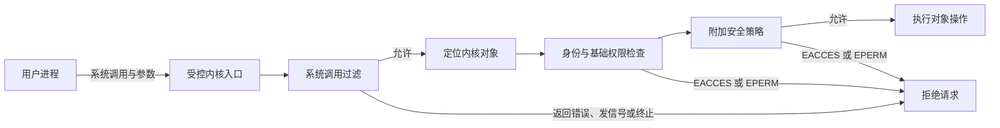

# 保护与安全

- 写作时间：`2026-03-04 首次提交，2026-07-13 最近修改`
- 当前字符：`9520`

[特权边界](/basics/03-privilege-boundary)说明用户程序不能直接修改页表或设备寄存器，[系统调用](/basics/04-system-call)则提供了受控的内核入口。不过，“只能请内核执行”还不等于“内核应当执行”。内核收到 `open("/etc/shadow", O_RDONLY)` 后，仍要判断调用者是谁、目标是什么、这次操作是否被允许。

这次判断从 **保护模型** 开始，明确主体、客体、操作与最小权限；进程凭据和文件元数据形成 **身份与 DAC**；传统 root 权限被 **Capabilities** 拆成更小单元；**LSM** 在内核授权点叠加额外安全策略；**Seccomp** 限制进程能够进入哪些系统调用；**内存安全** 防止越界和释放后使用等缺陷破坏前述边界；最后用 **密码学基础** 区分加密与散列能够提供的不同保证。

## 保护模型

保护模型(protection model)是操作系统用主体、客体、操作和策略描述资源访问，并在可信边界内执行授权决定的方法。

主体(subject)是发起操作的活动实体，例如带有一组凭据的进程或线程；客体(object)是被操作的资源，例如 inode、套接字、进程、共享内存或设备；操作(action)是读取、写入、执行、发送信号、挂载等具体请求；策略(policy)规定哪些主体可以对哪些客体执行哪些操作。

基础章节讲过的 Ring 0 与 Ring 3 解决执行权限隔离。用户态不能直接执行修改控制寄存器、配置中断控制器等特权指令，只能通过系统调用切换到受控内核入口。进入内核以后，CPU 不会自动知道 UID 1000 是否可以读取某个 inode；内核仍必须根据进程凭据、对象属性和安全策略完成软件授权。

这张图表示常见的授权职责，不规定每条内核路径都必须按图中的线性顺序执行全部检查。具体检查点取决于对象与操作，基础权限与附加策略的实现还可能共享内核基础设施；关键语义是相关检查必须全部允许，任一限制层拒绝都会终止请求。`EACCES` 与 `EPERM` 都表示权限不足，只是具体接口选择的错误码可能不同。

执行授权的内核部分可以视为引用监视器(reference monitor)。有效的引用监视器至少需要满足三点：所有受保护操作都经过检查，用户不能篡改检查逻辑与策略，检查机制足够明确以便审计和验证。若程序先在用户态检查路径，再让内核按该字符串操作，攻击者可能在两步之间替换对象；因此最终授权必须作用于内核解析得到的实际 inode、套接字或任务对象。

安全目标必须结合威胁模型(threat model)。只防止普通用户误读文件，与防止已攻陷网络服务逃出容器，需要的边界不同。[命名空间](/process/06-namespace)限制一组进程能看见哪些对象，[cgroups](/process/07-cgroup)限制它们能消耗多少资源，但可见性与资源额度本身不等于访问授权；容器仍要配合更细的权限、对象级策略、系统调用过滤和及时修复内核漏洞。

最小权限原则要求主体只获得完成当前任务所需的最小操作集合、对象范围和有效时间。它不能保证程序没有漏洞，但能缩小漏洞成功后可影响的资源范围。

## 身份与 DAC

身份与自主访问控制(Discretionary Access Control, DAC)是 Linux 根据进程凭据以及对象所有者、组、模式位和附加访问条目进行授权的基础机制。

[命名空间](/process/06-namespace)已经展示过用户命名空间如何映射 UID 与 GID；本节继续拆开一个任务在当前命名空间中的具体凭据。内核任务引用不可由用户空间直接改写的 `struct cred` 对象：真实 UID/GID 记录进程来源身份，有效 UID/GID 参与许多权限判断，保存 ID 允许程序按规则恢复此前的有效身份，文件系统 UID/GID 则专用于文件访问检查并通常跟随有效 ID。附加组是进程除主组之外所属的组集合。授权检查读取这些内核凭据，而不是进程自行声明的用户名字符串。

set-user-ID 是可执行文件模式位提供的一种身份转换：程序经 `execve()` 启动时，有效 UID 可以变成文件所有者。保存 ID 让这类程序暂时放弃高权限身份后，在规则允许时重新取得它，而不必始终以高权限运行。

普通 inode 的模式位分为所有者、所属组和其他用户三组，每组具有 `r`、`w`、`x` 位。三个位对普通文件和目录的含义并不完全相同：

| 位 | 普通文件 | 目录 |
|----|----------|------|
| `r` | 读取文件内容 | 枚举目录项名称 |
| `w` | 修改文件内容 | 创建、删除或重命名目录项，通常还需 `x` |
| `x` | 请求把文件作为程序执行 | 搜索目录并继续解析下一级名称 |

删除文件检查的重点是父目录权限，不是目标文件的写位，因为 `unlink()` 修改的是目录项。目录上的粘滞位(sticky bit)又增加一层限制，例如 `/tmp` 虽可由多人写入，但普通用户通常只能删除自己拥有的条目。[崩溃一致性](/filesystem/04-crash-consistency)的文件创建示例已经用过 `umask`：它不直接修改已有文件，而是在创建时从请求模式中屏蔽权限位。

POSIX 访问控制列表(Access Control List, ACL)允许 inode 为特定用户和组增加条目，突破“一个所有者、一个所属组、其他人”三组模式位的表达限制。访问检查仍由内核在对象操作处完成，ACL 只是提供更细的 DAC 策略数据。

DAC 中的“自主”表示对象所有者通常可以通过 `chmod()`、受限的 `chown()` 操作或 ACL 调整访问。它适合日常文件共享，但无法表达“即使文件所有者愿意，也不允许 Web 服务读取 SSH 私钥”这类强制组织策略，因此内核还需要一层由管理员统一施加、对象所有者不能自行取消的策略。

[VFS 与实现](/filesystem/02-vfs)说明 `open()` 成功后，fd 会持有打开文件对象而不是继续依赖路径。权限检查也因此具有时间边界：随后修改路径权限或删除名称，通常不会自动撤销已有 fd。系统设计若要求即时撤销，需要控制对象本身、关闭或替换连接，或者使用每次操作都会重新授权的协议，不能只修改路径模式位后假设所有旧引用失效。

## Capabilities

Capabilities 是 Linux 把传统超级用户权限拆分成多个可独立授予和移除的线程级特权单元。

早期 Unix 把进程大致分成 UID 0 与非 UID 0：root 可以绕过大量检查，普通用户接受完整检查。Linux 2.2 起逐步用 Capabilities 拆分这些能力。例如 `CAP_NET_BIND_SERVICE` 允许绑定低端口，`CAP_CHOWN` 允许改变文件所有者，`CAP_SYS_PTRACE` 允许在相应权限范围内追踪和检查其他进程，`CAP_DAC_OVERRIDE` 允许绕过部分文件权限。

每个线程维护多组 capability 位集合：

| 集合 | 作用 |
|------|------|
| 允许集(Permitted) | 线程当前可以转入 Effective 的能力上限 |
| 生效集(Effective) | 内核执行特权检查时实际使用的能力 |
| 可继承集(Inheritable) | 与文件属性共同影响 `execve()` 后可继承能力 |
| 边界集(Bounding) | 限制 `execve()` 期间能够获得的能力 |
| 环境集(Ambient) | 在同时属于 Permitted 与 Inheritable 等约束下，跨普通 `execve()` 保留的能力 |

[VFS 与实现](/filesystem/02-vfs)介绍的 xattrs 还可以保存文件能力(file capabilities)，让程序执行时只获得所需能力，而不必成为 set-user-ID root 程序。例如，在默认低端口配置下，仅需绑定 80 端口的服务可以取得 `CAP_NET_BIND_SERVICE`，而不应同时获得挂载文件系统、加载内核模块和修改系统时间的能力。启动完成后主动清除不再需要的 Effective 与 Permitted 位，可以进一步缩短特权存在时间。

`CAP_SYS_ADMIN` 覆盖了大量不相关管理操作，授予它往往接近授予广泛系统控制权，不能把它当成解决权限错误的通用开关。容器配置中常见的 `--privileged` 还会开放全部 Capabilities、设备访问并放宽部分安全策略，显著削弱原本需要验证的隔离边界，但不会凭空取消所有命名空间结构。

[命名空间](/process/06-namespace)已经说明，进程可以在自己的 User namespace 中拥有相对 root 身份和一组能力，却没有初始 User namespace 中的同等权限。检查某项能力时，内核还要结合该操作所管辖的 User namespace 解释，不能只看 capability 名称是否出现在进程状态中。

## LSM

Linux 安全模块(Linux Security Modules, LSM)是内核在文件、进程、网络和其他敏感操作路径上提供安全钩子，让安全模块叠加额外访问控制的框架。

VFS 解析和打开 inode 的路径中会经过相应 LSM hook；进程发送信号、创建套接字、加载内核模块或映射可执行内存时，也有对应安全检查点。具体模块注册 hook 并读取主体与客体的安全状态，返回 0 允许操作，或返回错误拒绝。授权位于对象真正被操作的路径中，因此不能通过换一个用户态 API 绕开。Capabilities 的通用检查代码也注册在这套框架中，所以 Capabilities 是一种特权语义，LSM 则是承载多种安全模块的实现框架。

安全增强型 Linux(Security-Enhanced Linux, SELinux)主要使用标签和类型强制策略。进程、inode、套接字等对象带有安全上下文，策略描述某类主体对某类客体可执行哪些操作。AppArmor 主要以程序配置文件和路径规则表达约束。Landlock 允许非特权进程为自己及后代增加限制，可以约束文件层次，并按运行内核支持的 Landlock ABI 限制 TCP、UDP 端口等网络操作，适合应用主动缩小可访问范围。它们策略表达不同，但都通过 LSM hook 接入内核授权点。

LSM 会在基础权限机制之外参与相关授权点。文件模式位允许并不保证最终允许，限制型 LSM 仍可拒绝；反过来，限制型策略也不会把 DAC 已经拒绝的普通访问直接变成允许。分层检查让系统管理员可以保留 Unix 权限的日常管理方式，同时施加对象所有者也不能自行取消的强制访问控制(Mandatory Access Control, MAC)。这里的 MAC 指访问控制策略，不是网络设备使用的 MAC 地址。

安全拒绝需要可观测性。SELinux 的访问向量缓存(Access Vector Cache, AVC)拒绝记录、AppArmor 记录和内核审计子系统的日志通常会包含主体上下文、目标、请求权限与拒绝原因。正确排障方式是先读取拒绝记录并理解缺少的最小授权，而不是直接关闭策略或改成全局宽松模式。

## Seccomp

安全计算(Secure Computing, Seccomp)是 Linux 在系统调用入口根据体系结构、系统调用号和原始参数执行过滤动作的机制。

Seccomp 过滤器使用经典伯克利包过滤器(classic Berkeley Packet Filter, cBPF)指令程序检查 `seccomp_data`。过滤器可以允许调用、返回指定 `errno`、发送 `SIGSYS`、通知监控进程、记录日志或终止线程/进程。过滤器一旦安装，后续还可以继续叠加更严格过滤；普通进程通常先设置 `no_new_privs`，保证后续 `execve()` 不会借 set-user-ID 或文件能力获得新权限，从而破坏原过滤假设。

系统调用号只在特定 ABI 中有意义，同一个数字在不同体系结构下可能代表不同调用。因此可靠过滤器必须同时检查 `seccomp_data.arch` 与 `nr`，确认体系结构和系统调用号，再解释参数。只按开发机器上的调用号生成规则，可能在兼容 ABI 或另一种架构上得到完全不同的含义。

过滤器只能检查系统调用号和寄存器中的原始参数值，不能解引用用户指针。路径参数在这里仅表现为一个地址数值，cBPF 无法读取它指向的字符串，因此不能据此完成路径授权。用户空间通知的监控进程虽然可以另行读取目标进程内存，但必须先复制全部参数再作决定，并避免检查结果与实际使用之间再次产生 TOCTOU。对象级策略应交给 DAC、LSM 或以 fd 为基础的内核接口，Seccomp 更适合表达“这个进程根本不需要 `mount()`、`ptrace()`、`bpf()` 或创建原始套接字”。

Seccomp 减少的是进程可触达的内核攻击面。一个只解析图片的工作进程若只需 `read()`、`write()`、`mmap()`、`futex()` 和少量信号调用，禁止其余入口可以让解析器漏洞更难进一步调用危险内核功能。但允许 `read()` 不表示它可以读取任意文件，允许 `ioctl()` 也可能暴露大量设备专属命令；系统调用集合必须与 fd、命名空间、Capabilities 和 LSM 策略共同设计。

:::thinking 既然 Seccomp 能禁止系统调用，为什么还需要文件权限与 LSM？

Seccomp 主要判断“能否调用某类入口”，DAC 与 LSM 判断“能否对某个实际对象执行某项操作”。服务必须调用 `openat()` 才能读取配置，也可能用同一调用尝试读取私钥；完全禁止 `openat()` 会破坏正常功能，只允许它又无法区分目标 inode。

因此 Seccomp 负责收缩接口集合，DAC 与 LSM 负责对象级授权。两者组合后，进程既不能进入业务不需要的内核功能，也不能借允许的系统调用访问策略外对象。
:::

## 内存安全

内存安全(memory safety)是程序只访问仍处于生命周期内、且位于已授权对象边界内的内存。

空间错误包括越界读写、错误长度和非法指针；时间错误包括释放后使用、重复释放和悬空引用。普通崩溃只影响可用性，但攻击者若能控制越界内容或对象重用时机，可能读取密钥、修改函数指针、构造任意代码执行，并最终绕过更高层授权。内核中的内存破坏尤其严重，因为被破坏代码运行在 Ring 0。

[特权边界](/basics/03-privilege-boundary)介绍过不可执行页 NX，[地址空间与分页](/memory/01-address-space-paging)介绍过用户空间 ASLR。内核地址空间布局随机化(Kernel Address Space Layout Randomization, KASLR)把同一思路用于内核地址；这些机制与下面的对象边界检测共同形成多层缓解。

| 机制 | 主要作用 | 边界 |
|------|----------|------|
| NX / 不可同时写与执行(W^X) | 阻止同一内存页同时可写且可执行，限制注入代码执行 | 不能阻止利用已有代码或数据破坏 |
| ASLR / KASLR | 随机化用户空间或内核地址布局 | 信息泄漏可能削弱随机化 |
| 栈金丝雀(stack canary) | 检测部分栈缓冲区覆盖 | 不覆盖所有越界和非栈对象 |
| 保护页(guard page) | 在栈或分配区边界留下不可访问页 | 细粒度对象内越界仍可能不触页错误 |
| 控制流完整性(Control-Flow Integrity, CFI) | 限制间接控制流转移到预期目标集合 | 依赖编译器覆盖与策略精度 |
| 动态检测器(sanitizer) / 模糊测试(fuzzing) | 在测试中发现越界、未定义行为和异常输入路径 | 不是生产环境授权机制 |

这些机制增加利用难度或提早暴露错误，但不能把不安全内存访问变成正确代码。减少手工生命周期管理、使用具有边界检查和所有权约束的语言、缩小不安全代码范围、启用编译器加固并持续模糊测试，属于缺陷预防；ASLR、NX 和 CFI 属于缺陷已经存在时的利用缓解。两类措施不能互相替代。

安全边界最终取决于每层都成立：硬件阻止用户态直接获得内核权限，内核对象操作执行完整授权，进程只持有最小接口与能力，内存实现不让攻击者改写检查状态。任何一层失效，其他层仍应限制影响范围，这就是纵深防御(defense in depth)的具体含义。

## 密码学基础

密码学基础是用明确的算法、密钥和协议属性保护数据机密性、完整性与来源可信度的基本机制。

高级加密标准(Advanced Encryption Standard, AES)是以 128 bit 为一个分组、使用 128、192 或 256 bit 密钥的对称分组密码。加密与解密使用同一秘密密钥；AES 本身只定义单个分组怎样变换，实际系统还必须选择工作模式并正确管理密钥与一次性值(nonce)。需要同时保护机密性和检测篡改时，可以使用 AES-GCM 这样的认证加密模式，但同一密钥下重复 nonce 会破坏其安全保证。

安全散列算法(Secure Hash Algorithm, SHA)是一族把任意长度输入映射为固定长度摘要的散列算法，例如 SHA-256 产生 256 bit 摘要。它没有解密过程，也不依赖秘密密钥，适合检测内容是否变化和构造其他密码学协议；它不能隐藏原文，普通 `SHA(message)` 也不能证明消息来自持有某个密钥的发送者。需要密钥认证时应使用专门的消息认证构造，而不是把“散列”和“加密”当成同一种操作。

在操作系统课程中，记住边界比展开算法内部步骤更重要：AES 主要提供带密钥的保密基础，SHA 主要提供无密钥的摘要基础，两者都必须放入完整协议才能形成可验证的安全属性。

## 小结

| 概念 | 说明 |
|------|------|
| 保护模型 | 用主体、客体、操作和策略描述并执行资源授权 |
| DAC | 根据进程凭据与对象所有者、组、模式位和 ACL 判断访问 |
| Capabilities | 把传统 root 权限拆成可独立授予和移除的线程级能力 |
| LSM | 在内核对象操作路径叠加 SELinux、AppArmor、Landlock 等策略 |
| Seccomp | 按系统调用号和参数收缩进程可进入的内核接口集合 |
| 内存安全 | 保证访问位于有效对象边界和生命周期内，并用多层机制缓解缺陷 |
| AES / SHA | AES 是对称分组密码，SHA 是散列算法族，二者用途与保证不同 |

硬件特权级只保证安全检查必须经过内核，真正的保护来自对象级授权、最小特权、接口收缩和内存实现共同构成的完整执行链。

---

**文档与源码入口**：
- [`credentials(7)`](https://man7.org/linux/man-pages/man7/credentials.7.html)：Linux 进程身份与凭据
- [`capabilities(7)`](https://man7.org/linux/man-pages/man7/capabilities.7.html)：Capability 集合与 `execve()` 转换
- [Linux Security Modules](https://www.kernel.org/doc/html/latest/userspace-api/lsm.html)：LSM 用户空间接口与安全上下文
- [LSM Development](https://www.kernel.org/doc/html/latest/security/lsm-development.html)：内核安全 hooks
- [Landlock](https://docs.kernel.org/userspace-api/landlock.html)：非特权进程主动收缩文件与网络访问范围
- [Seccomp BPF](https://www.kernel.org/doc/html/latest/userspace-api/seccomp_filter.html)：过滤模型、动作与边界
- [Kernel Self-Protection](https://www.kernel.org/doc/html/latest/security/self-protection.html)：内核自保护目标与缓解机制
- [NIST FIPS 197](https://csrc.nist.gov/pubs/fips/197/final)：AES 的分组与密钥规格
- [NIST FIPS 180-4](https://csrc.nist.gov/pubs/fips/180-4/upd1/final)：安全散列算法标准
- [`security/`](https://github.com/torvalds/linux/tree/master/security)：LSM 框架与安全模块源码

[虚拟化](/virtualization/01-virtualization)将继续说明，安全机制限制一个进程能操作哪些宿主对象以后，虚拟化怎样让一组操作系统看见独立的虚拟 CPU、内存和设备。
