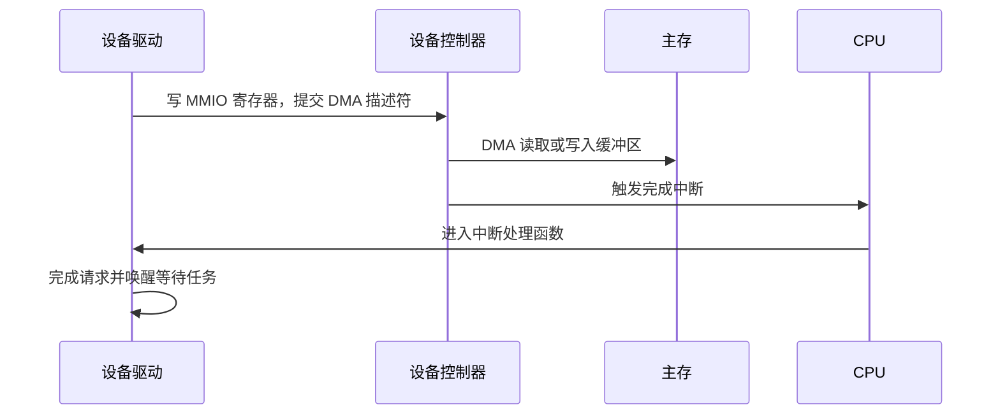
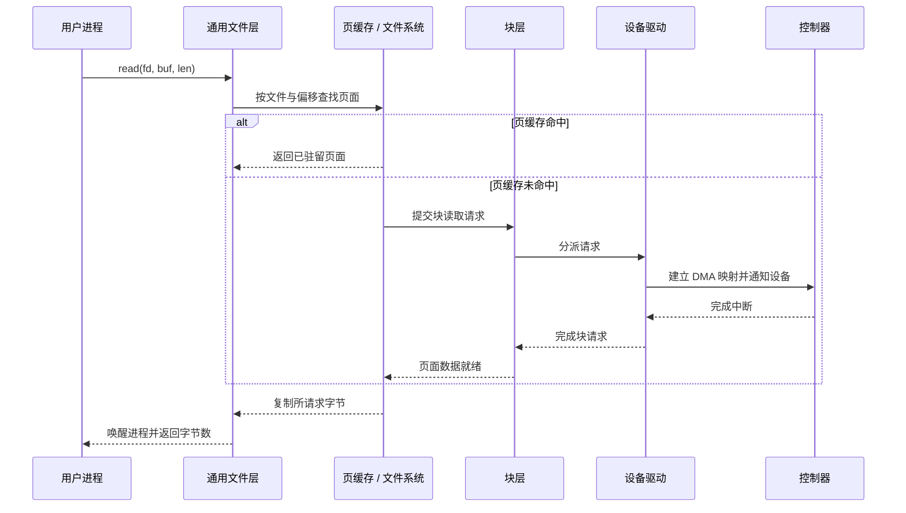

# I/O 系统

- 写作时间：`2026-03-04 首次提交，2026-07-13 最近修改`
- 当前字符：`10133`

[IPC 机制](/network/02-ipc)说明了进程怎样通过内核缓冲区或共享页交换数据，套接字最终仍要驱动网卡，文件写回也可能到达存储设备。[操作系统与硬件](/basics/01-os-overview)介绍过中断和 DMA 的基本作用，但还没有连接一次具体系统调用：应用执行 `read()` 后，内核何时只访问缓存，何时构造设备请求，驱动又怎样把它变成控制器可以执行的操作？

来看一次普通文件读取。应用只传入 fd、缓冲区和长度，设备却使用寄存器、DMA 地址、队列项和完成通知。**I/O 硬件**规定 CPU、内存与控制器交换命令和数据的基本方式；**I/O 路径**说明请求怎样分派，以及缓存命中为何不会到达设备；**设备类型**按访问语义组织驱动接口；**I/O 语义**拆开阻塞、异步完成、缓存路径和持久化保证；**缓冲与缓存**分别处理速度不匹配和重复访问；**零拷贝**最后减少不必要的 CPU 数据复制。六个概念共同缩小应用接口与设备执行模型之间的差异。

存储与 I/O 这一章会沿同一条路径继续向下。本课建立从应用到硬件的整体模型。[中断与设备驱动](/storage/02-interrupt-driver)深入设备完成后的执行上下文，[块 I/O 层](/storage/03-block-layer)再讨论块请求、多队列提交、I/O 调度以及现代存储设备的并行结构。

## I/O 硬件

I/O 硬件是处理器之外负责输入、输出或持久化数据的设备及其控制器，CPU 通过设备寄存器向它们提交命令并读取状态。

设备控制器通常暴露控制寄存器、状态寄存器和队列通知寄存器。控制寄存器接收操作要求，状态寄存器报告忙闲、完成或错误，内存中的描述符队列则记录命令、长度和数据地址。队列通知寄存器(doorbell register)让驱动告诉控制器“队列中已经加入新命令”。设备是执行输入输出的硬件，控制器是 CPU 与设备交互的命令接口；两者可能集成在同一硬件中，但驱动主要面对控制器协议。

端口映射 I/O(port-mapped I/O)把设备寄存器放进独立的 I/O 地址空间，其中每个编号位置就是一个 I/O 端口，x86 可用 `in`、`out` 等特权指令访问。[操作系统与硬件](/basics/01-os-overview)介绍的 MMIO 则把设备寄存器放在物理地址空间的一段 I/O 区域，驱动先映射资源，再通过 `readl()`、`writel()` 等体系结构访问器读写。MMIO 地址不是普通 RAM：访问宽度、顺序、缓存属性和写入何时到达设备都受平台规则约束，单纯把指针声明成 `volatile` 不能替代内核访问器和必要的内存屏障。

这里的 MMIO 与[内存映射](/memory/03-memory-mapping)中的文件 `mmap()` 不是同一语义。前者让内核驱动访问设备寄存器，读写可能产生硬件副作用；后者给用户进程建立普通虚拟内存映射，文件数据通常经过页缓存。两者都借助地址映射，但映射对象、访问权限和一致性规则完全不同。

提交命令以后，CPU 还要知道设备何时完成。[特权边界](/basics/03-privilege-boundary)介绍过轮询和中断：轮询让 CPU 反复读取状态或完成队列，省去中断进入与退出成本，设备很快完成时可获得较低延迟；等待时间较长时却会持续占用 CPU。中断允许 CPU 提交请求后执行其他任务，由设备在完成时触发通知。[中断与设备驱动](/storage/02-interrupt-driver)会继续拆分硬中断、延后处理与轮询批处理的关系。

少量控制信息可以由 CPU 直接读写寄存器，大量数据通常交给[操作系统与硬件](/basics/01-os-overview)介绍的 DMA。驱动不能把普通 CPU 虚拟地址直接交给设备，而要通过 DMA API 建立映射，得到类型为 `dma_addr_t` 的设备地址并写入描述符。设备控制器随后在设备与 RAM 之间传输数据，CPU 只负责建立映射、提交命令和处理完成。

设备地址也不必等于 CPU 看到的物理地址。[特权边界](/basics/03-privilege-boundary)介绍过 IOMMU 怎样把设备使用的 IOVA 翻译到获准物理页。若处理器与设备不会由硬件自动维持同一份缓存内容，DMA API 还必须在双方交接缓冲区时执行缓存同步；即使平台提供一致 DMA 内存，命令描述符与 doorbell 写入之间仍可能需要内存屏障。DMA API 同时表达地址能力、方向、一致性和生命周期，不只是计算一个地址。

:::thinking 已经有 DMA，为什么还需要中断？

DMA 解决的是“由谁搬数据”，并不解决“CPU 怎样知道搬完了”。如果没有中断，CPU 仍然要持续轮询 DMA 描述符或状态寄存器，才能发现完成事件。

中断把这两个职责拆开。设备控制器负责搬运数据，完成后只发送一次通知；CPU 在等待期间可以运行其他任务。高吞吐设备有时会混合两种方式，例如网卡第一次用中断唤醒接收路径，随后暂时轮询一批数据包，以减少每个包都触发中断的开销。
:::

## I/O 路径

I/O 路径是一次用户态请求经过与对象类型相匹配的内核层次并返回结果的执行链，缓存命中时可以在到达设备驱动之前结束。

应用调用 `read()` 时只给出 fd、用户缓冲区和长度。内核先在进程 fd 表中找到 `struct file`，再通过对象的操作表把请求分派给对应子系统。普通文件、套接字和字符设备虽然都支持 `read()`，之后的路径并不相同：普通文件进入页缓存和文件系统，套接字从协议接收队列取数据，字符设备则按驱动定义的读操作处理。

设备无关层(device-independent layer)是位于用户接口与具体设备驱动之间、统一对象查找、权限、缓存、排队和错误语义的内核部分。对普通文件，它包括通用文件层、页缓存、文件系统和块层；驱动再把通用请求翻译成控制器命令，中断路径把完成结果向上交还，最终唤醒或返回用户空间。不同对象经过的子系统不完全相同，但“用户接口 -> 设备无关机制 -> 设备驱动 -> 硬件，再由完成路径返回”的职责分层保持一致。

以本地块设备上普通文件的缓冲 I/O 为例，内核先按文件和偏移查找[内存映射](/memory/03-memory-mapping)介绍的页缓存。命中且页面数据有效时，只需把字节复制到用户缓冲区，不访问存储设备。未命中时，文件系统把文件偏移映射到存储位置，块层组织块请求，设备驱动再选择硬件队列、建立 DMA 映射、填充命令描述符并写 doorbell 寄存器。完成中断到来后，驱动结束块请求，页缓存页面变为可读，等待的 `read()` 才复制数据并返回。

驱动把通用子系统请求转换成具体控制器协议，但它不是所有 I/O 的直接下一层。文件系统与块层处理文件布局、合并和排队，网络栈处理路由与传输协议，缓存命中甚至不会进入驱动。分层让权限、错误、等待和缓存语义保持稳定，只把寄存器、DMA 队列与硬件错误处理留给设备相关代码。

## 设备类型

设备类型是内核根据寻址方式、数据边界和操作集合对设备接口进行的分类，其中字符设备、块设备和网络设备走不同通用子系统。

字符设备(character device)绕过块层，通过驱动定义的字节型 `read()`、`write()`、`ioctl()`、`mmap()` 等操作暴露设备语义。其中 `ioctl()` 用来发送无法由普通读写表达的设备专用控制命令，例如设置终端属性。终端和串口常表现为顺序流，但“字符设备”不保证所有设备都只能顺序访问，也不保证每个字符对应一次硬件操作；`/dev/null` 等设备节点甚至没有对应的物理设备。分类重点是使用字符设备操作接口，而不是数据一定按单字符传输。

块设备(block device)暴露可随机寻址的逻辑扇区序列，块层可以拆分、合并、排序和并发提交读写请求。机械硬盘、SSD 和由软件组合出的逻辑卷都可以通过块层接入。设备逻辑扇区、文件系统块和内存页是三个不同粒度，请求必须满足相应对齐和大小约束，不能把它们都称为同一个“块”。

Linux 用设备号把 `/dev` 下的字符或块设备节点连接到驱动。主设备号(major number)选择驱动或设备类别，次设备号(minor number)区分该驱动管理的实例或子设备。设备节点是特殊文件，只保存类型和设备号等元数据，不保存设备内容；`open()` 根据设备号找到相应操作表。

网络设备以数据包、收发队列和网络配置为核心，不通过普通字符或块设备读写路径传送应用数据；应用使用套接字，管理工具则可使用 Netlink。分类的目的不是把所有硬件归入两类特殊文件，而是让具有相同访问语义的设备共享一套内核接口。

## I/O 语义

I/O 语义是系统调用在等待方式、完成通知、缓存路径和持久化保证等维度上对调用者作出的行为约定。

这些维度彼此正交，不能用一个“同步”或“直接”概括：

| 维度 | 选项 | 回答的问题 |
|------|------|------------|
| 等待方式 | 阻塞 / 非阻塞 | 当前暂时不能推进时，调用线程是否睡眠 |
| 完成模型 | 同步返回 / 异步完成 | 请求结果是在系统调用返回时给出，还是稍后通过完成事件交付 |
| 数据路径 | 缓冲 I/O(buffered I/O) / 直接 I/O(direct I/O) | 文件数据是否通常经过页缓存 |
| 持久化 | 普通写 / 同步持久化 I/O(synchronized I/O) | 返回时只完成内存中的写入，还是要求数据和必要元数据到达存储边界 |

阻塞 I/O 在当前无法取得数据或空间时让线程等待。例如阻塞套接字没有数据时，`read()` 可以睡眠；管道已满时，`write()` 可以等待消费者。设置 `O_NONBLOCK` 后，这类暂时无法推进的调用通常返回 `EAGAIN` 或 `EWOULDBLOCK`。但 Linux 当前对普通文件和块设备不提供同样的非阻塞设备等待语义，即使设置 `O_NONBLOCK`，缓存未命中时仍可能因设备 I/O 短暂阻塞。

同步返回表示一次 `read()` 或 `write()` 在返回时已经给出本次传输的字节数或错误，调用线程可能在内部等待。异步接口则先提交请求，结果稍后通过完成队列、事件或回调取得；`io_uring` 就使用提交队列和完成队列分离这两个时间点。[事件驱动并发](/concurrency/04-event-driven)已经区分就绪通知与完成通知：`epoll` 通知“现在执行 I/O 大概率不会阻塞”，异步完成通知则表示某次已提交操作已经结束。

buffered I/O 是普通文件的默认路径，读写通过页缓存完成。`O_DIRECT` 请求 direct I/O，尽量让数据在存储设备与调用者缓冲区之间传输并绕过页缓存；文件偏移、长度和缓冲区地址通常受文件系统与设备对齐约束，不满足要求时可能失败或按具体实现处理。direct I/O 既不自动变成异步 I/O，也不保证避免用户态与内核态之间的数据复制，更不提供 `O_SYNC` 的持久化语义。混用 buffered I/O 与 direct I/O 还可能要求刷新和失效重叠的页缓存范围，因此通常应由同一应用明确协调。

普通 buffered `write()` 返回时，数据可能只进入脏页，稍后才由内核回写。`fsync()` 请求同步文件数据和相关元数据，`fdatasync()` 可以省略不影响数据读取的部分元数据，`O_SYNC` 则让每次写入承担同步完成要求。这里的 POSIX “synchronized I/O”专指持久化完成语义，与“系统调用是不是阻塞式返回”不是同一个维度。[断电后的文件更新协议](/filesystem/04-crash-consistency)会继续说明文件系统、设备缓存和落盘顺序的边界。

文件 `mmap()` 又是另一种访问形式。程序通过 load/store 和缺页访问文件页，普通映射仍通常使用页缓存；省去显式 `read()` 不表示整条路径已经避免数据复制，也不使它成为 direct I/O 或持久化接口。

## 缓冲与缓存

缓冲(buffering)是用一块临时存储协调生产者和消费者的速度或数据粒度，缓存(caching)则是保留已有数据的副本，以便后续重复访问时避免重新取得原始数据。

两者都可能占用 RAM，但解决的问题不同。终端输出缓冲区让应用先写入一批字符，设备随后按自身速度发送，这是速度协调；前文已经使用过的页缓存保留文件内容，下次读取同一页时直接从 RAM 返回，这是重复利用。同一内存区域可能同时承担两种作用，但分析时仍要区分“暂存尚未消费的数据”和“保留以后可能复用的副本”。

“缓冲”还可能位于不同层。C 标准库的 `FILE *` 可以在用户态聚合多次小写入，`write()` 再把数据送入内核；内核页缓存按文件页缓存内容；块层与设备控制器还有请求队列和硬件缓存。`fflush()` 只把 C 库缓冲提交给内核，不等于 `fsync()` 的持久化保证。名称都包含 buffer 或 cache，不代表刷新其中一层会自动完成所有后续层。

单缓冲只有一块区域，填充与处理容易串行化。双缓冲准备两块区域，设备填充 A 时消费者处理 B，随后交换角色，使数据传输和处理重叠。环形缓冲区把多个槽位按循环索引组织，生产者推进写位置，消费者推进读位置，适合持续数据流和硬件描述符队列。环形布局只规定槽位组织方式，并不自动保证多生产者、多消费者并发安全，索引更新仍需要相应同步协议。

缓冲区满时必须有明确策略。阻塞 I/O 会让生产者睡眠，非阻塞 I/O 返回 `EAGAIN`，某些实时数据流则可能丢弃旧数据或新数据。这正是[事件驱动并发](/concurrency/04-event-driven)介绍的背压：消费者速度不足时，系统必须限制生产者继续提交，而不能假设内存可以无限增长。

缓存也需要一致性规则。页缓存中的脏页已经被应用修改但尚未写回存储，内核必须跟踪何时提交和何时可以回收。设备 DMA 与 CPU 高速缓存的一致性则取决于平台：缓存一致 DMA 平台由硬件维持大部分可见性，非一致平台需要 DMA API 在所有权交接时执行同步；两者都仍要遵守内存屏障与设备协议。缓存提升平均性能，同时增加了“哪份数据最新、谁拥有缓冲区、何时必须写回”的状态管理。

## 零拷贝

零拷贝是减少数据在用户空间、内核缓冲区和设备之间由 CPU 执行的复制次数，而不是保证数据在整条路径上完全不移动。[IPC 机制](/network/02-ipc)已经用 AF_UNIX 说明“协议路径更短”不等于零拷贝，这里继续比较文件与套接字之间的数据路径。

传统文件发送通常先 `read()`，把页缓存中的数据复制到用户缓冲区；应用再 `write()`，把相同数据复制回套接字发送缓冲区。应用并不修改这些字节，两次跨边界复制只是为了把数据从一个内核子系统交给另一个内核子系统。

Linux 提供了几种不同边界的零拷贝接口：

| 接口 | 省掉的工作 | 主要限制 |
|------|------------|----------|
| `sendfile()` | 文件数据不必先复制到用户缓冲区，再写入套接字 | 输入通常是可读取文件，输出是套接字等支持对象 |
| `splice()` | 在文件描述符与管道之间转移内核缓冲区数据，不经用户数据区 | 至少一端必须是管道，具体路径仍可能复制 |
| `copy_file_range()` | 在两个文件之间请求内核内复制，不把数据送入用户缓冲区 | 支持范围与跨文件系统行为取决于内核和文件系统 |
| `MSG_ZEROCOPY` | 大块套接字发送时，尽量避免把用户缓冲区复制进内核 | 页面需要暂时固定，应用必须等待内核的完成通知 |

`sendfile()` 仍可能读取存储设备，也仍需要网卡 DMA 发送；它主要省去把同一批文件字节先复制到用户缓冲区再送回内核。`splice()` 和 `copy_file_range()` 同样表达“不经过用户数据区”的接口边界，底层是否完全用页引用转移仍取决于对象和文件系统实现。

使用 `MSG_ZEROCOPY` 前要在套接字上启用 `SO_ZEROCOPY`。发送调用返回后，网络栈仍可能引用用户页，应用不能立即覆盖或释放缓冲区；内核稍后通过套接字错误队列(error queue)报告完成范围，这条独立队列保存异步扩展错误和完成元数据。应用用带 `MSG_ERRQUEUE` 的 `recvmsg()` 取回通知后才能安全复用缓冲区。页固定、记账、DMA 映射和完成处理都有固定成本，较小消息往往普通复制更便宜，某些发送还可能回退到复制路径。

`io_uring` 本身也不等于零拷贝。它主要改变提交、批处理与完成通知方式，普通读写操作仍可能复制数据；只有使用特定零拷贝能力并满足设备与内存条件时，数据路径才会进一步变化。评估零拷贝必须覆盖整条路径：减少 CPU 复制可能增加页面固定时间、内存压力、生命周期管理和延迟错误处理。只有测量确认复制是主要瓶颈，再选择与数据来源和目标匹配的接口，优化才成立。

## 小结

| 概念 | 说明 |
|------|------|
| 端口映射 I/O | 用独立 I/O 地址空间和专用指令访问设备寄存器 |
| MMIO | 把设备寄存器映射进物理地址空间，由驱动使用专用接口访问 |
| 轮询 | CPU 反复检查设备状态，延迟直接但会占用处理器周期 |
| DMA | 设备通过 DMA API 提供的设备地址直接与 RAM 传输数据 |
| I/O 路径 | 请求按 fd 对象类型分派，缓存命中时可以不进入设备驱动 |
| 字符设备 | 通过驱动定义的字节型操作接口工作，不经过块层 |
| 块设备 | 暴露可随机寻址逻辑扇区，并通过块层组织请求 |
| 阻塞 / 非阻塞 | 规定暂时不能推进时，线程睡眠还是返回 `EAGAIN` |
| 同步 / 异步完成 | 规定结果随系统调用返回还是稍后从完成通道取得 |
| buffered / direct I/O | 规定普通文件数据是否通常经过页缓存，与完成模型和持久化正交 |
| synchronized I/O | 通过 `fsync()`、`O_SYNC` 等要求数据与必要元数据到达存储边界 |
| 缓冲 | 用临时区域协调速度、粒度并提供背压 |
| 缓存 | 保留数据副本，减少后续对慢速来源的重复访问 |
| 零拷贝 | 减少 CPU 执行的数据复制和不必要的用户态往返 |

I/O 子系统的核心工作是逐层缩小语义差距：应用表达“读取这些数据”，通用层组织权限、缓存和等待，驱动把请求翻译成设备命令，DMA 和中断最终完成传输与通知。

---

**接口、源码与文档入口**：
- [Bus-Independent Device Accesses](https://docs.kernel.org/driver-api/device-io.html)：端口 I/O、MMIO 访问器与映射接口
- [Dynamic DMA mapping Guide](https://docs.kernel.org/core-api/dma-api-howto.html)：CPU 地址、设备地址、一致性与 DMA 映射
- [`drivers/char/`](https://github.com/torvalds/linux/tree/master/drivers/char)：字符设备驱动示例
- [`block/`](https://github.com/torvalds/linux/tree/master/block)：块设备通用层
- [`mm/filemap.c`](https://github.com/torvalds/linux/blob/master/mm/filemap.c)：页缓存核心路径
- [`open(2)`](https://man7.org/linux/man-pages/man2/open.2.html)：`O_NONBLOCK`、`O_DIRECT`、`O_SYNC` 与 `O_DSYNC`
- [`fsync(2)`](https://man7.org/linux/man-pages/man2/fsync.2.html)：数据和元数据同步接口
- [iomap Supported File Operations](https://docs.kernel.org/filesystems/iomap/operations.html)：buffered I/O 与 direct I/O 路径
- [`sendfile(2)`](https://man7.org/linux/man-pages/man2/sendfile.2.html)：文件到输出 fd 的内核内传输
- [`splice(2)`](https://man7.org/linux/man-pages/man2/splice.2.html)：管道参与的内核缓冲区传输
- [`copy_file_range(2)`](https://man7.org/linux/man-pages/man2/copy_file_range.2.html)：文件区间的内核内复制
- [MSG_ZEROCOPY](https://docs.kernel.org/networking/msg_zerocopy.html)：套接字数据复制规避与完成通知
