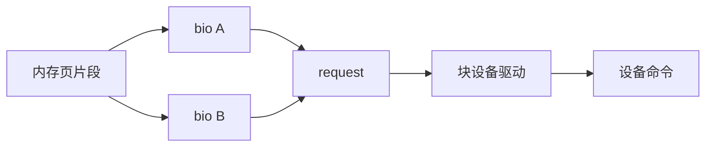
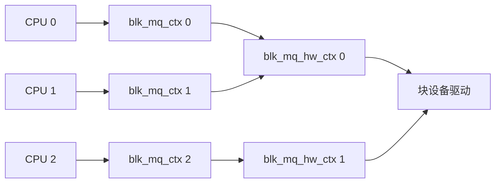

# 块层

- 写作时间：`2026-03-04 首次提交，2026-07-13 最近修改`
- 当前字符：`8959`

[中断与设备驱动](/storage/02-interrupt-driver)解释了驱动怎样接管设备、提交操作并接收完成通知。对于磁盘和 SSD，文件系统不会直接构造控制器命令：上层产生的是文件偏移和内存页，设备接受的却是逻辑块地址，而且一次只能容纳有限的数据段和在途命令。Linux 块层位于两者之间，负责把上层 I/O 转换成设备能够派发和完成的请求。

先用 **块 I/O 请求**区分 `bio`、`request` 与硬件命令；再看 **blk-mq** 怎样把多核提交映射到设备队列；请求仍留在软件中时，**I/O 调度器**可以调整派发次序；多个块设备还能通过 **RAID** 组合容量与冗余；最后进入 **SSD 与 NVMe**，理解闪存介质和 PCIe 多队列协议为什么改变了整个路径。

## 块 I/O 请求

块 I/O 请求是内核对某个块设备地址范围执行读、写、刷新或丢弃等操作的表示。

存储路径中同时出现了几种不同的“块”，先把它们区分开：

| 单位 | 所在层次 | 含义 |
|------|----------|------|
| 内存页 | 内存管理、页缓存 | I/O 数据在内存中的载体，`bio_vec` 用页、页内偏移和长度描述其中一段 |
| 文件系统块 | 文件系统 | 文件系统分配和定位数据的单位，常见大小是 4 KiB，但由具体文件系统决定 |
| 块层扇区 | Linux 块层 | `bio` 中的起始位置单位，固定按 512 字节计数 |
| 设备逻辑块与逻辑块地址 | 设备协议 | 设备能够寻址的最小单位及其编号，逻辑块常见为 512 字节或 4 KiB |

逻辑块地址(Logical Block Address, LBA)就是设备逻辑块的编号。假设设备的逻辑块大小是 4 KiB，那么一个设备 LBA 对应 8 个块层扇区；发往该设备的普通读写范围也必须满足它报告的大小与对齐限制。文件系统块、块层扇区和设备逻辑块可能恰好一样大，也可能完全不同，不能只看“块”这个名称就把它们当成同一个单位。

Linux 用 `struct bio` 描述从上层提交的一段块 I/O。`bi_iter.bi_sector` 保存起始块层扇区，操作字段说明读写类型，一组 `bio_vec` 指向实际承载数据的内存页片段。这些页不必在物理内存中连续；支持分散聚集 DMA(scatter-gather DMA)的设备可以读取一组地址和长度，在一次命令中完成多个不连续内存片段的传输。

`bio` 不是最终硬件命令。相邻、方向相同且满足设备限制的多个 `bio` 可以合并到一个 `struct request`；单个 `bio` 也可能因为最大扇区数、DMA 段数、边界或对齐限制而被拆分。`request` 是块层用于调度和派发的单位，可以包含一个或多个 `bio`。逻辑块设备层和低层驱动仍可能继续拆分或重映射请求，再据此构造设备命令，因此 `bio`、`request` 与硬件命令不是固定的一一对应关系。

读写之外，持久化和空间回收也要通过块请求表达：

| 操作或标志 | 语义 |
|------------|------|
| `REQ_OP_READ` / `REQ_OP_WRITE` | 从设备读取数据或向设备写入数据 |
| `REQ_PREFLUSH` | 在附带的 I/O 开始前，要求此前已经完成的写入到达非易失介质 |
| `REQ_FUA` | 这次写操作只有在数据进入非易失介质后才能报告完成 |
| `REQ_OP_DISCARD` | 提示设备某段逻辑地址中的旧数据已经无须保留 |

缓存刷新(flush)与强制单元访问(Force Unit Access, FUA)都在处理“设备已经报告写完，但数据仍停留在断电会丢失的缓存中”这个问题。`REQ_PREFLUSH` 要求此前写入已经到达非易失介质；只有刷新语义而不携带数据的请求会在块层内部成为 `REQ_OP_FLUSH`。`REQ_FUA` 约束当前这次写的完成时机，设备不原生支持 FUA 时，块层会在写完成后追加 flush 来实现相应语义。discard 只是回收提示，不是安全擦除；丢弃后再次读取会得到零、旧值还是其他内容，不能由通用块层语义保证。

完成路径沿相反方向返回。驱动从中断或轮询路径发现设备命令完成，向块层报告 `request` 的状态；块层再完成其中的 `bio`，调用各自的完成函数并传播错误。只有相应范围完成，上层等待者才能继续。块层和设备协议都不保证不同 `request` 按提交顺序完成，需要顺序约束的文件系统必须显式使用合适的依赖、flush 或 FUA。

## blk-mq

多队列块层(multi-queue block layer, blk-mq)是 Linux 把多核产生的块请求并行映射到驱动派发队列的框架。

旧式单队列设计让所有 CPU 竞争同一条请求队列及其锁。机械硬盘本身并行度较低时，这个瓶颈尚不突出；多核系统连接高并行度 SSD 控制器后，设备能够同时处理许多命令，单一软件队列反而可能先耗尽 CPU 时间并引发缓存行竞争。

blk-mq 用 `struct blk_mq_ctx` 表示与 CPU 关联的软件提交上下文，用 `struct blk_mq_hw_ctx` 表示面向低层驱动的硬件派发上下文。请求需要合并、调度或暂时等待时，会进入软件队列；没有这些需求且驱动有资源时，也可以直接尝试派发。硬件派发上下文通常映射到设备提交队列或 DMA 环，但它是块层对象，不保证与物理硬件队列严格一一对应。

软件上下文数量和硬件派发上下文数量不必相等。系统可能有 64 个 CPU，驱动却只建立 8 个派发上下文；blk-mq 根据 CPU 拓扑、驱动能力和队列类型建立映射。CPU 本地提交减少前端共享状态，多个派发上下文则保留设备能够利用的并行度。

标签(tag)是 blk-mq 为在途 `request` 分配的整数槽位编号。派发后，驱动可以凭 tag 在完成路径中快速找到原 `request`，而不必遍历整条队列；驱动还可以把它转换成设备协议使用的命令标识。不过，tag 首先是块层资源，不能把它理解成所有设备都原生提供的统一命令编号。启用额外的软件排序层时还可能存在排序层 tag 与驱动 tag，两者分别约束软件排队和实际在途请求。

当驱动暂时没有命令槽位时，请求会留在派发列表，资源释放后再重试。blk-mq 提供的是提交、排队、tag 管理和完成机制，并不强制请求一定经过排序；是否插入调度策略由设备和系统配置决定。

## I/O 调度器

I/O 调度器(I/O scheduler)是对仍停留在块层软件队列中的 `request` 决定派发顺序和时机的策略。

块层在构造请求时已经可能进行合并，调度器还可以利用请求位置和来源影响后续合并与排序。机械硬盘的磁头移动成本很高，按相邻扇区派发能减少寻道；SSD 没有机械寻道，但仍存在队列占用、公平性和尾延迟问题。现代调度策略因此既考虑位置，也考虑等待时间和请求来源。

`mq-deadline` 同时维护按扇区位置和按到达时间组织的请求。位置顺序有利于顺序访问，过期队列则防止请求无限等待。这里的 deadline 是“请求应该在软件队列中被选中派发”的期限，不是设备必须在该时刻前完成的硬实时保证。请求交给驱动以后，设备固件仍可能改变执行和完成顺序。

预算公平队列(Budget Fair Queueing, BFQ)把请求按进程或控制组归入队列，并为队列分配以服务量计的预算。一个队列消耗完预算后再让其他队列获得服务，从而改善交互响应和带宽公平。它适合共享桌面、较慢设备以及需要 cgroup 权重控制的场景，但处理成本通常高于简单策略，而且是否可选取决于内核配置与设备队列。

| 调度器 | 主要目标 | 常见适用倾向 |
|--------|----------|--------------|
| `none` | 不做额外重排，尽快尝试派发 | 专用高速设备、设备自身调度充分 |
| `mq-deadline` | 限制饥饿和软件排队延迟，同时保留位置排序 | 通用块设备、重视尾延迟可预测性 |
| `bfq` | 按队列预算提供带宽公平和交互响应 | 共享桌面、慢速设备、需要权重隔离 |

`none` 表示不启用额外的排序策略，不表示系统中没有软件队列、tag 或设备队列。实际可用的调度器可以从 `/sys/block/<device>/queue/scheduler` 查看。没有一种策略对所有设备和负载都最好，顺序或随机访问、队列深度、吞吐目标与尾延迟目标都必须通过测量判断。

:::thinking 设备已经有很多硬件队列，为什么还可能需要 I/O 调度器？

硬件队列提供并行提交能力，却不知道请求属于前台交互程序还是后台批处理。一个持续写入的任务仍可能占满命令槽位，让同步读取在软件队列中长时间等待。

I/O 调度器可以在请求进入硬件之前限制单个来源的占用、优先派发等待过久的读取，或按 cgroup 权重分配服务。专用负载可以选择 `none` 降低软件开销，共享设备则可能需要公平和延迟策略。
:::

## RAID

独立磁盘冗余阵列(Redundant Array of Independent Disks, RAID)是把多个块设备组合成一个逻辑块设备，以聚合容量、并行处理 I/O、提供故障冗余或组合这些目标。

条带化(striping)先把逻辑地址空间切成固定大小的分块(chunk)，再把连续分块轮流放到不同成员设备；横跨一轮成员位置的一组分块构成条带(stripe)。镜像(mirroring)把同一份数据保存到多个成员。校验(parity)则根据一组数据计算冗余信息，使阵列能在部分成员失效后重建缺失内容。

假设有 `N` 块同容量设备，每块容量为 `S`，下面比较的是常见布局；RAID 10 按两路镜像且 `N` 为偶数计算：

| 级别 | 最少成员 | 数据布局 | 可用容量 | 可容忍故障 | 主要特点 |
|------|----------|----------|----------|------------|----------|
| RAID 0 | 2 | 条带化，无冗余 | `N × S` | 0 块 | 并行吞吐高，任一成员失效都会破坏阵列 |
| RAID 1 | 2 | `N` 路完整镜像 | `S` | 最多 `N−1` 块，但必须留下一个完整副本 | 读取可分散，容量利用率低 |
| RAID 5 | 3 | 条带化 + 单校验 | `(N−1) × S` | 1 块 | 容量效率较高，小随机写有校验代价 |
| RAID 6 | 4 | 条带化 + 双校验 | `(N−2) × S` | 2 块 | 冗余更强，写入计算和 I/O 更多 |
| RAID 10 | 4 | 两路镜像后条带化 | `N/2 × S` | 取决于失效是否落在同一镜像组 | 读写并行度与恢复速度较好 |

RAID 5 和 RAID 6 的小范围写入通常无法覆盖完整条带。控制器或 Linux 多设备(Multiple Devices, MD)子系统可能先读取旧数据和旧校验，计算新校验，再分别写回数据与校验，这称为读改写(read-modify-write)。完整条带写可以直接根据新数据计算校验，但上层请求不一定天然对齐并覆盖完整条带。

数据块与校验块分布在不同设备上，更新不能天然原子完成。若断电发生在其中一部分写完之后，数据和校验可能不一致，这就是 RAID 写洞(write hole)。写意图位图可以记录哪些区域需要在重启后重新同步并缩小检查范围，但不会把多设备写入变成原子操作。Linux MD 可以用写日志保护校验阵列；RAID 5 还可以使用部分校验日志(Partial Parity Log, PPL)恢复一致的校验。PPL 不保存所有在途新数据，因此它防止的是降级恢复时的静默损坏，不等于完整的预写日志。设备的掉电保护以及正确的 flush/FUA 语义也很重要，但不能单独替代阵列级一致性机制。

RAID 不是备份。误删除、文件系统损坏、勒索软件和控制器错误可能同时影响所有成员，阵列也不保存历史版本。成员失效后的重建还会长时间读取幸存设备，既降低性能，也增加重建期间再次遇到错误的风险。

## SSD 与 NVMe

SSD 是通常以 NAND 闪存保存数据的存储设备；非易失存储快速接口(Non-Volatile Memory Express, NVMe)是一组让主机软件与非易失存储通信的接口和命令规范。NVMe 可以绑定到不同传输，本课聚焦本机 SSD 常用的 PCIe 传输。

NAND 闪存按页读取和编程，却必须按更大的擦除块执行擦除；已经编程的物理页不能像内存一样直接原地覆盖。SSD 控制器中的闪存转换层(Flash Translation Layer, FTL)把主机 LBA 映射到不断变化的物理闪存页。新数据通常写入空闲页，旧映射随即失效，因此主机看到的固定 LBA 并不对应固定闪存位置。

垃圾回收(garbage collection)把擦除块中的有效页搬到别处，再擦除整个块以取得空闲页。磨损均衡(wear leveling)分散擦除次数，避免少数块过早耗尽寿命。设备为了完成主机写入而在内部搬移数据，会让实际写入闪存的字节数大于主机提交量；两者之比称为写放大(write amplification)。空闲空间越紧张、随机覆盖越分散，垃圾回收和写放大通常越明显。

文件系统释放空间后，可以通过 Linux 块层的 discard 操作告诉 SSD，相应 LBA 的旧内容已经不再需要；设备协议再把它转换成 TRIM、deallocate 等具体命令。这个提示允许 FTL 在垃圾回收时少搬有效页，但设备可以延迟处理。discard 不是安全擦除，也不保证随后读取一定返回零。

SSD 还可能使用易失写缓存，在数据尚未进入 NAND 时就报告普通写完成。带掉电保护(power-loss protection, PLP)的设备可以在失电时把缓存内容保存到非易失介质；没有这种能力时，文件系统必须依赖设备正确实现 flush 和 FUA 才能建立持久化顺序。高顺序写带宽并不能证明设备在断电后保留了已经确认的每次写入。

[事件驱动并发](/concurrency/04-event-driven)中的 io_uring 已经用提交队列和完成队列分离“发出操作”与“取得结果”；在 PCIe 传输中，NVMe 把同样的队列关系落实为主机与存储控制器之间的硬件协议。驱动把命令写入主机内存中的提交队列，再更新队列通知寄存器；控制器读取新的提交项，把结果写入完成队列，再通过 MSI-X 中断或轮询通知 CPU。每条提交队列会关联一条完成队列，一条完成队列也可以接收多条提交队列的结果。

串行 ATA(Serial ATA, SATA)存储控制器常使用高级主机控制器接口(Advanced Host Controller Interface, AHCI)，每个端口提供一条深度较小的命令队列。NVMe 从协议设计开始就支持更多、更深的队列。blk-mq 的硬件派发上下文因此可以映射到不同 NVMe 提交队列，让多个 CPU 减少共享锁和缓存行竞争。不过，块层队列、NVMe 协议队列和 SSD 内部 NAND 通道仍是三个不同层次；增加操作系统队列数不会自动消除固件垃圾回收、介质写放大或内部资源争用。

## 小结

| 概念 | 说明 |
|------|------|
| `bio` | 描述块操作、512 字节扇区范围和内存页向量的上层 I/O 对象 |
| `request` | 块层用于合并、调度和派发的请求，可以包含一个或多个 `bio` |
| flush / FUA | 分别为此前写入和当前写入建立非易失持久化约束 |
| discard | 通知设备某段逻辑地址无须保留，不等同于安全擦除 |
| blk-mq | 把 CPU 提交上下文映射到驱动派发上下文，并管理 `tag` 与完成 |
| I/O 调度器 | 在 `request` 仍位于软件队列时控制派发顺序、公平与延迟 |
| RAID 写洞 | 校验阵列的数据与校验无法原子更新时产生的不一致风险 |
| FTL | 把主机 LBA 映射到闪存物理页的 SSD 控制器层 |
| 写放大 | SSD 内部实际闪存写入量与主机写入量之比 |
| NVMe | 在常见 PCIe 传输中用主机内存队列和队列通知寄存器组织存储命令 |

块层最重要的边界不是“把请求转发给磁盘”，而是让[文件与目录](/filesystem/01-file-directory)依赖稳定的块 I/O 语义，同时把设备队列、持久化能力和介质限制留给下层处理。

---

**文档与源码入口**：
- [blk-mq 文档](https://docs.kernel.org/block/blk-mq.html)：软件提交上下文、硬件派发上下文和 tag
- [易失写缓存控制](https://docs.kernel.org/block/writeback_cache_control.html)：flush 与 FUA 的块层语义
- [队列 sysfs 文档](https://docs.kernel.org/block/queue-sysfs.html)：请求大小、DMA 段数、discard 与调度器属性
- [BFQ 文档](https://docs.kernel.org/block/bfq-iosched.html)：预算公平调度
- [Linux MD 文档](https://docs.kernel.org/admin-guide/md.html)：RAID 阵列、写意图位图与一致性策略
- [RAID 4/5/6 缓存文档](https://docs.kernel.org/driver-api/md/raid5-cache.html)：写日志与写洞
- [Partial Parity Log](https://docs.kernel.org/driver-api/md/raid5-ppl.html)：RAID 5 的 PPL 一致性边界
- [`include/linux/bio.h`](https://github.com/torvalds/linux/blob/master/include/linux/bio.h)：`struct bio` 与 `bio_vec`
- [`include/linux/blk-mq.h`](https://github.com/torvalds/linux/blob/master/include/linux/blk-mq.h)：blk-mq 核心结构
- [`block/blk-mq.c`](https://github.com/torvalds/linux/blob/master/block/blk-mq.c)：请求提交与派发
- [`block/mq-deadline.c`](https://github.com/torvalds/linux/blob/master/block/mq-deadline.c)：`mq-deadline` 实现
- [`drivers/md/`](https://github.com/torvalds/linux/tree/master/drivers/md)：Linux MD/RAID 实现
- [`drivers/nvme/host/`](https://github.com/torvalds/linux/tree/master/drivers/nvme/host)：NVMe 主机驱动
- [NVMe 规范入口](https://nvmexpress.org/specifications/)：命令集、提交与完成队列以及多种传输绑定
