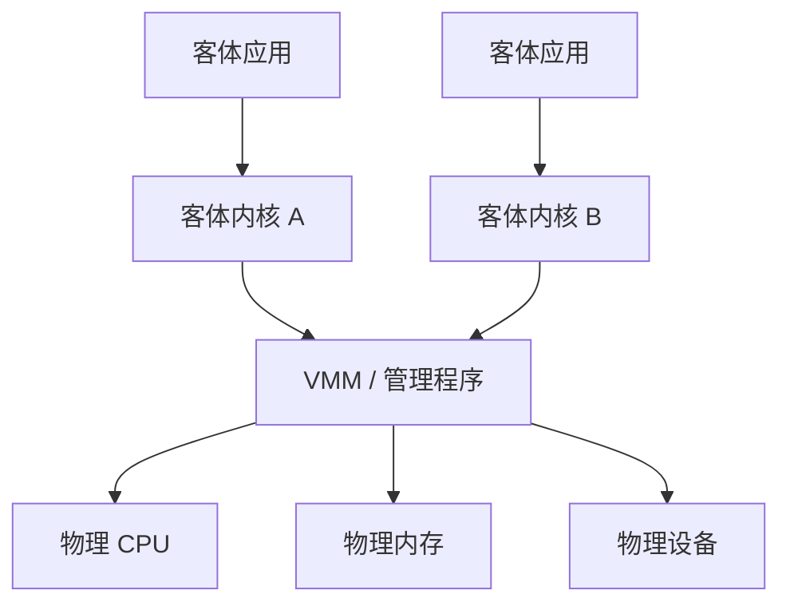
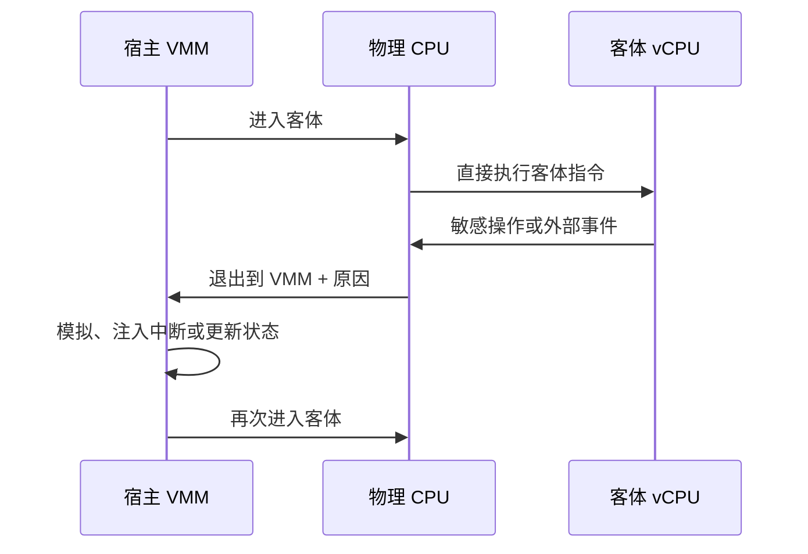
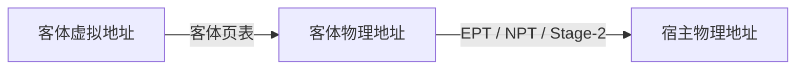
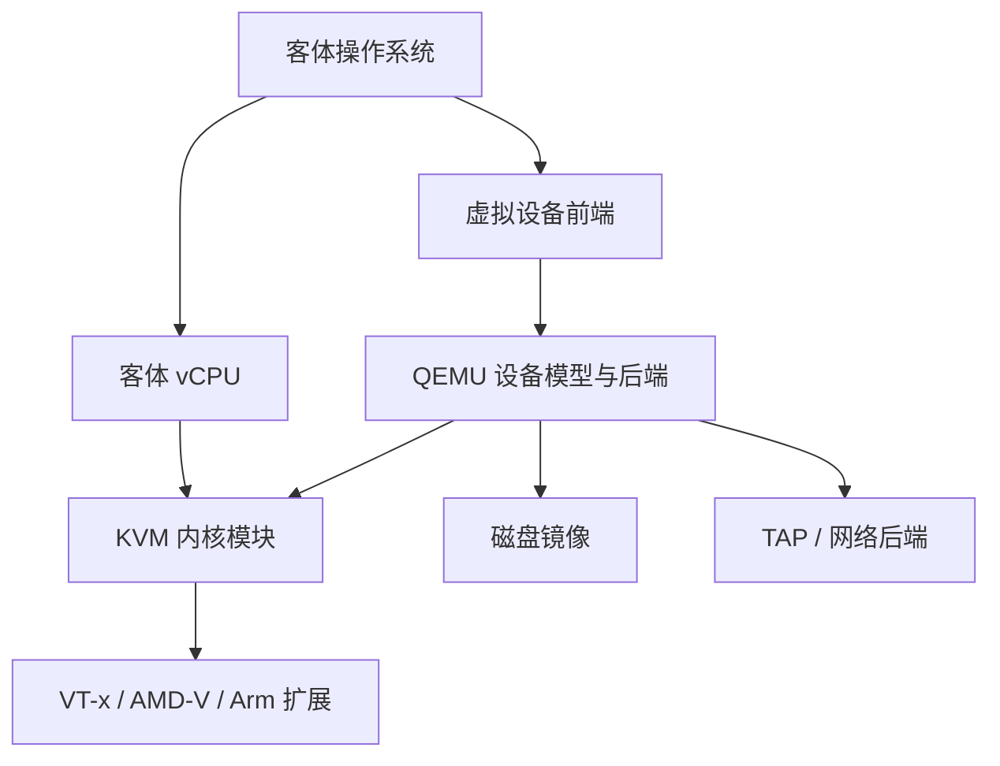
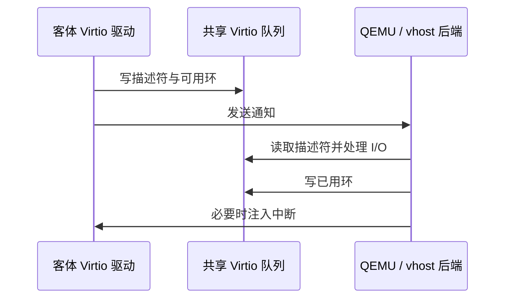

# 虚拟化

- 写作时间：`2026-03-04 首次提交，2026-07-13 最近修改`
- 当前字符：`9303`

[保护与安全](/security/01-protection-security)说明了操作系统怎样限制主体对宿主对象的访问，但这些保护仍发生在同一个内核中。云平台还需要让不同租户运行自己的内核版本，让一个客体系统即使执行页表切换、配置中断或崩溃，也不能控制宿主系统。实现这一点不能只创建几个普通进程，还要为客体提供一套受控的虚拟硬件接口。

本课先建立 **虚拟化模型**，区分宿主、客体与虚拟机监控器；**CPU 虚拟化** 让大部分客体指令直接执行，并在敏感事件上退出；**内存虚拟化** 用两阶段地址翻译限制客体可访问的宿主页；Linux 的 **KVM 与 QEMU** 分别处理内核加速和用户态机器模型；**Virtio** 为虚拟设备提供高效共享队列；最后通过 **虚拟机与容器** 比较两种隔离边界。

## 虚拟化模型

虚拟化模型(virtualization model)是把物理 CPU、内存和设备转换成一组相互隔离的虚拟机接口，并由虚拟机监控器控制资源映射的方法。

宿主(host)是拥有真实硬件并运行虚拟化栈的系统，客体(guest)是在虚拟硬件上运行的操作系统。虚拟 CPU(virtual CPU, vCPU)是呈现给客体的处理器执行单元，虚拟机监控器(Virtual Machine Monitor, VMM)负责创建 vCPU、映射内存、处理特权事件并提供设备。管理程序(hypervisor)通常指承担这项职责的整体软件层。

全虚拟化(full virtualization)向客体提供足以运行未经修改操作系统的机器接口。客体仍执行自己的启动流程、建立自己的页表、处理自己的虚拟中断，并加载面向虚拟硬件的驱动。VMM 截获不能由客体直接控制的操作，再模拟结果或拒绝请求。

模拟(emulation)与虚拟化需要区分。模拟器可以用软件解释或动态翻译另一种指令集，例如在 Arm 主机上运行 x86 客体；硬件辅助虚拟化通常让同一体系结构的客体指令直接在物理 CPU 上执行，只在必要时切换到 VMM。前者更灵活，后者通常具有更低 CPU 开销。

第一类管理程序(Type 1 hypervisor)与第二类管理程序(Type 2 hypervisor)是常见部署分类。第一类管理程序直接管理硬件并承载客体，第二类管理程序作为宿主操作系统上的程序运行。Linux 的实现会把管理程序能力放入内核，同时把完整机器模型留在用户态，因此很难只用一个标签概括；理解具体 CPU、内存和设备路径比争论分类更有价值。

虚拟化必须同时满足隔离与复用。每个客体看到独立的 vCPU 集合和客体物理地址空间，但物理 CPU 时间由宿主调度器分配，宿主页可以分散，磁盘镜像可能只是宿主文件。虚拟网卡还可能连接 TAP 设备与网络桥：TAP 是通过 fd 在用户空间交换以太网帧的宿主虚拟网卡，网络桥则在多个二层端口之间转发帧。客体看到的是稳定接口，宿主保留实际资源控制权。

## CPU 虚拟化

CPU 虚拟化(CPU virtualization)是把物理处理器执行时间和特权状态组织成一个或多个虚拟 CPU，并受控运行客体指令的机制。

在[特权边界](/basics/03-privilege-boundary)中，Ring 0 与 Ring 3 区分同一个操作系统内部的内核态和用户态。虚拟化还需要在这条边界之外再区分宿主与客体，否则客体内核进入 Ring 0 后就可能取得宿主控制权。

没有硬件辅助时，VMM 可以解释每条客体指令，或把客体代码动态翻译成安全的宿主指令序列。这样能完整控制行为，但每次执行都增加软件处理。现代 x86 的 Intel VT-x 与 AMD-V、Arm 的虚拟化扩展提供专门执行模式，使客体大部分普通指令能够直接运行。

陷入并模拟(trap-and-emulate)是让客体直接执行普通指令，在敏感操作触发受控退出后由 VMM 检查并模拟结果的 CPU 虚拟化方法。“陷入”把控制权交回 VMM，“模拟”则按虚拟硬件状态计算客体应看到的寄存器值、异常或中断。经典实现要求所有可能改变宿主资源的敏感操作都能被截获；硬件虚拟化扩展通过可配置退出条件补齐并加速这条路径。

Intel 虚拟机扩展(Virtual Machine Extensions, VMX)把 x86 执行分成 VMX 根操作模式(root operation)与 VMX 非根操作模式(non-root operation)，这个维度独立于 Ring 0 到 Ring 3。宿主 VMM 运行在根模式；客体内核可以在非根模式的 Ring 0 运行，客体应用在非根模式的 Ring 3 运行。客体因此能保留自己的用户态与内核态边界，却不能获得根模式对宿主的控制。

VMM 为每个 vCPU 配置客体寄存器、控制状态和退出条件，然后执行虚拟机进入(VM entry)。普通算术、访存和大量非敏感指令直接在 CPU 上运行；客体执行被配置为截获的操作、访问模拟设备、遇到被配置为导致退出的外部中断或触发嵌套页表缺页时，CPU 保存客体状态并执行虚拟机退出(VM exit)，把控制权交回 VMM。

虚拟机退出比普通函数调用昂贵，因为 CPU 与 VMM 要保存、检查和切换更多虚拟化状态。高性能设计会减少不必要退出，例如使用硬件中断虚拟化、批量设备通知和半虚拟化共享队列。另一方面，完全不退出就无法控制敏感操作，所以优化目标是保留隔离所需的退出，消除接口设计造成的频繁往返。

vCPU 仍然是宿主调度实体。Linux 的硬件虚拟化实现通常让每个 vCPU 对应一个宿主线程，由[Linux 调度器](/process/05-linux-scheduler)放到物理 CPU 上运行。虚拟机配置 8 个 vCPU 不表示它独占 8 个物理核心；过量分配时，vCPU 会等待宿主调度，客体内部观察到的停顿也可能影响锁持有时间和时钟判断。

:::thinking 客体内核运行在 Ring 0，为什么不能修改宿主页表？

Ring 0 只描述当前 VMX 操作模式内部的特权级。客体 Ring 0 处于 VMX 非根模式，CPU 仍按照 VMM 配置限制控制寄存器、页表翻译和敏感操作。客体写入 CR3 可以切换自己的页表，但最终物理地址还要经过 VMM 控制的第二阶段翻译。

即使客体把某个页表项指向任意“客体物理地址”，它也只能访问第二阶段页表允许的宿主页。试图越界会触发嵌套页表故障和虚拟机退出，而不会直接得到宿主物理内存。
:::

## 内存虚拟化

内存虚拟化(memory virtualization)是把客体管理的虚拟地址与宿主控制的物理页映射组合起来，为每台虚拟机提供独立地址空间的机制。

[地址空间与分页](/memory/01-address-space-paging)中的普通进程只有“进程虚拟地址 → 物理地址”一阶段翻译。虚拟机多出一个地址层次：客体页表把客体虚拟地址(Guest Virtual Address, GVA)翻译成客体物理地址(Guest Physical Address, GPA)，VMM 控制的第二阶段页表再把 GPA 翻译成宿主物理地址(Host Physical Address, HPA)。Intel 把第二阶段页表称为扩展页表(Extended Page Tables, EPT)，AMD 常称嵌套页表(Nested Page Tables, NPT)，Arm 使用第二阶段地址翻译(Stage-2 translation)。

客体完全管理第一阶段，所以能为自己的进程实现分页、写时复制与缺页处理。宿主完全管理第二阶段，所以能决定每段客体物理内存实际对应哪些宿主页、是否只读、是否暂时缺失。前面分页课介绍过的 TLB 还可以缓存两阶段组合后的翻译，避免每次访存都完整遍历两套页表。

Linux 的内核虚拟化层把用户态虚拟机进程提供的地址范围注册成内存槽(memory slot)。每个内存槽描述一段连续 GPA 与一段用户虚拟地址范围之间的对应关系。客体访问某个 GPA 时，内核先根据内存槽找到对应的宿主用户虚拟地址，再由用户态虚拟机进程的页表落实到 HPA。宿主可以用匿名映射、文件映射或大页作为后端，也可以在迁移与脏页跟踪时修改映射和写保护。

内存过量分配允许多台虚拟机声明的总内存超过当前物理内存，前提是实际工作集没有同时达到峰值。宿主可以换出用户态虚拟机进程的页面；半虚拟化内存气球(balloon)驱动也可以让客体把一批 GPA 对应的页面暂时从自身可用内存中移出，使宿主回收其背后的 HPA。GPA 地址空间并未因此消失，内存气球缩小时这些页面还可以重新交给客体。过量分配提高利用率，但内存压力会产生不可预测延迟，甚至触发宿主 OOM；它是容量取舍，不是无成本扩容。

第二阶段页表是虚拟机隔离的核心边界。[特权边界](/basics/03-privilege-boundary)介绍过，IOMMU 用独立地址映射限制设备的 DMA 访问。设备直通时，VMM 还要为客体建立对应的 IOMMU 地址域，否则客体控制的设备可能绕过 CPU 页表访问其他宿主内存。CPU 与 DMA 两条路径都必须受到映射限制。

## KVM 与 QEMU

KVM 与 QEMU 是 Linux 虚拟化中分别提供内核硬件加速接口和用户态机器模型的协作组件。

基于内核的虚拟机(Kernel-based Virtual Machine, KVM)由 `/dev/kvm` 暴露 API。用户态 VMM 打开它后，依次创建 VM fd、注册内存区域、创建 vCPU fd、设置寄存器与中断状态，再对 vCPU fd 调用 `KVM_RUN`。KVM 进入硬件虚拟化模式运行客体，发生需要用户态处理的虚拟机退出时，通过共享的 `struct kvm_run` 返回退出原因和参数。

QEMU 提供完整系统模型：固件启动环境、芯片组、PCI 总线、存储控制器、网卡、显示设备、磁盘镜像和网络后端。没有 KVM 时，QEMU 可以使用微型代码生成器(Tiny Code Generator, TCG)模拟 CPU；使用 KVM 加速器时，客体 CPU 由 KVM 直接运行，QEMU 主要处理设备模型、管理与 KVM 不能在内核完成的退出。

一次 I/O 端口访问可能触发 `KVM_EXIT_IO`，QEMU 根据虚拟设备寄存器状态模拟结果，再让 vCPU 继续。部分中断控制器和定时器可以在 KVM 内核中处理，减少用户态往返。

虚拟机仍表现为宿主进程。QEMU 的内存受宿主 MMU 管理，vCPU 是可调度线程，磁盘镜像通过宿主文件系统或块设备访问，网络可以通过普通 fd 和事件循环处理。因此[Linux 调度器](/process/05-linux-scheduler)、[虚拟内存](/memory/02-virtual-memory)、[VFS 与实现](/filesystem/02-vfs)和[保护与安全](/security/01-protection-security)中的机制都会继续作用于虚拟化栈。

## Virtio

Virtio 是客体与 VMM 共同遵循的半虚拟化设备标准，通过共享内存队列批量交换 I/O 描述符和完成状态。

Virtio 后端不一定留在 QEMU 主设备模型中。vhost 可以把数据面处理移入内核，vhost-user 则通过协议把后端放到独立用户态进程；两者都能让高频数据路径避开 QEMU 主设备模型。

模拟传统网卡或 SATA 控制器的优点是现有客体驱动可以直接使用，缺点是客体与 VMM 必须维持大量历史寄存器和状态机语义，频繁访问还可能产生虚拟机退出。Virtio 不复现某款旧硬件的完整寄存器接口，而是定义虚拟环境专用的块设备、网卡、控制台等标准，客体加载对应 Virtio 驱动。

Virtio 队列(virtqueue)是 Virtio 数据路径的核心。以分离式队列(split virtqueue)为例，vring 是由描述符表、可用环(available ring)和已用环(used ring)组成的共享内存布局。客体驱动在描述符表中写入缓冲区地址和长度，把待处理描述符索引加入可用环，再通知设备后端；后端读取描述符并完成 I/O，把已完成描述符索引写入已用环，必要时向客体注入中断。数据缓冲区由双方共享映射，不必逐字节通过设备寄存器传递，但这不等于[I/O 系统](/storage/01-io-system)讨论的端到端零拷贝：QEMU、vhost、网络栈或存储后端仍可能复制、映射或转换数据。

通知与中断可以抑制和批量处理。客体连续提交多个网络包后只通知一次，后端完成一批请求后也可只注入一次中断，因而减少虚拟机退出和上下文切换。紧凑式队列(packed virtqueue)使用另一种环形布局，目标仍是通过共享描述符与批量通知提高吞吐。

虚拟功能输入输出(Virtual Function I/O, VFIO)是 Linux 让用户态在 IOMMU 约束下安全访问可直通设备的框架。表中的“硬件划分功能”是某些 PCI 设备在硬件中划分出的可独立分配接口；把整个设备或其中一个功能交给客体后，常规 QEMU 或 vhost 数据路径便不再处理主体 I/O。

虚拟设备有三种常见实现取舍：

| 方式 | 客体接口 | 数据路径 | 主要取舍 |
|------|----------|----------|----------|
| 完整设备模拟 | 真实硬件兼容接口 | QEMU 模拟寄存器与状态机 | 兼容性高，退出与模拟开销较大 |
| Virtio | 虚拟化专用标准接口 | 共享队列，QEMU、vhost 或 vhost-user 后端 | 需要客体驱动，通常性能更好 |
| 设备直通 | 真实物理设备或硬件划分功能 | VFIO 与 IOMMU 直接映射 | 宿主软件路径短，依赖 IOMMU 隔离，迁移与共享更复杂 |

Virtio 降低设备虚拟化开销，但不会取消安全检查。后端必须验证客体提供的描述符范围、长度与队列状态，IOMMU 或 KVM 映射必须阻止越界 DMA；恶意客体输入仍然是虚拟化栈的重要攻击面。

## 虚拟机与容器

虚拟机与容器是分别以虚拟硬件和共享宿主内核为边界的两种隔离方式。

容器中的进程仍直接执行宿主 Linux 系统调用。前面学过的[命名空间](/process/06-namespace)改变它能看到的进程、挂载点、网络和用户，[cgroups](/process/07-cgroup)控制资源，[保护与安全](/security/01-protection-security)中的 Capabilities、LSM 和 Seccomp 限制权限。容器没有自己的 Linux 内核，镜像中的 `/bin` 和库可以不同，但系统调用 ABI 必须由宿主内核提供。

虚拟机运行自己的客体内核。客体系统调用先由客体内核处理，只有虚拟 CPU、内存或设备需要宿主参与时才进入 KVM/QEMU。它可以运行与宿主不同版本甚至不同类型的操作系统，代价是需要为整套客体内核和虚拟硬件分配资源。

| 维度 | 容器 | 虚拟机 |
|------|------|--------|
| 隔离边界 | 共享宿主内核中的进程与命名空间 | 客体内核与虚拟硬件 |
| 启动单位 | 一组宿主进程 | 固件、客体内核和用户空间 |
| 内核选择 | 必须使用宿主内核 ABI | 可以运行独立客体内核 |
| 资源开销 | 通常较低，页缓存与内核可共享 | 通常较高，需要客体内核与设备状态 |
| 主要攻击面 | 宿主系统调用与容器配置 | KVM、虚拟设备和管理面 |
| 典型用途 | 高密度服务部署、统一 Linux 环境 | 强租户边界、不同内核或操作系统 |

虚拟机并非绝对安全，设备模拟、KVM 和管理接口都可能存在漏洞；容器也不是“没有隔离”，正确配置的 user namespace、LSM 和 Seccomp 能建立实质限制。选择取决于威胁模型、内核需求、性能和运维成本。很多平台还会在虚拟机中运行容器，以虚拟机提供租户边界，再用容器组织单个租户内部的工作负载。

## 小结

| 概念 | 说明 |
|------|------|
| 虚拟化模型 | 由 VMM 把物理资源映射为相互隔离的虚拟机器接口 |
| CPU 虚拟化 | 让客体普通指令直接运行，并在敏感事件上退出到 VMM |
| 陷入并模拟 | 截获客体敏感操作，再由 VMM 按虚拟状态计算结果 |
| 内存虚拟化 | 用客体页表与 EPT/NPT 等第二阶段页表完成两级翻译 |
| KVM | Linux 内核中的硬件虚拟化接口，负责运行 vCPU 与处理内核级退出 |
| QEMU | 用户态机器模型、设备模拟、I/O 后端和虚拟机管理进程 |
| Virtio | 通过共享描述符队列和批量通知实现高效虚拟 I/O |
| vring | 分离式 virtqueue 的描述符表、可用环和已用环共享布局 |
| 容器 | 共享宿主内核，以命名空间、cgroups 和安全策略隔离进程 |

虚拟化没有让客体获得真实硬件控制权，而是让普通执行尽量直接发生，把所有可能改变宿主资源归属的操作保留在 VMM 控制的映射和退出路径中。

---

**文档与源码入口**：
- [KVM API](https://www.kernel.org/doc/html/latest/virt/kvm/api.html)：VM、vCPU、内存槽与 `KVM_RUN`
- [KVM x86 MMU](https://www.kernel.org/doc/html/latest/virt/kvm/x86/mmu.html)：EPT/NPT 与 KVM 内存虚拟化
- [QEMU System Emulation](https://www.qemu.org/docs/master/system/introduction.html)：机器模型、加速器与设备后端
- [QEMU Device Emulation](https://www.qemu.org/docs/master/system/device-emulation.html)：设备前端、后端与直通
- [Virtio specification](https://docs.oasis-open.org/virtio/virtio/v1.3/virtio-v1.3.html)：Virtio 队列与设备协议
- [`virt/kvm/`](https://github.com/torvalds/linux/tree/master/virt/kvm)：KVM 通用实现
- [`drivers/vhost/`](https://github.com/torvalds/linux/tree/master/drivers/vhost)：内核 vhost 后端

[性能分析与内核追踪](/observability/01-perf-tracing)将面对客体、VMM、宿主内核和设备后端等多个层次，用采样与追踪证据判断延迟实际发生在哪一层。
